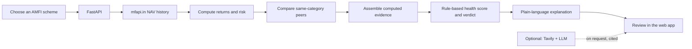

<div align="center">
  
  <h1>Truthfolio</h1>
  <p><strong>An evidence-first review of Indian mutual funds.</strong></p>
  <p>Real NAV history. Transparent comparisons. Plain-language explanations.</p>
  <p>
    <a href="https://chamanthmvs.github.io/Truthfolio/">Project site</a>
    ·
    <a href="docs/TECHNICAL.md">Technical guide</a>
    ·
    <a href="docs/BACKEND.md">Backend handbook</a>
    ·
    <a href="https://github.com/chamanthmvs/Truthfolio/issues">Report an issue</a>
  </p>
</div>

---

Truthfolio helps investors examine a mutual fund or a whole portfolio. A fund review brings
together performance, risk, rolling returns, and a comparison with similar schemes. The
result is a **Continue / Stop / Shift** verdict with its score, confidence, evidence, and
caveats visible.

The core analysis is deterministic: published NAV data is used to calculate the numbers, and
documented rules produce the score and verdict. Optional AI features can explain existing
results or summarise appraised web sources; they do not decide the standard fund verdict.

> **Educational analysis only.** Truthfolio does not provide personalised investment advice.
> Past performance does not guarantee future results.

## What you can do

### Review a fund

- Search for a real AMFI-registered scheme.
- See the fund's returns, risk measures, drawdown, and historical rolling-return ranges.
- Compare selected metrics with same-category peers.
- Inspect the health score, verdict, confidence, evidence ledger, and plain-English metric
  explanations.
- Optionally request cached insight cards or cited web research.

### Review a portfolio

- Add holdings using units and average purchase NAV, or import a CAMS/KFintech CAS PDF.
- Review and correct imported holdings before analysis.
- See estimated current value, total gain/loss, and total-to-date return for each position.
- Understand category mix, concentration, portfolio health, and which holdings merit a
  closer look.
- Open any holding for the same detailed review used in the single-fund flow.

### Read the Market Pulse

Request an on-demand, cited snapshot of market mood, reported drivers, risks, and attributed
analyst views. This feature requires optional web-search and LLM credentials; it is not
automatically loaded.

## How the analysis works



The core review requires no API keys. AMFI provides the scheme master; mfapi.in provides NAV
history. An optional LLM may write the narrative after the verdict is decided. Optional
research uses Tavily and an LLM to extract cited claims from sources that pass a reliability
gate. See the [technical guide](docs/TECHNICAL.md) for formulas, endpoint contracts, request
sequences, privacy details, and current limitations.

## Run locally

### Prerequisites

- Python 3.11 or newer
- [`uv`](https://docs.astral.sh/uv/)
- Node.js 18 or newer and npm

### Start both services

Install the backend and frontend dependencies once:

```bash
cd backend
uv venv .venv
uv pip install -e ".[dev]"

cd ../frontend
npm install
```

Then, from the repository root, start both services:

```bash
./dev.sh
```

Open the web app at **http://localhost:3000**. The API is at **http://localhost:8077** and its
interactive documentation is at **http://localhost:8077/docs**.

### Run services separately

Backend:

```bash
cd backend
uv venv .venv
uv pip install -e ".[dev]"
.venv/bin/uvicorn app.main:app --reload --port 8077
```

Frontend, in another terminal:

```bash
cd frontend
npm install
npm run dev
```

The frontend defaults to `http://localhost:8077/api`. To point it at another API, set
`NEXT_PUBLIC_API_BASE` in the frontend environment.

## Optional configuration

No environment file or credentials are required for the deterministic fund and portfolio
flows. To enable optional features, create `backend/.env`:

```dotenv
# Optional narrative, insights, research, and Market Pulse
LLM_PROVIDER=anthropic
ANTHROPIC_API_KEY=
# Or use Groq:
# LLM_PROVIDER=groq
# GROQ_API_KEY=

# Required together with an LLM key for fund research and Market Pulse
HPR_TAVILY_API_KEY=
```

The application also supports settings for CORS, cache paths and lifetimes, upstream timeouts,
the risk-free rate, CAS freshness, Tavily depth, and daily search limits. See
[`backend/app/config.py`](backend/app/config.py) and the configuration table in the
[technical guide](docs/TECHNICAL.md#6-configuration-and-optional-services). Never commit
credentials or `.env` files.

## Verify changes

Run the backend tests:

```bash
cd backend
.venv/bin/python -m pytest -q
```

Type-check the frontend:

```bash
cd frontend
npx tsc --noEmit
```

Build the frontend for production:

```bash
cd frontend
npm run build
```

## Repository map

```text
backend/
  app/api/        FastAPI routes, JSON and Server-Sent Events
  app/agent/      LangGraph supervisor, specialists, verdict, research, insights
  app/analysis/   NAV metrics, peer comparisons, explainers, portfolio calculations
  app/data/       AMFI, mfapi, local cache, CAS import, web search
  app/models/     API request and response models
  tests/          Metric, CAS import, and citation tests
frontend/
  src/app/        Next.js app shell, metadata, global visual system
  src/components/ Search, fund review, portfolio, research, and Market Pulse UI
  src/lib/        API/SSE client, shared types, display formatters
docs/
  index.html      Static GitHub Pages project site
  TECHNICAL.md    Detailed product and engineering reference
  BACKEND.md      Backend-only implementation handbook
  truthfolio-mark.svg
                Shared brand symbol for the project site
```

## Project boundaries

These distinctions matter when interpreting a result:

- Portfolio return is total return from the supplied average cost basis, **not annualised**;
  purchase dates and cash flows are not collected.
- Portfolio concentration is based on fund and category weights. Underlying stock overlap is
  not currently calculated.
- Peer ranks use a bounded sample of same-category Direct-Growth schemes; they are not a
  census of every eligible fund.
- NAV history and analysis depend on the availability and freshness of public upstream data.
- CAS files are parsed in memory and are not intentionally sent to AI or web-search services.
  Imported holdings are returned for the user to review; this is not a claim of cryptographic
  memory erasure.
- The project currently has no accounts, saved portfolios, authentication, or cross-device
  persistence.

For full scoring formulas, privacy behavior, API payloads, caching, deployment, and extension
guidance, see [`docs/TECHNICAL.md`](docs/TECHNICAL.md).
For a backend-only walkthrough of the application entry point, all 17 endpoints, request and
SSE lifecycles, agent graph, data integrations, calculations, and module responsibilities, see
the [backend handbook](docs/BACKEND.md).

## Deployment

GitHub Pages hosts the static landing page from `docs/`; it does not host the FastAPI backend
or the interactive Next.js application. Deploy the frontend and API separately, set
`NEXT_PUBLIC_API_BASE` to the backend API URL, and configure the backend's
`HPR_CORS_ORIGINS` for the deployed frontend origin.

## License

No license file is currently included. Unless a license is added, the repository's contents
are not granted an open-source license by default.
