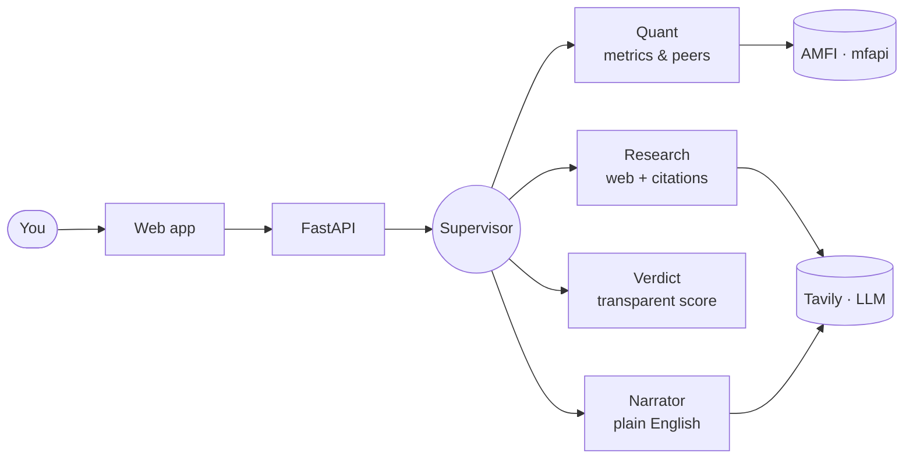

<div align="center">

# ⚖️ Truthfolio

**An honest, evidence-backed reviewer for your mutual funds.**
Keep it, drop it, or switch — every verdict computed from real data, ranked against peers,
and explained in plain English.

[**Overview & demo →**](https://chamanthmvs.github.io/Truthfolio/) · [**Technical docs →**](docs/TECHNICAL.md)

</div>

---

Truthfolio answers one question honestly: *is your money in a good fund, or not?* You give it
a fund — or your whole portfolio — and it returns a clear **Continue / Stop / Shift** verdict
backed by numbers it actually computes (returns, risk, consistency), ranked against similar
funds, with every metric explained like you're new to investing. No flattery, no jargon, no
sales pitch.

It runs entirely on **free, public data** (AMFI + mfapi) — no API keys needed for the core.

## Features

**Single-fund review**
- Verdict (Continue / Stop / Shift) with a transparent 0–100 health score and confidence
- Returns, rolling returns, volatility, Sharpe, Sortino, drawdown — each with a plain-English explainer
- Percentile ranking against same-category peers
- An evidence ledger where every claim carries its source and a reliability score

**Portfolio review**
- Add holdings by units + average buy NAV → your real gain/loss and return, per fund and overall
- Portfolio health score and verdict, category mix, and concentration analysis
- Best/worst performers and a clear "what to reconsider" list
- Drill into any holding for its full fund review

## Quick start

```bash
./dev.sh          # starts backend (:8077) and frontend (:3000)
```

Then open **http://localhost:3000**. Or run them separately:

```bash
# Backend  → http://localhost:8077  (API docs at /docs)
cd backend && uv venv .venv && uv pip install -e ".[dev]"
.venv/bin/uvicorn app.main:app --reload --port 8077

# Frontend → http://localhost:3000
cd frontend && npm install && npm run dev
```

Tests: `cd backend && .venv/bin/python -m pytest -q` · Types: `cd frontend && npx tsc --noEmit`

## Architecture

A **supervisor** orchestrates focused specialist agents over free public data — and, only
when you ask, the web. Orchestration and scoring are deterministic; the LLM is used only
inside the specialists that need it.



Full diagrams (flow, sequence, service interaction) are in
[`docs/TECHNICAL.md`](docs/TECHNICAL.md).

## Tech stack

**Backend** Python · FastAPI · LangGraph (supervisor/multi-agent) · NumPy / Pandas  
**Frontend** Next.js · React · TypeScript · Tailwind CSS  
**LLM** Claude (Anthropic) or Groq — provider-switchable · **Search** Tavily (on-demand)  
**Data** AMFI `NAVAll.txt` · mfapi.in (free, public)

## Project structure

```
backend/    FastAPI + LangGraph API
  app/data/       fund search (AMFI) · NAV history (mfapi) · web search (Tavily) · cache
  app/analysis/   metrics · peers · portfolio · explainers
  app/agent/      supervisor · specialists (quant/research/verdict/narrator)
                  scoring/verdict · appraisal gate · citations · LLM provider factory
frontend/   Next.js app (two tabs: fund review / portfolio)
docs/       TECHNICAL.md (engineering reference) · index.html (landing page)
```

See [`docs/TECHNICAL.md`](docs/TECHNICAL.md) for architecture, scoring methodology, API
reference, and extension points.

## Roadmap

- ✅ **V1** — single-fund review
- ✅ **V2** — whole-portfolio review
- ✅ **V3** — web research with citations · supervisor multi-agent · provider-switchable LLM · insights
- 🚧 **Next** — *in progress… loading.*

## Disclaimer

Truthfolio is **educational analysis, not personalised investment advice.** Verdicts are based
on past performance, which never guarantees future results.
