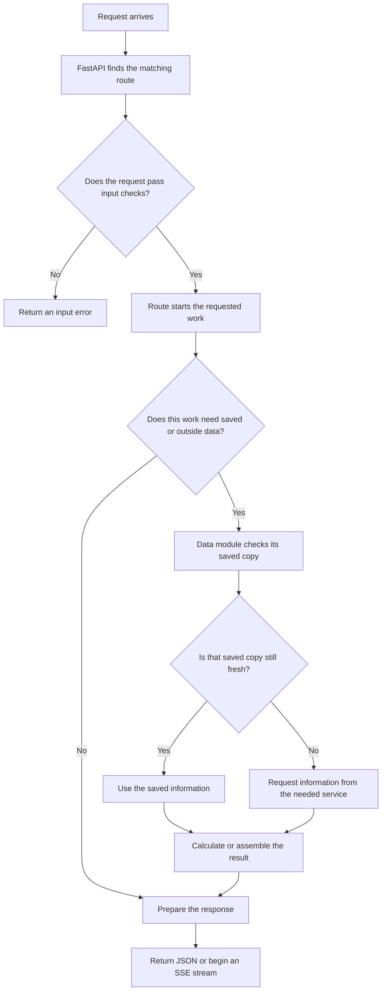
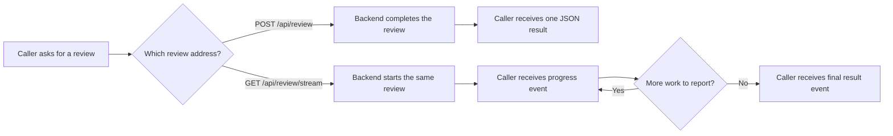
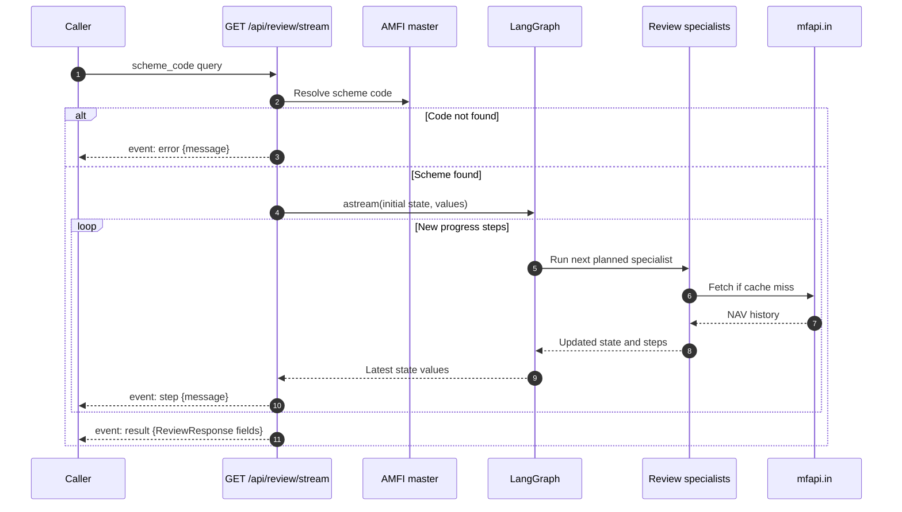
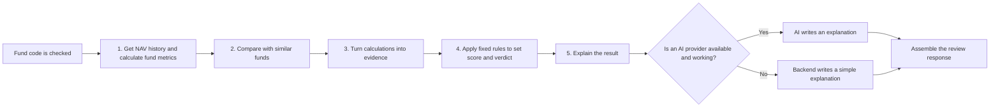
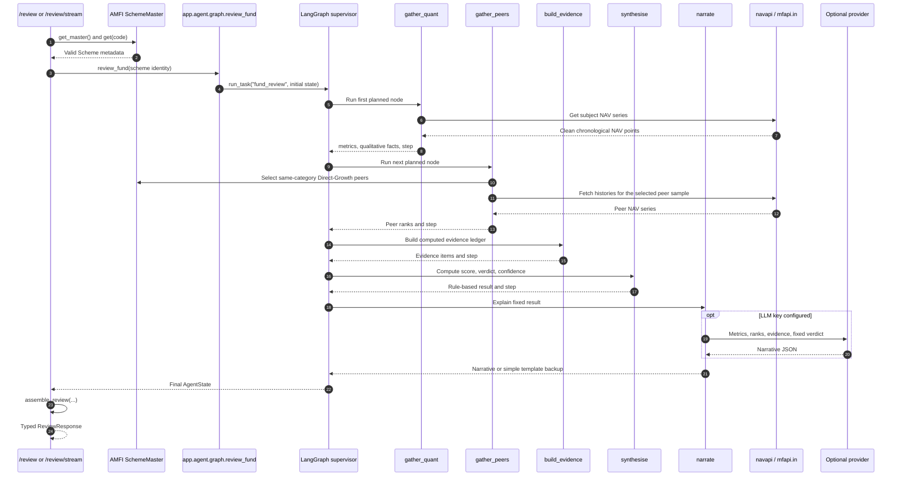
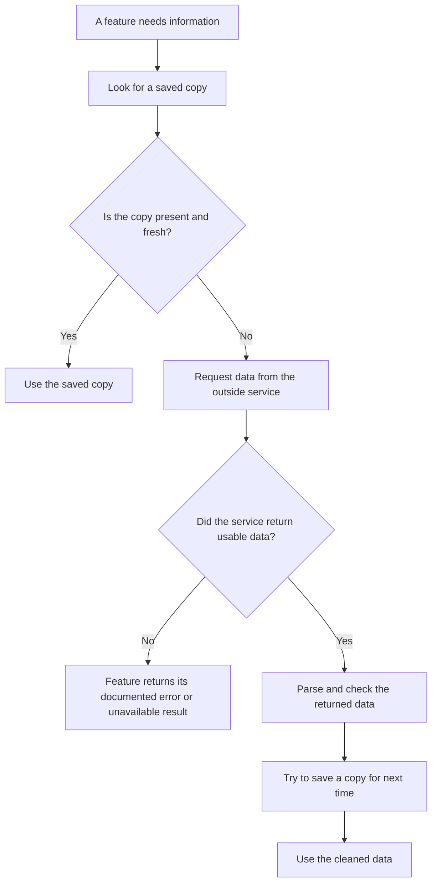
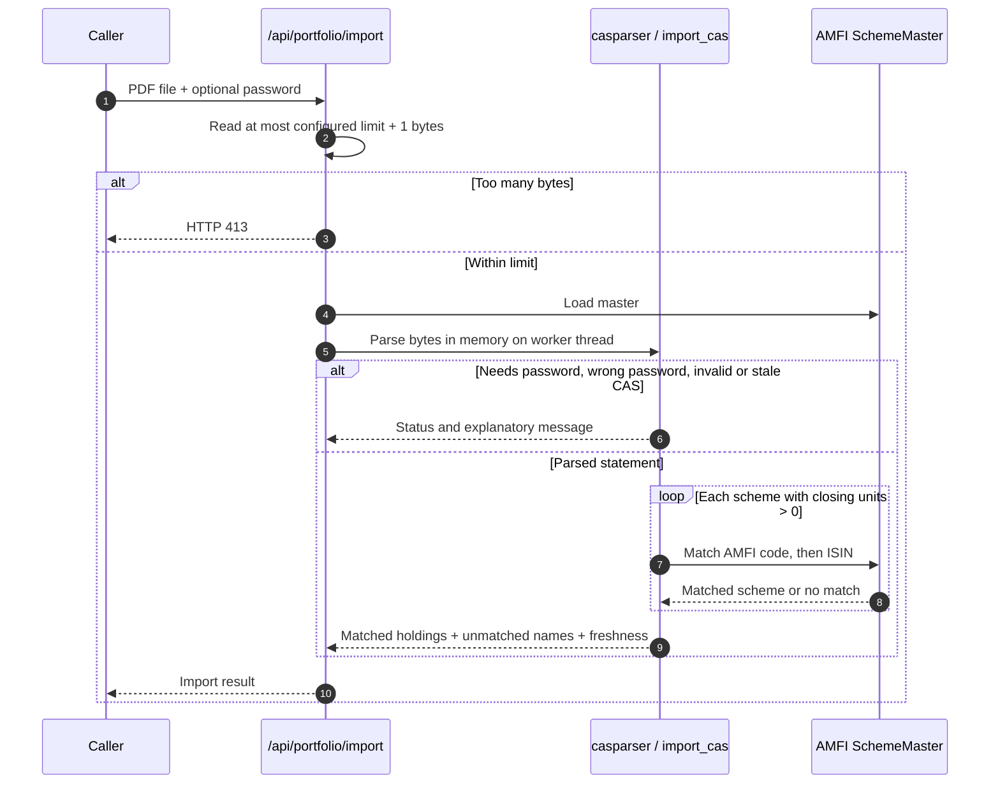

# Truthfolio backend handbook

> A code-aligned, backend-only explanation of how a request enters Truthfolio, how it moves
> through the API and analysis pipeline, which external services are called, what the backend
> returns, and why its main classes and modules exist. Examples use simple language, but
> describe the implementation in this repository rather than an idealized design.

**Audience:** backend contributors, reviewers, operators, and anyone tracing a request from
HTTP entry to its final response.

**Scope:** the Python service under `backend/app/`. The browser and frontend are intentionally
out of scope. For the broader product guide, see [TECHNICAL.md](./TECHNICAL.md). For deployment,
see [DEPLOYMENT.md](./DEPLOYMENT.md).

## Contents

1. [Backend in one minute](#1-backend-in-one-minute)
2. [Entry point and application startup](#2-entry-point-and-application-startup)
3. [The request lifecycle](#3-the-request-lifecycle)
4. [All HTTP endpoints](#4-all-http-endpoints)
5. [Request and response contracts](#5-request-and-response-contracts)
6. [Server-Sent Events (SSE)](#6-server-sent-events-sse)
7. [Fund-review workflow and LangGraph](#7-fund-review-workflow-and-langgraph)
8. [Data sources, parsing, and cache](#8-data-sources-parsing-and-cache)
9. [Metrics, peer comparison, and verdict](#9-metrics-peer-comparison-and-verdict)
10. [Portfolio workflow](#10-portfolio-workflow)
11. [CAS statement import](#11-cas-statement-import)
12. [Optional AI, web research, and citations](#12-optional-ai-web-research-and-citations)
13. [Module-by-module map](#13-module-by-module-map)
14. [Configuration and integrations](#14-configuration-and-integrations)
15. [Errors, limits, privacy, and operational boundaries](#15-errors-limits-privacy-and-operational-boundaries)
16. [Run, test, and change the backend](#16-run-test-and-change-the-backend)
17. [Glossary](#17-glossary)

---

## 1. Backend in one minute

### What the backend does

Truthfolio's backend is the part of the application that receives requests, does the work,
and sends back results. It is written in Python 3.11+ and uses **FastAPI**, a toolkit for
building web APIs.

An **API** is the set of agreed ways another program can ask this service for something.
For example, a caller can ask `GET /api/search` to find a fund or send `POST /api/review` to
request a review. **HTTP** is the standard set of rules computers use to send those requests
and responses over a network.

Most requests and responses use **JSON**: a text format for structured data, similar to a
clearly labelled form. The backend uses **Pydantic** to check that incoming forms contain the
right fields and sensible values. The CAS upload uses a different format called multipart,
which can carry a file and text fields together.

The backend gets official scheme identities and NAV history from public data sources, does
the main calculations with ordinary Python code, and returns either JSON or a stream of
Server-Sent Events. When we say a result is **deterministic**, we mean that the same input
data and settings produce the same calculation; the core verdict is not a model's guess.

### Key fund and AI terms

**NAV** means **Net Asset Value**. It is the published value of one unit of a mutual fund,
like the price tag for one unit. A fund's NAV history is the sequence of those published
values over time.

An **LLM** is a **large language model**: an AI system that can write or explain text. In
Truthfolio, it may help explain an already-calculated result or summarize cited web sources.
It does not calculate the core fund metrics or decide the standard fund verdict.
An LLM **provider** is the outside company/service that runs the model; this backend can be
configured to use Anthropic or Groq.

### Where AI is used

The ordinary fund and portfolio calculations do **not** require AI credentials. The regular
fund-review result is decided by code using NAV history and peer comparisons. If an LLM is
configured, it can write a narrative about that already-decided result. Research and Market
Pulse are separate, on-demand experiences that use both Tavily web search and an LLM.

### Backend at a glance

```mermaid
flowchart TB
    Caller["Caller sends a request"] --> Server["Uvicorn receives it"]
    Server --> App["FastAPI app"]
    App --> Route["Matching route under /api"]
    Route --> Check["Pydantic checks request data"]
    Check --> Work["Route calls analysis or feature code"]
    Work --> Data["Data modules load or fetch needed information"]
    Data --> Review["Analysis and review functions"]
    Review --> Output{"How is the result returned?"}
    Output --> Json["One JSON response"]
    Output --> Stream["SSE progress messages then final result"]

    Data -. may use .-> Cache["Saved JSON copies with expiry times"]
    Data -. may fetch .-> Public["AMFI scheme directory or mfapi.in NAV history"]
    Data -. optional features only .-> Search["Tavily web search"]
    Review -. optional explanation only .-> Model["Anthropic or Groq language model"]
```



An analogy: FastAPI is the front desk, Pydantic checks the form, the route sends the request
to the right team, and the analysis modules prepare the report. The LangGraph supervisor is
like a coordinator following a fixed checklist: gather the fund's numbers, compare peers,
calculate the verdict, and prepare an explanation.

The dashed arrows show possible supporting services, not steps that every request takes.
For example, `/health` does not need fund data, and the usual fund review does not search the
web.

### What is not in this backend

- No database or server-side saved portfolios.
- No user accounts, login, or authentication.
- No persistent chat history.
- No background job queue; work happens during the HTTP request.
- No shared cache or distributed rate limiter. Cache files and usage caps belong to one
  running backend instance.

---

## 2. Entry point and application startup

### The executable entry point

The application entry point is the object named `app` in
`backend/app/main.py`. It is normally launched with:

```bash
cd backend
.venv/bin/uvicorn app.main:app --reload --port 8077
```

The command's `app.main:app` means: open the Python file `app/main.py`, then use the object
inside it that is named `app`.

**Uvicorn** is the web-server program that listens for network traffic and hands each request
to FastAPI. **ASGI** is the standard connection between Uvicorn and an asynchronous Python
web application. You can think of ASGI as a plug shape: Uvicorn and FastAPI can work together
because both use the same agreed connection. In production, the Docker image starts Uvicorn
the same way and listens on the port supplied by the host (`PORT`, default `8077`).

### What `create_app()` connects

1. `get_settings()` reads configuration such as allowed website addresses and cache location.
   It also creates the cache folder if needed.
2. `FastAPI(...)` creates the application and gives it a name and version.
3. FastAPI is given a startup/shutdown function. In web frameworks, this is often called the
   **lifespan**: the work to do as the service starts and stops.
4. The app installs CORS rules for browser requests.
5. `include_router(router, prefix="/api")` adds the URL handlers from
   `app/api/routes.py`. A **route** (also called an endpoint) is one supported method and
   address, for example `GET /api/search`.
6. `app = create_app()` creates the one application object that Uvicorn serves.

#### CORS, explained without assuming you know the term

**CORS** stands for **Cross-Origin Resource Sharing**. A browser treats two web addresses as
different origins if their protocol, host name, or port differs. For example,
`http://localhost:3000` and `http://localhost:8077` are different origins because the ports
differ.

For safety, browsers normally stop a page from reading a response from a different origin
unless the server says that page is allowed. Truthfolio adds **CORS middleware** to attach
special instructions to responses. Those instructions tell the browser which website
addresses, request actions, and extra request details are allowed. The browser—not this
middleware—uses those instructions to decide whether the page may read the response.
Middleware is helper code that runs around a request or response, like a checkpoint that
checks the rules before a visitor can continue.

The backend currently allows the local website addresses `http://localhost:3000` and
`http://127.0.0.1:3000` by default. In production, `HPR_CORS_ORIGINS` should contain the
actual website address or addresses that need to call this API.

The code also allows **credentials** and uses `["*"]` for methods and headers:

- A method is the kind of action in an HTTP request, such as `GET` (read) or `POST` (send
  data). `["*"]` means the browser may use any method, provided the website's origin is
  allowed.
- A header is extra request information, such as the content type. `["*"]` means the browser
  may send any headers.
- Credentials means browser requests may include credential information such as cookies.
  This backend currently has no login or user authentication, so allowing credentials does
  **not** mean the app has user accounts.

For some requests, the browser first sends a small `OPTIONS` check asking whether the
planned request is allowed. If the check passes, the browser sends the actual request.

CORS is a browser rule, **not** a login system, an API key check, or a firewall. It does not
stop command-line programs or other servers from calling the API. It only tells browsers
which website origins may read responses.

The router is just the list of supported method/address pairs; it does not do the analysis
itself. Each route checks its input, calls the relevant function, and prepares the response.

### Startup lifespan

At startup, the lifespan function calls `amfi.get_master()` before serving requests. This
loads the fund directory into memory so the first search is usually faster. This early load
is sometimes called **warming the cache**—like putting frequently used reference books on a
desk before work begins.

If downloading or reading the directory fails during startup, the app still starts. A later
request that needs the directory will try again. This means the health endpoint can respond
even while the first real fund request may still fail if AMFI remains unavailable.

The application does not load NAV data for every fund at startup. NAV data is fetched only
when an endpoint needs that scheme's history.

---

## 3. The request lifecycle

### Step-by-step request path

Here is what happens when a caller asks the backend to review a fund:

1. Uvicorn receives the network message and passes it to FastAPI.
2. FastAPI checks the request's method and address. For example, `POST /api/review` means
   "send data to the review route."
3. FastAPI and Pydantic read the incoming data and check that required fields are present and
   values are within allowed ranges. If a required field is missing, the review does not run.
4. The matching route looks up the submitted scheme code in the AMFI directory. A valid code
   is like a library call number: it lets the backend find the exact scheme without guessing
   from a name.
5. The route calls the code that performs the requested work. For a fund review, that means
   running the review steps; for health, it simply returns the health response.
6. If the work needs information from outside the app, the data module first checks its
   cache. If there is no fresh copy, it requests the information from AMFI, mfapi.in, Tavily,
   or an LLM provider, depending on the feature.
7. The route turns the result into the promised response shape and sends it back. A quick
   result is usually JSON; a longer review can send progress events as it works.

### What the HTTP status tells the caller

An **HTTP status code** is a short number that tells the caller how the request went. Common
examples are:

- **200:** request succeeded.
- **404:** the requested scheme or item was not found.
- **422:** the submitted data did not pass validation.
- **429:** a usage limit was reached.
- **502 / 503:** an outside service failed, or a needed feature is unavailable.
- **500:** an unexpected backend failure.

These numbers describe the HTTP request itself. Once an SSE stream is already open, some
later errors are sent as `error` messages inside the stream instead of changing the status
code.

### Request flow diagram



### Endpoints with a different path

This is the common shape, not one path that every endpoint follows. `/health` skips fund data.
`/market-pulse` searches the web and prepares a summary. `/portfolio/import` reads a PDF.
`/review/stream` sends progress while a review is running. The endpoint table below shows
what each address does.

---

## 4. All HTTP endpoints

All 17 routes are mounted under `/api`. A **route** or **endpoint** is one address plus one
kind of action. For example, `GET /api/health` asks to read the health status; `POST
/api/review` sends review data for the server to process. `GET` and `POST` are HTTP methods:
`GET` usually reads information, and `POST` usually sends information or starts work.

FastAPI also builds interactive API reference pages at `/docs` and `/redoc`; these pages are
outside the `/api` prefix.

### Service and scheme lookup

| # | Method and path | Input | What happens / response |
|---:|---|---|---|
| 1 | `GET /api/health` | None | Says whether this backend process is responding: `{"status":"ok"}`. It does not check outside data services. |
| 2 | `GET /api/capabilities` | None | Reports whether chat, research, Market Pulse, and AI insights are enabled by current keys. |
| 3 | `GET /api/search` | `q` query (at least 2 chars); `limit` 1-30, default 12 | Loads AMFI master and returns matching official schemes. |

### Fund review and related tools

| # | Method and path | Input | What happens / response |
|---:|---|---|---|
| 4 | `POST /api/review` | `ReviewRequest` JSON | Runs the standard fund review and returns the final review JSON. |
| 5 | `GET /api/review/stream` | `scheme_code` query | Runs a fund review and streams `step`, then `result`; unknown code emits `error`. |
| 6 | `GET /api/research` | `scheme_code` query | Explicitly runs cited web research, or returns an enabled/disabled result and search budget. |
| 7 | `GET /api/recommendations` | `scheme_code` query | Scans same-category alternatives and returns qualifying research leads. |
| 8 | `POST /api/fund/chat` | `FundChatRequest` JSON | Sends the supplied one-fund details and size-limited conversation to the configured AI service. |
| 9 | `GET /api/insights` | `scheme_code` query | Runs fund analysis without narrative, then produces insight cards. |
| 10 | `GET /api/fund/history` | `scheme_code` query | Returns monthly rebased fund NAV history and statistics, or `available:false`. |

### Market data and commentary

| # | Method and path | Input | What happens / response |
|---:|---|---|---|
| 11 | `GET /api/market-chart` | None | Returns public index-fund proxy histories and a factual, numbers-only market read. |
| 12 | `GET /api/market-pulse` | Optional `focus` query | Runs cited, current web synthesis, or explicitly reports unavailable. |

### Portfolio analysis and related tools

| # | Method and path | Input | What happens / response |
|---:|---|---|---|
| 13 | `POST /api/insights/portfolio` | JSON `summary`, optional `holdings` | Produces portfolio insight cards from the submitted analysis. |
| 14 | `POST /api/portfolio/chat` | `PortfolioChatRequest` JSON | Sends the supplied portfolio details and size-limited conversation to the configured AI service. |
| 15 | `POST /api/portfolio/import` | A file upload plus optional password | Reads a CAS statement and returns matched active holdings. |
| 16 | `POST /api/portfolio` | `PortfolioRequest` JSON | Analyzes all submitted holdings and returns summary JSON. |
| 17 | `POST /api/portfolio/stream` | `PortfolioRequest` JSON | Streams a start event, each holding completion, then final portfolio result. |

---

## 5. Request and response contracts

Pydantic definitions live in `backend/app/models/schemas.py`. A **model** here is a written
description of which fields a request or response should contain. Pydantic uses that
description as a form checker: it checks the data's shape and limits before analysis starts.
If the form is invalid, FastAPI returns HTTP 422 with details of the problem. Some checks need
real-world data and happen later—for example, the scheme code can have the right text format
but still not exist in AMFI's directory.

### Search

`GET /api/search?q=parag%20flexi&limit=12` returns:

```json
{
  "query": "parag flexi",
  "results": [
    {
      "code": "official-AMFI-code",
      "name": "Full scheme name",
      "amc": "Fund house",
      "category": "Distilled category",
      "scheme_type": "AMFI section label"
    }
  ]
}
```

The example code is a placeholder, not a real fund scheme code. The response shape is
described by `SearchResponse`, which contains a list of `SchemeHit` results.

### Standard fund review

`ReviewRequest` requires `scheme_code`. It can also accept `units` and `invested_amount` as
non-negative numbers. The current standard review response does not include personal holding
calculations; those fields are passed into the graph state but are not used to assemble
personal values by the standard review path. Portfolio-specific personal calculations use
`units` and `avg_nav` in the portfolio flow.

The `ReviewResponse` contains:

| Field | Meaning |
|---|---|
| `scheme_code`, `scheme_name`, `category` | Official scheme identity and simplified category label. |
| `as_of` | Date of the last NAV used in the computed metrics. |
| `verdict`, `health_score`, `confidence` | Result from fixed rules; confidence is a rough indicator, not a guarantee. |
| `headline`, `narrative`, `caveats` | Short summary, an explanation written by the LLM or by a simple backup template, and fixed educational limits. |
| `metrics` | Values plus units, better direction, plain explanation and interpretation. |
| `qualitative` | Deterministic track-record and resilience facts derived from NAV history. |
| `rolling` | Historical rolling-return distributions when sufficient history exists. |
| `peers` | Category, sample sizes, and direction-aware peer ranks. |
| `evidence` | Statements that support the result, whether each is positive/negative/neutral, how much weight it gets, and the sources behind it. |
| `footnotes` | Numbered research citations; normally empty for standard review. |
| `steps` | Progress messages from the ordered review steps, also used by the streaming endpoint. |
| `llm_used`, `research_used` | Identify optional work used by this result. |

`analysis/review_view.py` is the shared response builder. It adds plain-language explanations
to metric rows, then turns the internal results into the same JSON shape for a standalone
review and for a fund inside a portfolio.

### Portfolio analysis

`PortfolioRequest` accepts between 1 and 40 holdings. Each `HoldingInput` requires:

```json
{
  "scheme_code": "official-AMFI-code",
  "units": 12.5,
  "avg_nav": 100.0
}
```

`units` and `avg_nav` must both be greater than zero. Successful results contain:

- `summary`: total invested/current/gain, overall return, health and verdict, category mix,
  concentration data, performers, action items, headline and caveats.
- `holdings`: each successful holding's shared `review`, `personal` values, and current-value
  `weight`.
- `errors`: number of submitted holdings that could not be analyzed.

If every holding fails, `POST /api/portfolio` responds with HTTP 422. Individual holding
failures do not fail the whole request when at least one holding succeeds.

### Chat requests

The two chat endpoints accept a short summary of the analysis and a limited conversation:

- **Fund chat:** `FundChatRequest` contains a `FundChatContext` and `messages`.
- **Portfolio chat:** the request contains a `PortfolioChatSummary`, 1-40
  `PortfolioChatHolding` entries, and `messages`.

**Conversation limits:**

- Messages alternate `user`, `assistant`, start with a user question, and end with a user
  question.
- A request can contain at most nine messages (five user questions).
- User messages are limited to 600 characters; assistant messages to 2,000 characters.
- The complete request, converted to JSON text, cannot exceed 50 KB.
- Blank messages are rejected.

The context models also limit field lengths and list sizes to keep AI requests small.
Percentages are expressed in percentage points (`12.5` means 12.5%), and money is in INR.
Responses use `FundChatResponse` or `PortfolioChatResponse`, each with a non-empty `answer`
of at most 2,000 characters.

### Pydantic model inventory

The models below are defined in `models/schemas.py`. Pydantic rejects values outside the
stated bounds before the route handles the request.

| Model | Fields and constraints |
|---|---|
| `SchemeHit` | `code`, `name`, `amc`, `category`, and `scheme_type` are strings. |
| `SearchResponse` | `query` string and `results` list of `SchemeHit`. |
| `ReviewRequest` | `scheme_code` string; optional `units` and `invested_amount` are each >= 0. |
| `MetricOut` | Metric key, label, optional numeric value, unit, good direction, optional plain explanation fields, and optional interpretation dictionary. |
| `HoldingInput` | `scheme_code`; `units > 0`; `avg_nav > 0`. |
| `PortfolioRequest` | `holdings` list of 1-40 `HoldingInput` values. |
| `PortfolioChatMetric` | `label` length 1-80; optional ordinary number for `value`; `unit` length at most 20 (default empty). |
| `PortfolioChatHolding` | Scheme name length 1-240; category <=120; verdict <=40; health score from 0-100; weight from 0-100; invested/current value >=0; gain and return must be ordinary numbers; headline <=500; up to 12 metrics and 8 evidence strings (each <=400); peer summary <=500. |
| `PortfolioChatCategory` | Category length 1-120; percentage from 0 to 100. |
| `PortfolioChatSummary` | Non-negative invested/current totals; gain and return must be ordinary numbers; health 0-100; verdict <=60; diversification text <=500; top holding and category percentages 0-100; top category <=120; category mix up to 20; headline <=500; action items and caveats up to 10 each, each string <=500. |
| `PortfolioChatMessage` | Role is exactly `user` or `assistant`; content length 1-2,000, then whitespace-trimmed. The request validator applies the stricter user-question limit of 600. |
| `PortfolioChatRequest` | One summary, 1-40 holdings, and 1-9 messages; the request must be no larger than 50 KB after conversion to JSON text, messages must alternate roles, first and final message must be from the user, and there can be at most five questions. |
| `FundChatContext` | Fund name length 1-240; optional category/date/headline/peer text with length limits; score and confidence 0-100; up to 14 metrics, 4 rolling-return strings, 10 evidence strings, and 6 caveat strings, each with length limits. |
| `FundChatRequest` | One fund context and 1-9 messages; applies the same 50 KB JSON size, alternating messages, question-count, and final-user-message checks as portfolio chat. |
| `FundChatResponse`, `PortfolioChatResponse` | Non-empty answer, maximum 2,000 characters. |
| `ReviewResponse` | Typed final fund-review fields listed above; metrics are `MetricOut` records. |

On some numeric fields, the chat models reject special values such as `NaN` ("not a number")
or infinity; they only accept ordinary numbers. Holdings submitted to `/portfolio` differ from holdings
submitted to chat: portfolio analysis needs scheme code, units, and average NAV; chat only
receives a limited-size summary of analysis that has already been calculated.

### CAS upload

The request is multipart form data: one `file` upload and an optional `password` form field.
The response is a dictionary with a `status` such as `ok`, `password_required`, or `error`.
For a successful parse it includes matched `holdings`, names that could not be matched,
statement date, and freshness warning information.

### Other endpoint shapes

- `/capabilities` returns booleans: `chat`, `research`, `market_pulse`, and `insights_ai`.
- `/research` returns `enabled`, evidence, footnotes, and Tavily `budget`; when disabled,
  `reason` explains that both an LLM and Tavily key are needed.
- `/recommendations` returns the subject, number of peer candidates considered, alternatives,
  comparison reasons, basis, disclaimer, and optional `empty_reason`.
- `/insights` returns `insights` and `llm_used`. `/insights/portfolio` returns generated
  insight cards and LLM-use state from the insight service.
- `/fund/history` returns `available`, monthly history and statistics when sufficient history
  exists; otherwise it returns `available:false` and a reason.
- `/market-chart` returns `available`, segment histories, calculated read, assumed scenario
  rates and disclaimers, or `available:false`.
- `/market-pulse` returns `enabled`, `pulse`, cited `footnotes`, and search `budget`, or a
  clear disabled/unavailable message.

---

## 6. Server-Sent Events (SSE)

### What SSE means

**Server-Sent Events**, usually shortened to **SSE**, is a way for the server to send several
small messages through one request while it is still working. Imagine ordering a long report
and getting updates such as "numbers calculated" and "peer comparison finished" before the
complete report arrives. Without SSE, the caller would wait silently and receive only the
finished report.

SSE uses one open HTTP connection and sends messages in one direction: from server to caller.
The caller cannot send a new instruction through that same stream. The server labels each
message with an event name and puts the message contents on a `data:` line. The technical
content type sent in the response is `text/event-stream`.



The main difference is how the caller receives the result: ordinary review waits and sends
one answer; the stream sends progress messages first and the answer at the end. Both paths
use the same review calculations.

One message looks like this:

```text
event: event-name
data: {"some":"JSON data"}

```

The blank line marks the end of that message. The next message follows the same pattern.
`_sse()` builds these frames and converts the data to JSON text with `json.dumps()`.

SSE is used by two endpoints:

1. `GET /api/review/stream`
2. `POST /api/portfolio/stream`

It is not used for `/api/review`, `/api/portfolio`, or optional model responses.

### Fund review stream



The route emits only newly added `steps`, so already-sent progress text is not repeated. The
final event uses the same `assemble_review()` response-building function as the ordinary
review.

- If the graph raises after the stream starts, the route emits `event: error` with a message.
- If loading the AMFI master fails before the graph starts, the failure can instead terminate
  the stream as a server error.

### Portfolio stream


Events are emitted as holdings finish, not necessarily in the same order they were submitted.
Each `holding` event contains `done` and `total`; a successful event also carries `scheme_name`
and `verdict`. A failed item carries `failed:true`. If none succeed, the route emits one
`error` event and does not emit `result`.

### Event reference

| Endpoint | Event | Data |
|---|---|---|
| Fund stream | `step` | `{"message":"..."}` for each newly recorded pipeline step. |
| Fund stream | `result` | Full assembled fund-review object. |
| Fund stream | `error` | `{"message":"..."}` for unknown scheme or graph failure. |
| Portfolio stream | `start` | `{"total": number_of_submitted_holdings}`. |
| Portfolio stream | `holding` | `{"done": n, "total": n, "scheme_name":"...", "verdict":"..."}` or `{"done": n, "total": n, "failed": true}`. |
| Portfolio stream | `result` | `{"summary": ..., "holdings": [...], "errors": count}`. |
| Portfolio stream | `error` | `{"message":"..."}` if no submitted holding could be analyzed. |

---

## 7. Fund-review workflow and LangGraph

### Why a graph/supervisor?

A review consists of separate responsibilities: load facts, compare peers, assemble evidence,
calculate a result, and explain it. `supervisor.py` records those as an ordered plan. Each
specialist does one job and returns to the supervisor. This is easier to inspect and stream
than one large function with mixed responsibilities.

Despite the word "agent", **the route through the steps is not chosen by an LLM**. The steps
are written down in a fixed order in Python. The graph only coordinates those functions;
only selected work, such as writing a narrative, calls an LLM.

### Standard review sequence



The first four steps use calculated data and fixed code rules. The optional AI step only
helps write the explanation; if it is unavailable, the backend uses its own simple wording.



### The shared graph state

`AgentState` in `agent/state.py` is a typed Python dictionary: a set of named slots with
documented kinds of values. Think of it as a shared clipboard for the review. Each step reads
what earlier steps wrote and adds its own results. LangGraph combines those updates and
hands the updated clipboard to the next step. It stores simple data so the final answer can
be turned into JSON.

**LangGraph** is the Python library that provides this checklist-and-clipboard structure.
Each specialist is called a **node**: one stop in the checklist, implemented as a Python
function. The node name describes its job, such as `gather_quant` for collecting and
calculating the fund's numbers.

| State area | Examples | Why it exists |
|---|---|---|
| Inputs | scheme code/name, base name, AMC, category, optional units and invested amount | Carries the selected fund and any task context into nodes. |
| Gathered data | `metrics`, `qualitative`, `peers` | Stores cleaned-up results in a predictable shape, ready for later calculations. |
| Evidence/research | `evidence`, `research_evidence`, `footnotes`, `research_used` | Carries claims and traceable sources separately from raw metrics. |
| Outputs | health score, verdict, confidence, headline, narrative, caveats | Stores review result and explanation. |
| Supervisor control | `task`, remaining `plan`, `_next` | Selects the next specialist by fixed plan. |
| Bookkeeping | `steps`, `llm_used`, insights | Tracks work and optional language generation. |

`EvidenceItem` describes a claim, category, direction, weight, confidence, and source list.
`SourceRef` describes the source kind, title/URL, reliability, and reasons. The computed
analysis source is deterministic and assigned reliability 1.0. Web sources use the appraisal
gate.

### Plans and callers

`PLANS` in `agent/supervisor.py` specifies all registered task sequences:

| Task | Ordered nodes | Caller |
|---|---|---|
| `fund_review` | `gather_quant` -> `gather_peers` -> `build_evidence` -> `synthesise` -> `narrate` | `/review`, `/review/stream`, portfolio holding. |
| `fund_review_deep` | Quant -> peers -> research -> evidence -> synthesize -> narrate | Available through `review_fund(deep=True)`; not the default API path. |
| `research_only` | `gather_research` | `/research`. |
| `fund_insights` | Quant -> peers -> evidence -> synthesize -> generate insights | `/insights`. |

Each named specialist is a Python function in `agent/nodes.py`. In the graph, an **edge**
means "after this step, go here." Every specialist sends control back to the supervisor, which
chooses the next item from the written plan or stops when the list is empty. The finished
graph is kept in memory and reused by the process instead of being rebuilt for every request.

### What each standard node does

1. **`gather_quant`** fetches the subject's NAV series, calls `compute_metrics`, and derives
   deterministic track-record facts with `build_qualitative`.
2. **`gather_peers`** converts metric dictionaries back to `Metric` records, computes category
   peer metrics and ranks, then records a human-readable progress step.
3. **`build_evidence`** converts computed metrics and peer ranks to `EvidenceItem`s. Deep review
   can add researched evidence here.
4. **`synthesise`** calculates the score, verdict, and confidence using the deterministic rules.
5. **`narrate`** either calls the configured LLM with the already-decided result or creates a
   deterministic template. Fixed caveats are merged after LLM output so the model cannot
   remove the core disclaimer.

`review_view.assemble_review()` then supplies defaults for optional values, enriches metric
rows, and gives every review path one consistent response shape.

### What deep research changes

The graph's research plan can add web evidence to the state before the evidence-building step.
However, `synthesise()` currently receives only `metrics` and `peers`; it does not read the
combined evidence list.

That means researched claims can appear in the evidence and explanation for a deep review,
but they do not change the numeric health score, confidence, or Continue/Stop/Shift result.

---

## 8. Data sources, parsing, and cache

### AMFI: the scheme directory

`data/amfi.py` downloads the AMFI `NAVAll.txt` feed. AMFI is the Association of Mutual Funds
in India. This feed is the directory of official scheme codes and names; it is not where the
backend gets a scheme's full historical NAV record.

The parser handles semicolon-delimited records and delimiter-less section headers. It builds:

- `Scheme`: one scheme's code, full name, base name, fund house (AMC), scheme type/category,
  plan/option, and optional ISINs. An ISIN is another standardized identifier for a financial
  product, useful when a statement does not contain the AMFI code.
- `SchemeMaster`: the list plus lookup indexes by code and ISIN, and a fuzzy-search corpus.

`SchemeMaster.search()` uses RapidFuzz, a library that compares words even when they are
typed in a different order. It ignores generic words such as "fund" and "growth" when
checking whether a search is distinctive, combines duplicate plan/option versions of the same
fund into one result, and prefers Direct-Growth when available. For example, a search for
"flexi parag" can still find a scheme whose official name says "Parag Parikh Flexi Cap Fund."
The result is an official scheme identity, not a free-text name invented by the caller.

`get_master()` checks this running program's temporary memory first, then the saved JSON copy,
then AMFI. An `asyncio.Lock` makes sure two requests that arrive together do not both download
and prepare the same directory. The prepared copy stays in temporary memory until the program
restarts; the saved disk copy is considered fresh for 24 hours by default.

### mfapi.in: historical NAV

`data/navapi.py` calls `GET {HPR_MFAPI_BASE}/{scheme_code}` (default base is
`https://api.mfapi.in/mf`). The response is parsed into:

- `NavPoint(on, nav)`: one date and positive NAV.
- `NavSeries`: scheme metadata and chronologically sorted points, with convenient `start`,
  `end`, and `latest_nav` properties.

Bad date/value rows and non-positive NAVs are skipped. No remaining points raises `ValueError`.
Raw API JSON is kept in the cache for 12 hours by default. Network fetches have a time limit
and retry up to three times, waiting a little longer between attempts. A semaphore is a
traffic light for concurrent work: the `asyncio.Semaphore(16)` lets at most 16 NAV downloads
run at once. It is shared by portfolio and peer work in this process, preventing a large
portfolio from opening an uncontrolled number of simultaneous connections.

### Tavily: optional web search

`data/websearch.py` calls Tavily's search service over HTTP using the `httpx` library; it is
not part of the standard fund-review path. Search responses are cleaned into the same
`WebResult` record shape and cached by
the query, topic, days, and result count. Cache hits do not consume the daily search counter.
The counter allows at most the configured number of real requests per process/day.

When the search key is absent, budget is exhausted, or the Tavily request fails, the module
returns an empty result list. Research and Market Pulse treat this as no available source
material; they do not infer facts from an empty result. The current counter increments after
a successful HTTP response and JSON parse; a failed Tavily call does not increment it.

### The file cache

`data/cache.py` stores JSON files in `HPR_CACHE_DIR` (default `backend/.cache`). Each saved
entry contains the data and the time it was saved. Each caller chooses a **time to live**
(**TTL**): how long that saved copy may be reused before it is considered old. A read returns
"no saved copy" if the file is missing, unreadable, incorrectly formatted, or past its TTL.
Saving is best-effort: if writing the cache fails, the request can still continue.



This is a performance/cost cache, **not** a database. A cache is a saved copy used to avoid
repeating work; it is not the permanent record of a user's portfolio:

- It is local to one running backend copy and is not shared with other copies of the service.
- It has no user data model or query layer.
- It may be cleared without losing a saved portfolio because portfolios are not persisted.
- Separate features choose their own key and TTL (for example NAV 12 hours, fund history and
  recommendations 12 hours, fund/portfolio insights 12 hours, Market Pulse 6 hours, and
  search results configured 72 hours).

---

## 9. Metrics, peer comparison, and verdict

### Preparing NAV data for calculation

`analysis/metrics.py` puts each NAV beside its date, drops duplicate dates (keeping the last
point for a date), sorts from oldest to newest, and calculates returns from NAV changes.
Pandas helps organize the dated values; NumPy helps with the number-crunching. These are
calculation tools: they do not choose the review rules. The results stay the same when the
NAV values and risk-free reference rate are the same.

In plain language: it lines up each NAV with its date, removes duplicate dates, puts the
oldest values first, and then compares each value with earlier values. This cleanup step
means later calculations all receive data in the same order and shape.

#### Return measurements

- **1-, 3-, and 5-year return:** How quickly the fund grew over that period. For a period of
  a year or more, the backend finds the NAV near the start and end, then calculates CAGR:
  `(end / start) ** (1 / years) - 1`. CAGR is the smoothed yearly rate connecting those values.
- **Return under one year:** The total change from start to finish. It is not converted into
  a yearly rate because a short period can be misleading.
- **Since-inception CAGR:** The smoothed yearly growth rate from the first available NAV to
  the latest NAV.

#### Risk measurements

- **Daily returns:** The percentage change from one published NAV to the next:
  `today's NAV / previous NAV - 1`.
- **Annualized volatility:** How much daily returns tend to jump around, scaled to a year.
  The calculation uses sample standard deviation (a common way to measure how spread out
  values are) multiplied by `sqrt(252)`, treating 252 as the approximate number of market
  days in a year.
- **Sharpe ratio:** Roughly, extra return for each unit of overall up-and-down movement:
  annualized average return minus the configured low-risk reference rate, divided by
  annualized volatility.
- **Sortino ratio:** Similar to Sharpe, but counts only downward daily movements as the risk.
  It may be unavailable when there are too few negative-return days.
- **Maximum drawdown:** The largest historical fall from a previous high:
  `NAV / highest NAV so far - 1`. It is zero or negative; for example, `-0.30` means the NAV
  fell 30% from a prior peak at its worst point.

#### Rolling returns

Rolling returns repeat the 3- and 5-year calculation at monthly start dates. This shows a
range of possible historical start dates instead of relying on one chosen start date. The
report gives the lowest, middle (median), and highest results, plus the share of periods that
ended below zero.

For example, if a fund's NAV goes from 100 to 121 over two years, its CAGR is about 10% per
year: growing 100 by 10% twice gives roughly 121. That smoothed yearly rate is useful for
comparing periods of different lengths, but it does not mean the fund earned exactly 10% in
each individual year.

Metrics with insufficient observations may have a `null` value; rolling windows with too
little history are omitted. `MetricsReport` groups scheme code, dates, history length, latest
NAV, metrics, and rolling stats. Each `Metric` has a stable key, label, value, unit, and
good-direction flag.

### Why the peer group exists

A return has little meaning without context: 10% might be strong in a difficult period or weak
in a rising market. `analysis/peers.py` therefore compares the subject with funds in the same
AMFI-derived category.

#### Peer ranking rules

The ranking peer set:

- includes Direct-Growth schemes (bought directly from the fund company, with gains kept
  invested rather than paid out),
- excludes the subject,
- sorts by fund house and name,
- includes no more than two schemes from one AMC, and
- selects at most 18 peers.

Peer NAV fetches can run at the same time through the same limited NAV client. A peer that cannot
load is dropped. The report shows both how many schemes could have been considered and how
many actually produced usable numbers.

A **percentile** answers "how many of these funds did this one do at least as well as?" For
example, a 0.80 percentile means it did as well as or better than about 80% of the compared
group on that measure. The code includes the subject fund in the comparison and respects
which direction is better: higher return/ratio, lower volatility, and a drawdown closer to
zero.

#### How recommendations differ

Recommendations are a separate operation from peer ranking:

- It can scan up to 120 same-category Direct-Growth candidates, deduplicated by base fund
  name. This is separate from the 18-fund ranking sample.
- "Direct" means the plan is bought from the fund company rather than through a distributor.
  "Growth" means gains remain invested in the fund rather than being paid out as income.
- A candidate must score at least three points above the subject on its own health score
  (calculated without the peer-comparison part).
- It must also win at least three available comparisons: 3-year return, 5-year return,
  Sharpe, Sortino, maximum drawdown, and rolling-return consistency. Comparisons with missing
  values are skipped.

These results are research leads, not personalized fund recommendations.

### The health score

`agent/verdict.py` applies five weighted components. Each component has an importance share
(its weight). The shares add to 1.0 when all five are available. If a fund lacks enough
history for one component, that component is left out and the remaining shares are scaled up
to add to 1.0 again; in other words, the remaining weights are rescaled to total 1.0.

| Component | Importance | How its 0-100 sub-score is made |
|---|---:|---|
| Long-term return | 0.22 | Use 5-year yearly growth, or 3-year if 5-year is unavailable. A 0% yearly return maps to 0 points and 20% or more maps to 100; values outside that range are capped. |
| Risk-adjusted | 0.26 | Average the available Sharpe and Sortino ratios. A ratio of 0 maps to 0 points; 1.5 or more maps to 100. |
| Peer standing | 0.30 | Average the available 3-year return, 5-year return, and Sharpe percentiles, then convert the fraction to 0-100 points. |
| Consistency | 0.14 | Prefer the 5-year rolling-return periods. Fewer negative periods means more points; 25% or more negative periods reaches 0. |
| Drawdown | 0.08 | A worst fall of 20% or less maps to 100 points; a fall of 60% or more maps to 0. Intermediate values scale between those points. |

The final health score is the weighted sum divided by the total weight of available
components. In other words, each available sub-score is multiplied by its importance share,
those results are added, and the total is divided by the shares used. A zero score is returned
only when no component can be calculated.

### Verdict and confidence

The order of the verdict rules is significant:

1. Health score >= 62 and peer score >= 0.45, or peer score unavailable: **Continue**.
2. Otherwise, health score < 42: **Stop**.
3. Otherwise, peer score exists and is < 0.45: **Shift**.
4. Otherwise: **Continue** for health >= 55, else **Shift**.

Confidence combines how much of the possible evidence was available with how much the
component scores agree. It is kept between 0.25 and 0.95. This is a simple indicator built by
the product's rules, not a formal statistical estimate and not a promise that the verdict is
correct.

`build_evidence()` creates a readable evidence ledger from computed metrics and peer results.
Each computed item includes its claim, evidence category, positive/negative/neutral direction,
weight, confidence, and a computed source reference. The evidence ledger makes the reasoning
inspectable; the arithmetic verdict remains deterministic.

### Plain-language metric explanations

`analysis/explainers.py` maps metric keys to plain-language text: short analogy, definition,
why the metric matters, how to read it, and interpretation bands. These bands explain a
metric; they do not individually choose the final verdict. `review_view.enrich_metrics()`
attaches those fields to every known metric before the API returns it.

---

## 10. Portfolio workflow

### Input and parallelism

`POST /api/portfolio` and `/api/portfolio/stream` use the same `PortfolioRequest` with 1-40
holdings. The route converts Pydantic's `HoldingInput` into the small dataclass of the same
name in `agent/portfolio.py`.

`analyze_holding()`:

1. Loads the AMFI master and finds the requested scheme code.
2. Calculates invested amount as `units * avg_nav`.
3. Calls the same `review_fund()` graph used for a single fund.
4. Builds the standard nested review through `assemble_review()`.
5. Reads the latest NAV from computed metrics.
6. Calculates the holding's personal position and returns it with the review.

A missing scheme, failed review, or absent latest NAV makes that holding unavailable to the
portfolio result. The batch endpoint uses `asyncio.gather()` to start all holding analyses
without waiting for one to finish before starting the next. The NAV traffic light separately
limits simultaneous downloads from mfapi.in; it does not limit how many holding-review tasks
can be waiting or calculating at once.

### Personal position math

For units `U`, average purchase NAV `A`, and latest NAV `N`:

```text
invested      = U * A
current_value = U * N
gain          = current_value - invested
return_pct    = gain / invested
```

`return_pct` is a fraction in the response (for example, `0.10` means 10%). It is total
return since the supplied average cost basis, **not annualized**. The backend does not receive
purchase dates or cash flows, so it cannot calculate time-weighted or annualized personal
return.

### Portfolio aggregation

`analysis/portfolio.py` is a pure calculation module. It combines successful holdings and
calculates:

- total invested, current value, gain/loss, and overall total return;
- each fund's weight by current value;
- category value and percentage mix;
- HHI concentration: square each holding's share of the portfolio and add the squares;
- largest holding and largest category percentages;
- a current-value-weighted mean of each fund's health score;
- a transparent concentration penalty (0-12 points);
- portfolio verdict, best/worst personal return, and action-item observations.

For example, if two funds each make up half the portfolio, their shares are 0.5 and 0.5;
squaring and adding gives an HHI of 0.50. A single holding with all the money has an HHI of
1.00. A higher HHI means more of the portfolio is concentrated in fewer funds.

The diversification penalty is 12 points for one holding; 10 points when at least 70% is in
one category or HHI is at least 0.50; 5 points when at least 50% is in one category or HHI is
at least 0.33; zero for at least four holdings with HHI below 0.25; and 2 points otherwise.
The verdict is `Healthy` for health >= 65 and penalty <= 5; otherwise `Minor tweaks` for health
>= 50; otherwise `Needs rebalancing`. These are product rules of thumb, not regulated ratings or
personalized instructions.

#### How the combined score is weighted

The portfolio health before the penalty is an average weighted by today's holding values:
larger holdings influence it more. Portfolio confidence is currently a fixed 0.8 for two or
more successfully analyzed holdings and 0.6 for one; it is not calculated from fund-level
confidence values.

#### How the two portfolio routes return results

The synchronous route returns the completed aggregate at once. The streaming route calls
`analyze_holding()` tasks and uses `asyncio.as_completed()`, which is why progress events
arrive in completion order. Both use the same aggregation function after successful holdings
are known.

---

## 11. CAS statement import

### What the endpoint accepts

`POST /api/portfolio/import` accepts a CAMS/KFintech Consolidated Account Statement (CAS)
PDF and optional password. CAMS and KFintech are Indian companies that maintain mutual-fund
account records. `data/cas_import.py` uses the `casparser` library to read the PDF.
PDF-reading is ordinary blocking work (the code waits while it finishes), so the route sends
that work to a separate worker thread. This lets the main request-handling loop keep serving
other requests while the PDF is read.

### Import flow



### What the importer returns

The backend reads at most `cas_max_bytes + 1` bytes (15,000,000 bytes by default), closes the
upload, then rejects an oversize file with HTTP 413 (request too large). The importer:

- parses only active schemes with closing units above zero;
- matches AMFI code first, then ISIN;
- computes average NAV from statement cost divided by closing units when possible;
- returns the scheme identity, units, average NAV, and current value when available;
- warns for statements older than 30 days and rejects statements older than 90 days by
  default; and
- returns explicit states for missing/wrong password, invalid CAS, unreadable file, and stale
  statement.

### File and password handling

The route does not intentionally write the PDF or password to disk, log them, or send them to
an AI or web-search service. It drops its references to the file and password after parsing.
This does not promise that every trace of those bytes is immediately erased from computer
memory; Python does not provide that kind of secure wipe here.

The import endpoint only prepares holdings. The user must submit the returned holdings to
`/portfolio` or `/portfolio/stream` to analyze them.

---

## 12. Optional AI, web research, and citations

### Optional means separately gated

`config.Settings` determines whether features are available:

- `llm_enabled`: the active provider has a key.
- `search_enabled`: a Tavily key is present.
- `research_enabled`: both an active LLM and Tavily are configured.

The `/capabilities` route reports feature availability. The API checks the setting again when
an optional route is called; a UI capability flag is not a security control.

### Provider selection

`agent/llm_provider.py` centralizes LLM construction. It selects Anthropic by default or Groq
when `LLM_PROVIDER=groq`, passes the configured model and token limit, and gives specialist
modules a LangChain chat model. Callers import it only on optional paths, keeping the
deterministic service usable without provider calls.

### Narrative

The standard graph calls `narrate` after the verdict is fixed:

- **Without an LLM key:** `_deterministic_narrative()` uses the existing evidence and verdict
  to form a simple report.
- **With an LLM key:** `agent/llm.py` sends metrics, peer ranks, evidence, and the
  already-computed verdict to the model, asking for explanatory JSON.
- **After generation:** `nodes.narrate()` keeps the computed verdict and adds the standard
  educational warnings. If generation fails, it uses a simple template.

The LLM's job is to explain, not calculate or replace the deterministic score/verdict.

### On-demand research

`GET /api/research?scheme_code=...` calls `research_fund()` and runs the `research_only` plan.
`agent/research.py` submits two search topics (fund facts and recent news/regulatory context)
to Tavily at the same time. It then:

1. drops results without usable URLs/content;
2. appraises each source with `appraisal.py`;
3. ignores sources below `TRUST_FLOOR` for claim extraction;
4. registers trusted URLs in `CitationRegistry`, which assigns stable first-use numbers;
5. sends source snippets and the fund identity to the LLM to extract concise, numbered,
   source-backed claims; and
6. drops claims that have no valid citation and returns evidence plus footnotes.

Research is additive and explicit. The standard review route does not automatically spend
Tavily credits. The separate `/research` result does not retroactively rewrite a previously
computed `/review` response.

### Source appraisal and citations

`appraisal.py` scores each web page from 0 to 1 using the website, publication date, and
**corroboration**—whether independent sources support the same fact. A score of 0.80 is an
80-out-of-100 score under these rules, not an 80% mathematical probability that the article
is true. The scoring reasons are stored with the source.

Computed data uses a separate `computed_source()` reference with reliability 1.0. Web-source
scoring starts with the domain's configured trust value (0.40 for an unknown domain; a page
without a URL is capped at 0.25), then adjusts:

- publication within 180 days: +0.05; older than 730 days: -0.15; unknown date: -0.05;
- two or more supporting sources: +0.15; one: +0.05; none: -0.10; and
- final score is kept within 0-1. Sources below `TRUST_FLOOR` (the minimum accepted score) of
  0.45 are not sent to the model for claim extraction.

Configured domain values include:

- Regulators and industry sources such as `sebi.gov.in`, `amfiindia.com`, and `rbi.org.in`:
  0.95.
- BSE/NSE: 0.90.
- Selected research/data platforms: around 0.58-0.80.
- Mainstream financial press: around 0.65-0.70.

These values form a transparent rule-of-thumb score, not an independent check that the
article's contents are true.

`citations.py` deduplicates sources by URL and numbers them in first-use order. Research
claims retain their source references; footnotes include number, title, URL, domain,
reliability, and publication date when known.

### Fund and portfolio insight cards

The two insight endpoints get their input in different ways:

- **`GET /api/insights`:** runs the `fund_insights` checklist—metrics, peer comparison,
  evidence, score, and `generate_insights`. It skips the narrative step.
- **`POST /api/insights/portfolio`:** accepts a summary and brief holdings that have already
  been calculated.

`agent/insights.py` asks the model for structured cards when available; otherwise, it makes
simple backup cards from the submitted or calculated numbers. Successful results are cached
for 12 hours. A fund card is identified by scheme code; a portfolio card uses a short
fingerprint of its summary and holdings. A temporary LLM failure does not create quantitative
data that was not present.

### Market Pulse versus market chart

These similarly named features have different data paths. A **proxy** is a stand-in used
when the exact thing cannot be measured directly:

- `/market-chart` is deterministic. `agent/market_chart.py` obtains NAV history from
  selected index funds that stand in for different market segments, calculates historical
  segment returns and a numbers-only
  recent-market read, and returns fixed illustrative scenario assumptions. It uses no LLM or
  Tavily. The scenarios are assumptions, not forecasts.
- `/market-pulse` uses current Tavily news results, the source appraisal gate, citations, and
  an LLM. It returns a clear disabled/unavailable result when keys or reliable sources are
  missing. It searches two broad topics plus an optional focused topic. Before returning
  model-written content, it validates section types, tone values, and citation numbers. Any
  outlook item must cite and attribute the named source's view.

### Chat

`POST /api/fund/chat` and `POST /api/portfolio/chat` accept analysis context from the caller;
the backend does not first load a fund or portfolio from storage. Their services pass only
that validated context and a size-limited conversation to the configured AI service.

**What chat can and cannot do:**

- It has no web-search tools and does not save a conversation transcript.
- Its instructions prohibit invented facts and personalized buy/sell/switch instructions.
- Each chat feature has a daily request cap stored in its running backend copy's memory.
- Known AI-service errors return HTTP 502; missing AI configuration returns HTTP 503.

**How the daily cap is counted:** fund chat and portfolio chat each keep a separate counter
in their own module. Both use `HPR_PORTFOLIO_CHAT_DAILY_CAP`, so the limit applies separately
to each endpoint rather than as one combined counter.

---

## 13. Module-by-module map

### Application and API

The word "typed" below means a value has a documented kind, such as text, a number, or a
list. A **response builder** turns results from the internal calculations into the JSON
shape promised by an endpoint.

| File | Responsibility |
|---|---|
| `backend/app/main.py` | Creates `FastAPI`, CORS middleware, startup lifespan, and `/api` router prefix. |
| `backend/app/api/routes.py` | The 17 HTTP request handlers, input checks, response building, starting one analysis per portfolio holding, and SSE message creation. |
| `backend/app/models/schemas.py` | Descriptions of accepted request and response fields, plus checks on values and chat-message order. |
| `backend/app/config.py` | Reads settings, reports whether optional services are available, remembers those settings during the run, and creates the cache folder. |
| `backend/app/disclaimer.py` | Canonical educational and portfolio/fund caveats used by analysis/narrative paths. |

### Agent and optional reasoning

| File | Responsibility |
|---|---|
| `backend/app/agent/state.py` | LangGraph `AgentState`, evidence item, source reference, and verdict/direction types. |
| `backend/app/agent/graph.py` | Stable API for `review_fund`, `research_fund`, `insights_fund`, and compiled graph access. |
| `backend/app/agent/supervisor.py` | Fixed task checklists, the list of specialist functions, and the code that runs the next step. |
| `backend/app/agent/nodes.py` | Graph node implementations: quant, peers, research, evidence, verdict, narrative, insight. |
| `backend/app/agent/verdict.py` | Computed evidence and deterministic health score/verdict/confidence rules. |
| `backend/app/agent/portfolio.py` | Reviews each holding and connects the review with its personal units and purchase cost. |
| `backend/app/agent/llm_provider.py` | Provider factory for Anthropic or Groq through LangChain. |
| `backend/app/agent/llm.py` | Optional fund-review narrative prompt and JSON parsing. |
| `backend/app/agent/research.py` | Fund searches, source filtering, cited claim extraction, and web evidence. |
| `backend/app/agent/appraisal.py` | Web-page trust score and the reasons behind it. |
| `backend/app/agent/citations.py` | URL-deduplicated citation numbering and footnote output. |
| `backend/app/agent/insights.py` | Fund/portfolio insight cards, backup cards when needed, and saved insight results. |
| `backend/app/agent/market.py` | Cited, web-based Market Pulse generation and validation. |
| `backend/app/agent/market_chart.py` | Deterministic index-fund proxy chart data, segment returns, market read, and scenario assumptions. |
| `backend/app/agent/fund_chat.py` | Single-fund Q&A with fixed limits and a daily counter stored in this running copy of the backend. |
| `backend/app/agent/portfolio_chat.py` | Portfolio Q&A with fixed limits and a separate daily counter stored in this running copy of the backend. |

### Analysis and data

| File | Responsibility |
|---|---|
| `backend/app/analysis/metrics.py` | Calculates fund measurements from NAV values and dates. |
| `backend/app/analysis/peers.py` | Peer candidate selection, peer NAV analysis, and percentile ranks. |
| `backend/app/analysis/portfolio.py` | Personal holding math, category mix, concentration, combined score, and portfolio verdict. |
| `backend/app/analysis/recommend.py` | Same-category research leads and side-by-side metric comparisons. |
| `backend/app/analysis/explainers.py` | Metric explanations and interpretation thresholds. |
| `backend/app/analysis/qualitative.py` | Deterministic record-age/recovery/resilience facts from NAV points. |
| `backend/app/analysis/fund_history.py` | Monthly fund NAV history rebased to growth of 100 and summary statistics. |
| `backend/app/analysis/review_view.py` | Builds the same complete review response wherever a fund review is used. |
| `backend/app/data/amfi.py` | AMFI feed download/parser, scheme records, search, and code/ISIN indexes. |
| `backend/app/data/navapi.py` | Gets and cleans NAV history from mfapi.in, retries failures, caches data, and limits simultaneous downloads. |
| `backend/app/data/websearch.py` | Gets Tavily search results, saves reusable copies, and tracks the daily search limit. |
| `backend/app/data/cache.py` | Dependency-free JSON file TTL cache. |
| `backend/app/data/cas_import.py` | Reads a CAS statement temporarily, checks its age, finds active holdings, and matches funds to AMFI. |

The backend is split by job: `data/` gets outside information and puts it into a consistent
shape; `analysis/` calculates values; `agent/` coordinates the review steps and optional
explanations; and `api/` receives network requests and returns results.

---

## 14. Configuration and integrations

Settings are the values that control how the backend behaves. They can be set outside the
Python code, usually in the deployment environment or a local `backend/.env` file. Most
settings start with `HPR_`; provider selection and API keys also accept the unprefixed names
shown below. An **API key** is a secret password-like value that lets this backend use a
third-party service. Do not commit `.env` files or API keys.

### Core service and data settings

| Setting | Default | Effect |
|---|---|---|
| `HPR_APP_NAME` | `Truthfolio` | Name shown in FastAPI's generated API reference. |
| `HPR_CORS_ORIGINS` | `http://localhost:3000,http://127.0.0.1:3000` | Allowed browser origins; a comma-separated string is accepted. |
| `HPR_AMFI_NAV_URL` | AMFI `NAVAll.txt` URL | Scheme master source. |
| `HPR_MFAPI_BASE` | `https://api.mfapi.in/mf` | NAV-history API base. |
| `HPR_HTTP_TIMEOUT_SECONDS` | `20` | How many seconds to wait for a reply from an outside service before stopping that request. |
| `HPR_CACHE_DIR` | `backend/.cache` | Folder where reusable JSON copies are saved. |
| `HPR_AMFI_MASTER_TTL_HOURS` | `24` | How many hours a saved AMFI directory is considered fresh. |
| `HPR_NAV_TTL_HOURS` | `12` | How many hours a saved NAV history is considered fresh. |
| `HPR_RISK_FREE_RATE` | `0.065` | Yearly low-risk reference rate used in Sharpe/Sortino calculations. |
| `HPR_MARKET_PROXY_CODE` | `119648` | Configured market proxy code; the market-segment chart currently uses its own list of fund codes. |

### AI and web-search settings

| Setting | Default | Effect |
|---|---|---|
| `LLM_PROVIDER` / `HPR_LLM_PROVIDER` | `anthropic` | Active LLM provider; `groq` selects Groq. |
| `LLM_MODEL` / `HPR_LLM_MODEL` | `claude-opus-4-8` | Model identifier passed to provider client. |
| `ANTHROPIC_API_KEY` / `HPR_ANTHROPIC_API_KEY` | Unset | Enables Anthropic when selected. |
| `GROQ_API_KEY` / `HPR_GROQ_API_KEY` | Unset | Enables Groq when selected. |
| `HPR_LLM_MAX_TOKENS` | `4096` | Default model output limit. |
| `HPR_TAVILY_API_KEY` | Unset | Enables Tavily searches. |
| `HPR_TAVILY_BASE` | Tavily search URL | Search endpoint. |
| `HPR_SEARCH_DEPTH` | `basic` | Tavily depth setting. |
| `HPR_SEARCH_MAX_RESULTS` | `4` | Result count requested per query. |
| `HPR_SEARCH_TTL_HOURS` | `72` | How many hours saved web-search results may be reused. |

### Usage and upload limits

| Setting | Default | Effect |
|---|---|---|
| `HPR_SEARCH_DAILY_CAP` | `60` | Successful uncached Tavily calls counted per process/day; failed calls do not increment the counter. |
| `HPR_PORTFOLIO_CHAT_DAILY_CAP` | `100` | Per-process daily cap for each chat endpoint; fund and portfolio counters are separate. |
| `HPR_CAS_WARN_DAYS` | `30` | Age after which the CAS gets a warning. |
| `HPR_CAS_REJECT_DAYS` | `90` | Age after which the CAS is rejected. |
| `HPR_CAS_MAX_BYTES` | `15000000` | Maximum accepted uploaded statement size. |

AMFI and mfapi are external public data services. Tavily, Anthropic, and Groq are optional
third-party services. When a request uses an LLM or search provider, relevant request data is
sent to that provider. Ordinary fund calculations do not require sending data to an AI provider.

---

## 15. Errors, limits, privacy, and operational boundaries

### Error behavior

| Situation | Backend behavior |
|---|---|
| Pydantic input is missing/out of bounds | HTTP 422 before normal handler processing. |
| Unknown scheme in `/review`, `/research`, `/recommendations`, `/insights` | HTTP 404. |
| AMFI master cannot be loaded for a route | Upstream exception follows FastAPI's server-error path; startup warming alone is best-effort. |
| Unknown scheme in review SSE | `event:error` with a message. |
| No configured LLM for fund/portfolio chat | HTTP 503. |
| Chat daily cap reached | HTTP 429. |
| Known chat provider failure or empty answer | HTTP 502. |
| A portfolio holding cannot be reviewed | It is omitted and counted in `errors`; all failed gives HTTP 422 for JSON or SSE `error` for stream. |
| CAS exceeds configured byte limit | HTTP 413. |
| CAS parse/password/freshness problem | Import status/message in normal response body. |
| Fund history cannot be produced | `available:false` with a reason in a normal response body. |
| Market chart unavailable | `available:false` with a reason in a normal response body. |
| LLM narrative unavailable/fails | The backend writes a simple explanation from the same evidence instead. |
| Tavily key absent/budget exhausted/request failure | No results; optional feature returns empty/disabled/unavailable output. |

Some optional enrichment code intentionally catches provider/parsing failures to preserve the
deterministic product. This differs from core data paths: failed NAV retrieval can prevent an
analysis, while a failed narrative request can use the simple backup template without
changing the score.

### Resource and concurrency limits

- A portfolio accepts at most 40 holdings.
- At most 16 NAV downloads can happen at once across this running backend copy.
- Peer ranking selects at most 18 peers; recommendation scans at most 120 category candidates.
- Chat requests have limits on message count, character count, and total JSON request size.
- CAS uploads are capped by `HPR_CAS_MAX_BYTES`.
- Tavily search and chat caps are in-memory per process, not per user or across instances.
  Fund-chat and portfolio-chat usage counters are separate even though they share one setting.
- Network calls use `HPR_HTTP_TIMEOUT_SECONDS`; NAV fetch retries are limited to three attempts.

### Privacy and persistence

- No accounts or database exist, so submitted portfolios are analyzed for the request rather
  than saved as user records.
- Chat context is submitted to the configured LLM provider but is not stored as a server-side
  transcript by these chat services.
- CAS PDF bytes/password are handled for the import request and are not intentionally persisted
  or sent to AI/search services.
- Public AMFI/mfapi inputs, feature outputs, and optional search results may be cached locally
  as JSON. The cache is not an encrypted user-data vault.

### Deployment considerations

This backend expects a long-running service process: a program that stays running and handles
requests over time. Each running copy:

- keeps the AMFI directory and usage counters in its memory;
- uses its own cache files; and
- can keep an SSE connection open while work continues.

A short-lived serverless setup may start a fresh program for each request, so it would not
automatically share those in-memory copies and counters.

When several service copies run to handle more traffic, each currently has its own cache and
usage counters. Search and chat limits therefore apply separately to each copy, not as one
total limit for the whole deployment. A shared cache or shared usage limit would require
additional shared storage.

---

## 16. Run, test, and change the backend

### Install and run locally

```bash
cd backend
uv venv .venv
uv pip install -e ".[dev]"
.venv/bin/uvicorn app.main:app --reload --port 8077
```

The backend responds at `http://localhost:8077`; the API prefix is
`http://localhost:8077/api`. Interactive API documentation is available at
`http://localhost:8077/docs`.

### Run tests

```bash
cd backend
.venv/bin/python -m pytest -q
```

Tests are under `backend/tests/`. Current test modules cover CAS import, citations, fund and
portfolio chat validation/behavior, market chart, Market Pulse cleaning, metrics,
recommendations, and qualitative analysis.

### Where to make a change

| Change | Start here | Also check |
|---|---|---|
| Add or change an HTTP route | `api/routes.py` | `models/schemas.py`, tests, this endpoint table. |
| Change request constraints | `models/schemas.py` | Route error handling and API contract documentation. |
| Add a fund metric | `analysis/metrics.py` | `analysis/explainers.py`, `analysis/peers.py`, `agent/verdict.py`, tests, formulas here. |
| Change score/verdict | `agent/verdict.py` | Evidence behavior, review outputs, quantitative tests, explanations. |
| Change peer selection | `analysis/peers.py` | Recommendation candidate rules and ranking tests. |
| Change portfolio math | `analysis/portfolio.py` | `agent/portfolio.py`, both portfolio routes and tests. |
| Change outside data sources or saved copies | `data/` | Timeouts, retries, how long copies stay fresh, error behavior, privacy. |
| Add a graph specialist/task | `agent/nodes.py`, `agent/supervisor.py` | `agent/state.py`, stable entry point in `agent/graph.py`, route, tests. |
| Change optional AI behavior | Specialist module plus `llm_provider.py` | Disabled/failure backup behavior and whether data leaves the backend. |
| Change CAS handling | `data/cas_import.py` and import route | File-size limit, matching, date policy, privacy, tests. |

The main package dependencies and test/lint settings are in `backend/pyproject.toml`.
`backend/Dockerfile` builds the Python service and starts Uvicorn on the injected `PORT`.

---

## 17. Glossary

| Term | Simple meaning |
|---|---|
| **API** | A set of agreed addresses and actions that lets one program ask another program for information or work. |
| **ASGI** | The standard connection used by Uvicorn to hand network requests to the Python web app. Think of it as the matching plug between server and app. |
| **AMFI** | Association of Mutual Funds in India. The scheme master is its directory of official fund scheme names and codes. |
| **AMC** | Asset Management Company: the fund house that manages a mutual fund. |
| **CORS** | Cross-Origin Resource Sharing: browser rules that decide which website addresses may read responses from this API. It is not login or authentication. |
| **CAGR** | Compound annual growth rate: a smoothed yearly growth rate connecting a starting value to an ending value. |
| **Cache** | A saved copy of information that can be reused instead of downloaded or calculated again. It is temporary convenience, not saved portfolio storage. |
| **CAS** | Consolidated Account Statement: a document listing mutual-fund holdings across accounts. |
| **Confidence** | Truthfolio's rough indicator of how much evidence is available and how well its score components agree. It is not a guarantee. |
| **Deterministic** | The same data and settings produce the same answer because ordinary code rules do the calculation. |
| **Endpoint / route** | One supported API address and action, such as `GET /api/search` or `POST /api/review`. |
| **Evidence ledger** | The list of statements used to explain a result, with what each statement supports and where it came from. |
| **HTTP** | The common rules computers use to send a request and receive a response over a network. |
| **HTTP status code** | A number describing the request outcome: for example 200 success, 404 not found, or 422 invalid input. |
| **HHI** | A concentration measure: square each holding's share and add the results. A larger number means more money sits in fewer holdings. |
| **ISIN** | An international identifier for a financial product. The CAS importer can use it to match a holding if its AMFI code is missing. |
| **LLM** | Large language model: an AI system that can write or explain text. Here it may explain results, but does not decide the standard fund verdict. |
| **Middleware** | Helper code that runs around requests and responses. Truthfolio's CORS middleware checks which website origin a browser request came from. |
| **NAV** | Net Asset Value: the published value of one mutual-fund unit, like the unit's price tag. |
| **Pydantic** | The Python library that checks incoming data has the required fields and acceptable values. Like checking that a form is filled out correctly. |
| **Percentile** | A comparison with a group. An 80th-percentile result means the fund did as well as or better than about 80% of the comparison group on that measure. |
| **Process** | One running copy of the backend program. Memory, counters, and in-memory data belong to that running copy. |
| **Proxy** | A stand-in used to represent something that is not measured directly. The market chart uses index-fund NAVs as stand-ins for market segments. |
| **SSE** | Server-Sent Events: a way for the server to send progress updates through one open HTTP response. |
| **TTL** | Time to live: how long a saved copy is considered fresh before the backend downloads or calculates it again. |
| **Uvicorn** | The web-server program that listens for requests and connects them to the FastAPI app. |
| **Weighted average** | An average where larger shares count more. For example, a fund that is 70% of a portfolio influences its combined health score more than one that is 5%. |

---

**Important:** Truthfolio provides educational analysis, not personalized investment advice.
Past NAV performance does not guarantee future results. A score or verdict is not a promise
and should not be the sole basis for an investment decision.
