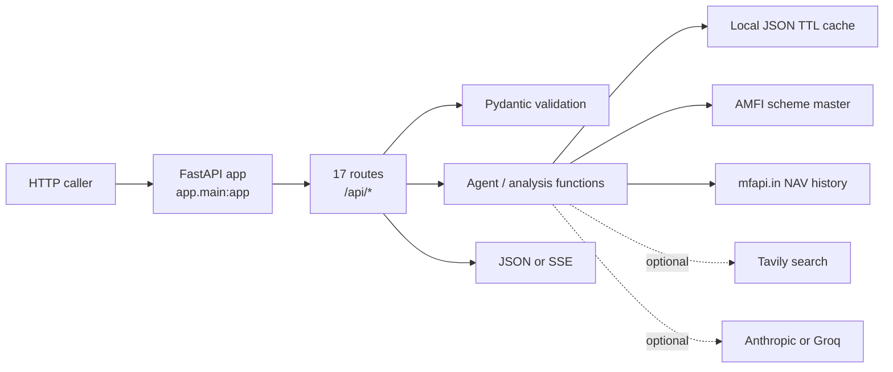
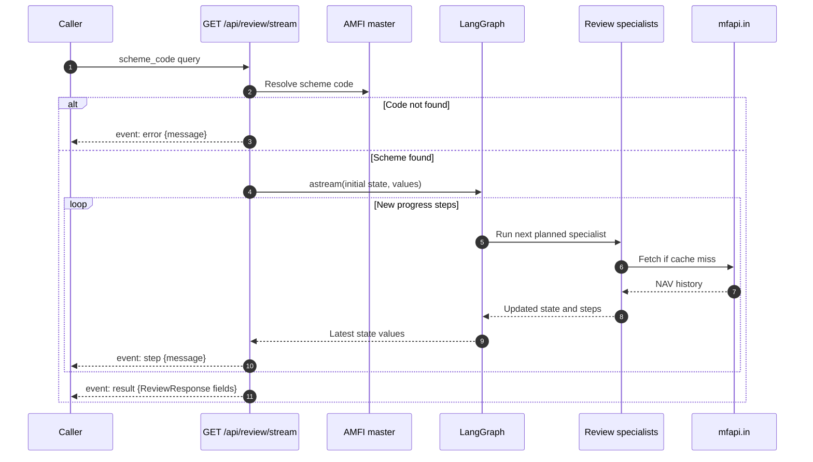
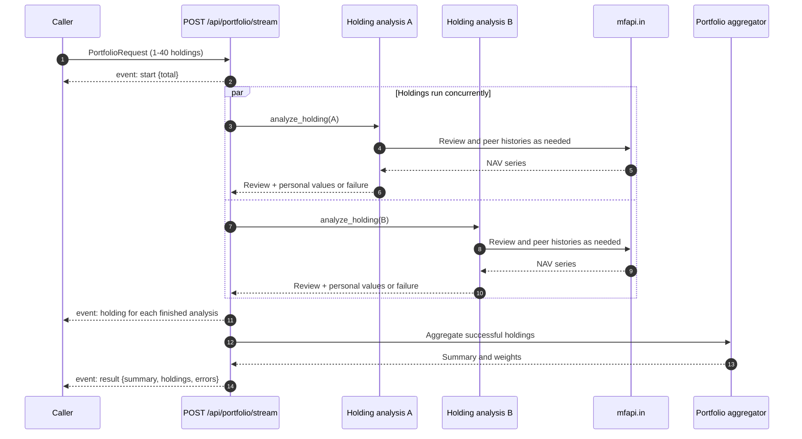
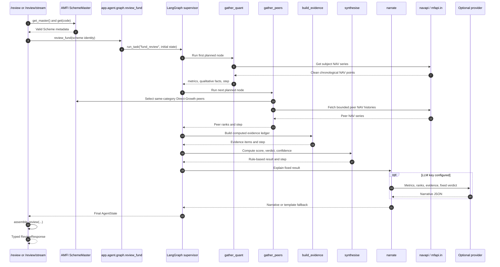
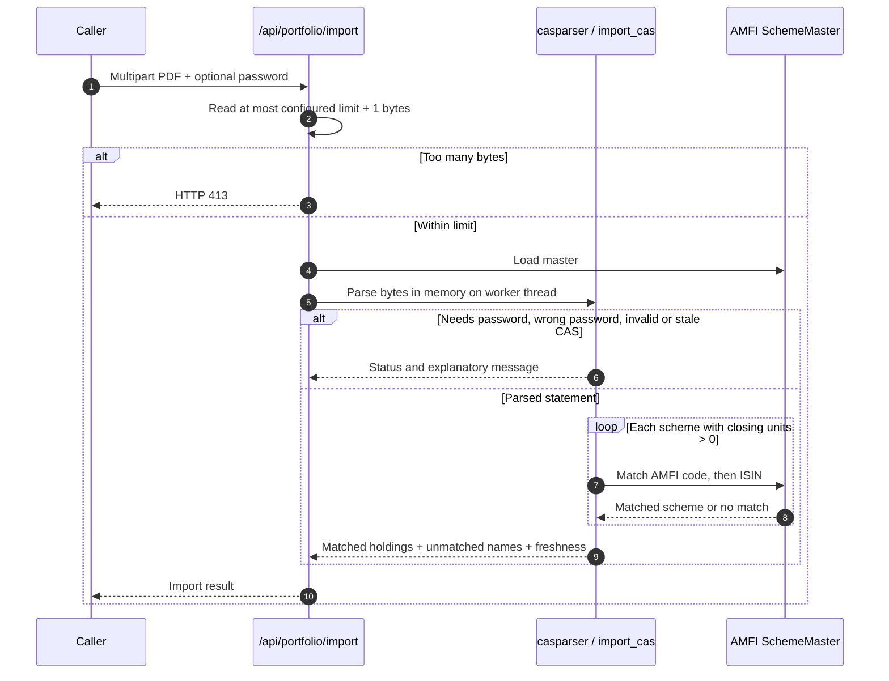

# Truthfolio backend handbook

> A code-aligned, backend-only explanation of how a request enters Truthfolio, how it moves
> through the API and analysis pipeline, which external services are called, what the backend
> returns, and why its main classes and modules exist. Examples use simple language, but
> describe the implementation in this repository rather than an idealized design.

**Audience:** backend contributors, reviewers, operators, and anyone tracing a request from
HTTP entry to its final response.

**Scope:** the Python service under `backend/app/`. The browser and frontend are intentionally
out of scope. For the broader product guide, see [TECHNICAL.md](./TECHNICAL.md). For deployment,
see [DEPLOYMENT.md](./DEPLOYMENT.md).

## Contents

1. [Backend in one minute](#1-backend-in-one-minute)
2. [Entry point and application startup](#2-entry-point-and-application-startup)
3. [The request lifecycle](#3-the-request-lifecycle)
4. [All HTTP endpoints](#4-all-http-endpoints)
5. [Request and response contracts](#5-request-and-response-contracts)
6. [Server-Sent Events (SSE)](#6-server-sent-events-sse)
7. [Fund-review workflow and LangGraph](#7-fund-review-workflow-and-langgraph)
8. [Data sources, parsing, and cache](#8-data-sources-parsing-and-cache)
9. [Metrics, peer comparison, and verdict](#9-metrics-peer-comparison-and-verdict)
10. [Portfolio workflow](#10-portfolio-workflow)
11. [CAS statement import](#11-cas-statement-import)
12. [Optional AI, web research, and citations](#12-optional-ai-web-research-and-citations)
13. [Module-by-module map](#13-module-by-module-map)
14. [Configuration and integrations](#14-configuration-and-integrations)
15. [Errors, limits, privacy, and operational boundaries](#15-errors-limits-privacy-and-operational-boundaries)
16. [Run, test, and change the backend](#16-run-test-and-change-the-backend)
17. [Glossary](#17-glossary)

---

## 1. Backend in one minute

Truthfolio's backend is a Python 3.11+ application built with **FastAPI**. It accepts HTTP
requests below `/api`, validates JSON or multipart input with **Pydantic**, obtains official
scheme identifiers and NAV history from public data sources, runs deterministic Python
analysis, and returns JSON or a stream of Server-Sent Events.

The ordinary fund and portfolio calculations do **not** require AI credentials. The regular
fund-review result is decided by code using NAV history and peer comparisons. If an LLM is
configured, it can write a narrative about that already-decided result. Research and Market
Pulse are separate, on-demand experiences that use both Tavily web search and an LLM.



An analogy: FastAPI is the front desk, Pydantic checks that the request form is filled out
correctly, the route chooses the right team, the analysis modules do the calculations, and
the response is the completed report. The LangGraph supervisor is a coordinator that sends
one review through a fixed checklist of specialists.

### What is not in this backend

- No database or server-side saved portfolios.
- No user accounts, login, or authentication.
- No persistent chat history.
- No background job queue; work happens during the HTTP request.
- No shared cache or distributed rate limiter. Cache files and usage caps belong to one
  running backend instance.

---

## 2. Entry point and application startup

### The executable entry point

The ASGI application object is `app` in `backend/app/main.py`. It is normally launched with:

```bash
cd backend
.venv/bin/uvicorn app.main:app --reload --port 8077
```

`app.main:app` means: import the Python module `app.main`, then serve the object named `app`.
In production, the Docker image runs the same module with Uvicorn and listens on the host's
`PORT` (default `8077`).

### What `create_app()` wires together

1. `get_settings()` loads environment-backed settings and creates the configured cache folder.
2. `FastAPI(...)` creates the application, sets its API title and version, and registers the
   lifespan handler.
3. `CORSMiddleware` allows browser requests from the configured origins. The default is the
   local frontend at `localhost:3000` and `127.0.0.1:3000`. Credentials are allowed, and
   methods and headers are configured as wildcards.
4. `include_router(router, prefix="/api")` mounts every route from `app/api/routes.py` under
   `/api`.
5. The module creates the ASGI instance once: `app = create_app()`.

The router is the route registry; it does not itself run analysis. Each endpoint validates
input, calls a focused function/module, and shapes the return value.

### Startup lifespan

FastAPI's lifespan calls `amfi.get_master()` before serving requests. This warms the in-memory
scheme index so the first search is usually faster. If the upstream request or parsing fails
during this warm-up, startup continues; a later endpoint will attempt to load the master
again. That startup fallback is explicit in `main.py`.

The application does not load NAV data for every fund at startup. NAV data is fetched only
when an endpoint needs that scheme's history.

---

## 3. The request lifecycle

For a typical JSON request:

1. **HTTP arrives** at Uvicorn, which serves the FastAPI application.
2. **Routing** matches method and path, such as `POST /api/review`.
3. **Parsing and validation** happen. Pydantic checks the request body, query parameters,
   numeric ranges, and list limits before endpoint code runs.
4. **Route logic** resolves any AMFI scheme code and calls the relevant analysis, agent, or
   data module.
5. **External reads** are made only if required and not available from cache. The data layer
   normalizes upstream responses before analysis uses them.
6. **Response shaping** produces the endpoint's JSON model/dictionary or SSE event frames.
7. **HTTP response** returns to the caller. Errors use HTTP status codes, except SSE workflows
   that have already started streaming and report some failures as named events.

```mermaid
sequenceDiagram
    autonumber
    participant C as HTTP caller
    participant U as Uvicorn
    participant F as FastAPI
    participant R as Route
    participant P as Pydantic
    participant S as Service / analysis
    participant D as Data source / cache

    C->>U: HTTP method + URL + headers + body
    U->>F: ASGI request
    F->>R: Match method and /api path
    R->>P: Parse and validate inputs
    P-->>R: Valid typed input (or HTTP 422)
    R->>S: Call focused backend function
    S->>D: Read cache; fetch upstream only on miss
    D-->>S: Normalized data
    S-->>R: Analysis result
    R-->>F: Response object / event stream
    F-->>U: HTTP response
    U-->>C: JSON or text/event-stream
```

This is not one universal path. `/health` does not call AMFI; `/market-pulse` does not use the
fund-review supervisor; `/portfolio/import` parses a PDF; and `/review/stream` returns a live
stream. The endpoint table below says which path each request takes.

---

## 4. All HTTP endpoints

All 17 routes are mounted under `/api`. For example, the health path is
`GET /api/health`. FastAPI also generates interactive docs at `/docs` and `/redoc` (outside
the `/api` prefix).

| # | Method and path | Input | What happens / response |
|---:|---|---|---|
| 1 | `GET /api/health` | None | Liveness response: `{"status":"ok"}`. It does not check upstream services. |
| 2 | `GET /api/capabilities` | None | Reports whether chat, research, Market Pulse, and AI insights are enabled by current keys. |
| 3 | `GET /api/search` | `q` query (at least 2 chars); `limit` 1-30, default 12 | Loads AMFI master and returns matching official schemes. |
| 4 | `POST /api/review` | `ReviewRequest` JSON | Runs the standard fund review and returns the final review JSON. |
| 5 | `GET /api/review/stream` | `scheme_code` query | Runs a fund review and streams `step`, then `result`; unknown code emits `error`. |
| 6 | `GET /api/research` | `scheme_code` query | Explicitly runs cited web research, or returns an enabled/disabled result and search budget. |
| 7 | `GET /api/recommendations` | `scheme_code` query | Scans same-category alternatives and returns qualifying research leads. |
| 8 | `POST /api/fund/chat` | `FundChatRequest` JSON | Sends supplied one-fund context and bounded conversation to configured LLM. |
| 9 | `GET /api/insights` | `scheme_code` query | Runs fund analysis without narrative, then produces insight cards. |
| 10 | `GET /api/fund/history` | `scheme_code` query | Returns monthly rebased fund NAV history and statistics, or `available:false`. |
| 11 | `GET /api/market-chart` | None | Returns public index-fund proxy histories and a factual, numbers-only market read. |
| 12 | `GET /api/market-pulse` | Optional `focus` query | Runs cited, current web synthesis, or explicitly reports unavailable. |
| 13 | `POST /api/insights/portfolio` | JSON `summary`, optional `holdings` | Produces portfolio insight cards from the submitted analysis. |
| 14 | `POST /api/portfolio/chat` | `PortfolioChatRequest` JSON | Sends supplied portfolio context and conversation to configured LLM. |
| 15 | `POST /api/portfolio/import` | Multipart `file`, optional `password` | Parses a CAMS/KFintech CAS and returns matched active holdings. |
| 16 | `POST /api/portfolio` | `PortfolioRequest` JSON | Analyzes all submitted holdings and returns summary JSON. |
| 17 | `POST /api/portfolio/stream` | `PortfolioRequest` JSON | Streams a start event, each holding completion, then final portfolio result. |

### Route families

- **Health and feature discovery:** `/health`, `/capabilities`.
- **Find and inspect one fund:** `/search`, `/review`, `/review/stream`, `/fund/history`.
- **Optional single-fund enrichment:** `/research`, `/recommendations`, `/insights`,
  `/fund/chat`.
- **Portfolio intake and analysis:** `/portfolio/import`, `/portfolio`, `/portfolio/stream`.
- **Optional portfolio enrichment:** `/insights/portfolio`, `/portfolio/chat`.
- **Market data and commentary:** `/market-chart` (deterministic) and `/market-pulse`
  (web-search + LLM).

---

## 5. Request and response contracts

Pydantic definitions live in `backend/app/models/schemas.py`. FastAPI converts a validation
failure into HTTP 422 with a structured error response. The endpoint may add business checks
after model validation, such as confirming that a syntactically valid scheme code exists in
AMFI's master.

### Search

`GET /api/search?q=parag%20flexi&limit=12` returns:

```json
{
  "query": "parag flexi",
  "results": [
    {
      "code": "official-AMFI-code",
      "name": "Full scheme name",
      "amc": "Fund house",
      "category": "Distilled category",
      "scheme_type": "AMFI section label"
    }
  ]
}
```

The example code is a placeholder, not a valid scheme assertion. The API result schema is
`SearchResponse` containing `SchemeHit` objects.

### Standard fund review

`ReviewRequest` requires `scheme_code`. It can also accept `units` and `invested_amount` as
non-negative numbers. The current standard review response does not include personal holding
calculations; those fields are passed into the graph state but are not used to assemble
personal values by the standard review path. Portfolio-specific personal calculations use
`units` and `avg_nav` in the portfolio flow.

The `ReviewResponse` contains:

| Field | Meaning |
|---|---|
| `scheme_code`, `scheme_name`, `category` | Official scheme identity and normalized category. |
| `as_of` | Date of the last NAV used in the computed metrics. |
| `verdict`, `health_score`, `confidence` | Rule-based result; confidence is a heuristic indicator, not a guarantee. |
| `headline`, `narrative`, `caveats` | Short summary, optional LLM-written explanation or deterministic fallback, and fixed educational limits. |
| `metrics` | Values plus units, better direction, plain explanation and interpretation. |
| `qualitative` | Deterministic track-record and resilience facts derived from NAV history. |
| `rolling` | Historical rolling-return distributions when sufficient history exists. |
| `peers` | Category, sample sizes, and direction-aware peer ranks. |
| `evidence` | Claims, direction, weight, confidence, and source references. |
| `footnotes` | Numbered research citations; normally empty for standard review. |
| `steps` | Pipeline progress messages, also used by the streaming endpoint. |
| `llm_used`, `research_used` | Identify optional work used by this result. |

`analysis/review_view.py` is the shared serializer. It enriches metric rows using the
explainer catalog, then assembles the same shape for a standalone review and a portfolio
holding's embedded review.

### Portfolio analysis

`PortfolioRequest` accepts between 1 and 40 holdings. Each `HoldingInput` requires:

```json
{
  "scheme_code": "official-AMFI-code",
  "units": 12.5,
  "avg_nav": 100.0
}
```

`units` and `avg_nav` must both be greater than zero. Successful results contain:

- `summary`: total invested/current/gain, overall return, health and verdict, category mix,
  concentration data, performers, action items, headline and caveats.
- `holdings`: each successful holding's shared `review`, `personal` values, and current-value
  `weight`.
- `errors`: number of submitted holdings that could not be analyzed.

If every holding fails, `POST /api/portfolio` responds with HTTP 422. Individual holding
failures do not fail the whole request when at least one holding succeeds.

### Chat requests

`FundChatRequest` contains a constrained `FundChatContext` plus `messages`. Portfolio chat
contains a `PortfolioChatSummary`, 1-40 `PortfolioChatHolding` entries, and `messages`.
Messages must alternate `user`, `assistant`, start with a user question, and end with a user
question. Each request is capped at nine messages (five user questions), 600 characters per
user message, 2,000 characters per assistant message, and 50 KB of serialized context. Blank
messages are rejected.

The context models cap fields and arrays to keep prompts bounded. Percentage fields that are
sent to chat are described as percentage points (for example `12.5` means 12.5%), and money
is INR. Responses use `FundChatResponse` or `PortfolioChatResponse`, each containing a
non-empty `answer` of at most 2,000 characters.

### Pydantic model inventory

The models below are defined in `models/schemas.py`. Pydantic rejects values outside the
stated bounds before the route handles the request.

| Model | Fields and constraints |
|---|---|
| `SchemeHit` | `code`, `name`, `amc`, `category`, and `scheme_type` are strings. |
| `SearchResponse` | `query` string and `results` list of `SchemeHit`. |
| `ReviewRequest` | `scheme_code` string; optional `units` and `invested_amount` are each >= 0. |
| `MetricOut` | Metric key, label, optional numeric value, unit, good direction, optional plain explanation fields, and optional interpretation dictionary. |
| `HoldingInput` | `scheme_code`; `units > 0`; `avg_nav > 0`. |
| `PortfolioRequest` | `holdings` list of 1-40 `HoldingInput` values. |
| `PortfolioChatMetric` | `label` length 1-80; optional finite `value`; `unit` length at most 20 (default empty). |
| `PortfolioChatHolding` | Scheme name length 1-240; category <=120; verdict <=40; finite score 0-100; finite weight 0-100; invested/current value >=0; finite gain/return; headline <=500; up to 12 metrics and 8 evidence strings (each <=400); peer summary <=500. |
| `PortfolioChatCategory` | Category length 1-120; finite percentage from 0 to 100. |
| `PortfolioChatSummary` | Finite non-negative invested/current totals; finite gain and return; health 0-100; verdict <=60; diversification <=500; top holding and category percentages 0-100; top category <=120; category mix up to 20; headline <=500; action items and caveats up to 10 each, each string <=500. |
| `PortfolioChatMessage` | Role is exactly `user` or `assistant`; content length 1-2,000, then whitespace-trimmed. The request validator applies the stricter user-question limit of 600. |
| `PortfolioChatRequest` | One summary, 1-40 holdings, and 1-9 messages; enforces <=50 KB serialized size, alternating roles, first and final message from user, and at most five questions. |
| `FundChatContext` | Fund name length 1-240; optional bounded category/date/headline/peer text; score and confidence 0-100; up to 14 metrics, 4 rolling-return strings, 10 evidence strings, and 6 caveat strings, each with per-field length limits. |
| `FundChatRequest` | One fund context and 1-9 messages; applies the same serialized-size, alternation, question-count, and final-user-message checks as portfolio chat. |
| `FundChatResponse`, `PortfolioChatResponse` | Non-empty answer, maximum 2,000 characters. |
| `ReviewResponse` | Typed final fund-review fields listed above; metrics are `MetricOut` records. |

The portfolio chat model also rejects NaN and infinity on numeric fields where
`allow_inf_nan=False` is specified. Holdings submitted to `/portfolio` differ from holdings
submitted to chat: portfolio analysis needs scheme code, units, and average NAV; chat only
receives already-computed, bounded analysis.

### CAS upload

The request is multipart form data: one `file` upload and an optional `password` form field.
The response is a dictionary with a `status` such as `ok`, `password_required`, or `error`.
For a successful parse it includes matched `holdings`, names that could not be matched,
statement date, and freshness warning information.

### Other endpoint shapes

- `/capabilities` returns booleans: `chat`, `research`, `market_pulse`, and `insights_ai`.
- `/research` returns `enabled`, evidence, footnotes, and Tavily `budget`; when disabled,
  `reason` explains that both an LLM and Tavily key are needed.
- `/recommendations` returns the subject, number of peer candidates considered, alternatives,
  comparison reasons, basis, disclaimer, and optional `empty_reason`.
- `/insights` returns `insights` and `llm_used`. `/insights/portfolio` returns generated
  insight cards and LLM-use state from the insight service.
- `/fund/history` returns `available`, monthly history and statistics when sufficient history
  exists; otherwise it returns `available:false` and a reason.
- `/market-chart` returns `available`, segment histories, calculated read, assumed scenario
  rates and disclaimers, or `available:false`.
- `/market-pulse` returns `enabled`, `pulse`, cited `footnotes`, and search `budget`, or a
  clear disabled/unavailable message.

---

## 6. Server-Sent Events (SSE)

### What SSE means

Server-Sent Events is a simple way for a server to keep one HTTP response open and send small
named messages as work progresses. It is like receiving numbered progress updates while a
long report is being prepared, instead of waiting silently for the complete report. The
connection is one-way: the server sends events; the client does not send new commands through
that same stream.

An SSE response uses media type `text/event-stream`. Each event frame has this form:

```text
event: event-name
data: {"some":"JSON data"}

```

The blank line ends the event. The backend helper `_sse()` serializes the data with
`json.dumps(..., default=str)`.

SSE is used by two endpoints:

1. `GET /api/review/stream`
2. `POST /api/portfolio/stream`

It is not used for `/api/review`, `/api/portfolio`, or optional model responses.

### Fund review stream



The route emits only newly added `steps`, so already-sent progress text is not repeated. The
final event uses the same `assemble_review()` serializer as the synchronous review. If the
graph raises after the stream starts, the route emits `event: error` with a message. A failure
while obtaining the AMFI master occurs before that graph exception handler and can instead
terminate the stream as a server error.

### Portfolio stream



Events are emitted as holdings finish, not necessarily in the same order they were submitted.
Each `holding` event contains `done` and `total`; a successful event also carries `scheme_name`
and `verdict`. A failed item carries `failed:true`. If none succeed, the route emits one
`error` event and does not emit `result`.

### Event reference

| Endpoint | Event | Data |
|---|---|---|
| Fund stream | `step` | `{"message":"..."}` for each newly recorded pipeline step. |
| Fund stream | `result` | Full assembled fund-review object. |
| Fund stream | `error` | `{"message":"..."}` for unknown scheme or graph failure. |
| Portfolio stream | `start` | `{"total": number_of_submitted_holdings}`. |
| Portfolio stream | `holding` | `{"done": n, "total": n, "scheme_name":"...", "verdict":"..."}` or `{"done": n, "total": n, "failed": true}`. |
| Portfolio stream | `result` | `{"summary": ..., "holdings": [...], "errors": count}`. |
| Portfolio stream | `error` | `{"message":"..."}` if no submitted holding could be analyzed. |

---

## 7. Fund-review workflow and LangGraph

### Why a graph/supervisor?

A review consists of separate responsibilities: load facts, compare peers, assemble evidence,
calculate a result, and explain it. `supervisor.py` records those as an ordered plan. Each
specialist does one job and returns to the supervisor. This is easier to inspect and stream
than one large function with mixed responsibilities.

Despite the word "agent", **the routing is not chosen by an LLM**. It is a deterministic
ordered plan. The graph coordinates Python functions; only selected specialist work invokes
an LLM.

### Standard review sequence



### The shared graph state

`AgentState` in `agent/state.py` is a `TypedDict`, a dictionary with documented field types.
LangGraph passes partial dictionaries between nodes and merges their updates. The state is
plain-data oriented so its outputs can be serialized into the API response.

| State area | Examples | Why it exists |
|---|---|---|
| Inputs | scheme code/name, base name, AMC, category, optional units and invested amount | Carries the selected fund and any task context into nodes. |
| Gathered data | `metrics`, `qualitative`, `peers` | Stores normalized results from deterministic analysis. |
| Evidence/research | `evidence`, `research_evidence`, `footnotes`, `research_used` | Carries claims and traceable sources separately from raw metrics. |
| Outputs | health score, verdict, confidence, headline, narrative, caveats | Stores review result and explanation. |
| Supervisor control | `task`, remaining `plan`, `_next` | Selects the next specialist by fixed plan. |
| Bookkeeping | `steps`, `llm_used`, insights | Tracks work and optional language generation. |

`EvidenceItem` describes a claim, category, direction, weight, confidence, and source list.
`SourceRef` describes the source kind, title/URL, reliability, and reasons. The computed
analysis source is deterministic and assigned reliability 1.0. Web sources use the appraisal
gate.

### Plans and callers

`PLANS` in `agent/supervisor.py` specifies all registered task sequences:

| Task | Ordered nodes | Caller |
|---|---|---|
| `fund_review` | `gather_quant` -> `gather_peers` -> `build_evidence` -> `synthesise` -> `narrate` | `/review`, `/review/stream`, portfolio holding. |
| `fund_review_deep` | Quant -> peers -> research -> evidence -> synthesize -> narrate | Available through `review_fund(deep=True)`; not the default API path. |
| `research_only` | `gather_research` | `/research`. |
| `fund_insights` | Quant -> peers -> evidence -> synthesize -> generate insights | `/insights`. |

Each registered specialist maps to a Python function in `agent/nodes.py`. Every specialist
has an edge back to `supervisor`; the supervisor picks the next item or ends the graph. The
compiled graph is cached with `lru_cache` so it is built once per process.

### What each standard node does

1. **`gather_quant`** fetches the subject's NAV series, calls `compute_metrics`, and derives
   deterministic track-record facts with `build_qualitative`.
2. **`gather_peers`** converts metric dictionaries back to `Metric` records, computes category
   peer metrics and ranks, then records a human-readable progress step.
3. **`build_evidence`** converts computed metrics and peer ranks to `EvidenceItem`s. Deep review
   can add researched evidence here.
4. **`synthesise`** calculates the score, verdict, and confidence using the deterministic rules.
5. **`narrate`** either calls the configured LLM with the already-decided result or creates a
   deterministic template. Fixed caveats are merged after LLM output so the model cannot
   remove the core disclaimer.

`review_view.assemble_review()` then supplies defaults for optional values, enriches metric
rows, and gives every review path one consistent response shape.

The graph's research plan can add web evidence to the state before the evidence-building step.
However, `synthesise()` currently receives only `metrics` and `peers`; it does not read the
combined evidence list. Therefore web-researched claims can appear in evidence/explanation
output for a deep review, but they do not change the numeric health score, confidence, or
Continue/Stop/Shift result.

---

## 8. Data sources, parsing, and cache

### AMFI: the scheme directory

`data/amfi.py` downloads the AMFI `NAVAll.txt` feed. It is the source of real scheme codes and
scheme names; it is not the historical NAV service.

The parser handles semicolon-delimited records and delimiter-less section headers. It builds:

- `Scheme`: one scheme's code, full name, base name, AMC, scheme type/category, plan/option,
  and optional ISINs.
- `SchemeMaster`: the list plus lookup indexes by code and ISIN, and a fuzzy-search corpus.

`SchemeMaster.search()` uses RapidFuzz's token-set matching, removes generic words such as
"fund" and "growth" from a distinctive-word gate, collapses plan/option duplicates, and
prefers Direct-Growth where possible. This makes the search result a validated identity, not
an arbitrary free-text name.

`get_master()` checks process memory first, then the JSON cache, then AMFI. An `asyncio.Lock`
prevents simultaneous cache misses in the same process from downloading/parsing the master
multiple times. The in-memory indexed copy is reused until the process restarts; disk TTL is
24 hours by default.

### mfapi.in: historical NAV

`data/navapi.py` calls `GET {HPR_MFAPI_BASE}/{scheme_code}` (default base is
`https://api.mfapi.in/mf`). The response is parsed into:

- `NavPoint(on, nav)`: one date and positive NAV.
- `NavSeries`: scheme metadata and chronologically sorted points, with convenient `start`,
  `end`, and `latest_nav` properties.

Bad date/value rows and non-positive NAVs are skipped. No remaining points raises `ValueError`.
Raw API JSON is cached for 12 hours by default. Network fetches use the configured HTTP
timeout, retry up to three times with exponential backoff, and pass through an
`asyncio.Semaphore(16)` to bound simultaneous requests. The semaphore is process-wide, so
portfolio and peer fan-out share that ceiling.

### Tavily: optional web search

`data/websearch.py` calls Tavily's REST search endpoint directly with `httpx`; it is not part
of the standard fund-review path. Results are normalized to `WebResult` records and cached by
the query, topic, days, and result count. Cache hits do not consume the daily search counter.
The counter allows at most the configured number of real requests per process/day.

When the search key is absent, budget is exhausted, or the Tavily request fails, the module
returns an empty result list. Research and Market Pulse treat this as no available source
material; they do not infer facts from an empty result. The current counter increments after
a successful HTTP response and JSON parse; a failed Tavily call does not increment it.

### The file cache

`data/cache.py` stores JSON files in `HPR_CACHE_DIR` (default `backend/.cache`). Each entry
contains a timestamp and data. A read returns no value if the file is absent, has invalid JSON,
is unreadable, or is expired. A write is best-effort; a disk write error does not fail the
request.

This is a performance/cost cache, **not** a database:

- It is local to one instance and is not shared across replicas.
- It has no user data model or query layer.
- It may be cleared without losing a saved portfolio because portfolios are not persisted.
- Separate features choose their own key and TTL (for example NAV 12 hours, fund history and
  recommendations 12 hours, fund/portfolio insights 12 hours, Market Pulse 6 hours, and
  search results configured 72 hours).

---

## 9. Metrics, peer comparison, and verdict

### NAV normalization before calculation

`analysis/metrics.py` converts points into a date-indexed Pandas series, drops duplicate dates
(keeping the last point for a date), sorts chronologically, and calculates returns from NAV
changes. NumPy and Pandas are used for the numerical work; the functions are deterministic
given the same NAV points and risk-free-rate setting.

| Output | How the backend calculates it |
|---|---|
| 1-, 3-, 5-year return | Finds the last NAV on or before the target date. For a year-or-longer window, calculates CAGR: `(end / start) ** (1 / years) - 1`. |
| Return under one year | Uses simple total return, not annualized. |
| Since-inception CAGR | Uses first NAV, last NAV, and elapsed calendar years. |
| Daily returns | `NAV[t] / NAV[t-1] - 1`. |
| Annualized volatility | Sample standard deviation of daily returns (`ddof=1`) multiplied by `sqrt(252)`. |
| Sharpe | Annualized arithmetic mean daily return minus configured annual risk-free rate, divided by annualized volatility. |
| Sortino | Same excess-return numerator divided by annualized sample standard deviation of negative daily returns. It can be absent if there are too few downside observations. |
| Maximum drawdown | Minimum of `NAV / running_peak - 1`; it is zero or negative. |
| Rolling returns | Monthly-stepped 3- and 5-year CAGR windows; reports observations, min/median/max, and share below zero when there are at least three windows. |

Metrics with insufficient observations may have a `null` value; rolling windows with too
little history are omitted. `MetricsReport` groups scheme code, dates, history length, latest
NAV, metrics, and rolling stats. Each `Metric` has a stable key, label, value, unit, and
good-direction flag.

### Why the peer group exists

A return has little meaning without context: 10% might be strong in a difficult period or weak
in a rising market. `analysis/peers.py` therefore compares the subject with funds in the same
AMFI-derived category.

The ranking peer set:

- includes Direct-Growth schemes,
- excludes the subject,
- sorts by fund house and name,
- includes no more than two schemes from one AMC, and
- selects at most 18 peers.

Peer NAV fetches run concurrently through the same bounded NAV client. A peer that cannot
load is dropped. The report separately records the eligible category-universe size and how
many peers actually produced metrics. Percentiles include the subject alongside the available
peer values; a direction-aware comparison makes a higher return/ratio better, lower
volatility better, and a less-negative drawdown better.

Recommendations are a separate operation: they can scan up to 120 same-category
Direct-Growth candidates, deduplicated by base fund name. They are not limited to the 18
ranking sample. A candidate must score at least three points above the subject on
self-health (with peer standing removed) and win at least three available displayed
comparisons. Those comparisons are 3-year return, 5-year return, Sharpe, Sortino, maximum
drawdown, and rolling-return consistency; unavailable values are skipped. These outputs are
research leads, not personalized fund recommendations.

### The health score

`agent/verdict.py` applies five weighted components. The configured weights sum to 1.0, but
missing components are excluded and the remaining weights are renormalized.

| Component | Weight | Score rule |
|---|---:|---|
| Long-term return | 0.22 | Use 5-year CAGR, otherwise 3-year CAGR; map 0%-20% to 0-100 and clamp. |
| Risk-adjusted | 0.26 | Average available Sharpe/Sortino; map ratio 0-1.5 to 0-100 and clamp. |
| Peer standing | 0.30 | Average available 3-year return, 5-year return, and Sharpe percentiles, multiplied by 100. |
| Consistency | 0.14 | Prefer 5-year rolling returns; score `100 * (1 - 4 * negative-window-share)`, clamped. |
| Drawdown | 0.08 | Score based on magnitude: -20% maps to 100, -60% maps to 0, clamped. |

The final health score is the weighted sum divided by the total weight of available
components. A zero score is returned only when no component can be calculated.

### Verdict and confidence

The order of the verdict rules is significant:

1. Health score >= 62 and peer score >= 0.45, or peer score unavailable: **Continue**.
2. Otherwise, health score < 42: **Stop**.
3. Otherwise, peer score exists and is < 0.45: **Shift**.
4. Otherwise: **Continue** for health >= 55, else **Shift**.

Confidence combines component completeness with how much the score components agree. It is
clamped between 0.25 and 0.95. It is a heuristic about this calculation's evidence, not a
statistical confidence interval or a guarantee.

`build_evidence()` creates a readable evidence ledger from computed metrics and peer results.
Each computed item includes its claim, evidence category, positive/negative/neutral direction,
weight, confidence, and a computed source reference. The evidence ledger makes the reasoning
inspectable; the arithmetic verdict remains deterministic.

### Plain-language metric explanations

`analysis/explainers.py` maps metric keys to plain-language text: short analogy, definition,
why the metric matters, how to read it, and interpretation bands. These bands explain a
metric; they do not individually choose the final verdict. `review_view.enrich_metrics()`
attaches those fields to every known metric before the API returns it.

---

## 10. Portfolio workflow

### Input and parallelism

`POST /api/portfolio` and `/api/portfolio/stream` use the same `PortfolioRequest` with 1-40
holdings. The route converts Pydantic's `HoldingInput` into the small dataclass of the same
name in `agent/portfolio.py`.

`analyze_holding()`:

1. Loads the AMFI master and finds the requested scheme code.
2. Calculates invested amount as `units * avg_nav`.
3. Calls the same `review_fund()` graph used for a single fund.
4. Builds the standard nested review through `assemble_review()`.
5. Reads the latest NAV from computed metrics.
6. Calculates the holding's personal position and returns it with the review.

A missing scheme, failed review, or absent latest NAV makes that holding unavailable to the
portfolio result. The batch endpoint uses `asyncio.gather()` to analyze all holdings
concurrently. The NAV semaphore separately limits simultaneous upstream HTTP fetches; it does
not limit the number of Python holding tasks created.

### Personal position math

For units `U`, average purchase NAV `A`, and latest NAV `N`:

```text
invested      = U * A
current_value = U * N
gain          = current_value - invested
return_pct    = gain / invested
```

`return_pct` is a fraction in the response (for example, `0.10` means 10%). It is total
return since the supplied average cost basis, **not annualized**. The backend does not receive
purchase dates or cash flows, so it cannot calculate time-weighted or annualized personal
return.

### Portfolio aggregation

`analysis/portfolio.py` is a pure calculation module. It combines successful holdings and
calculates:

- total invested, current value, gain/loss, and overall total return;
- each fund's weight by current value;
- category value and percentage mix;
- HHI concentration: sum of squared current holding weights;
- largest holding and largest category percentages;
- a current-value-weighted mean of each fund's health score;
- a transparent concentration penalty (0-12 points);
- portfolio verdict, best/worst personal return, and action-item observations.

The diversification penalty is 12 points for one holding; 10 points when at least 70% is in
one category or HHI is at least 0.50; 5 points when at least 50% is in one category or HHI is
at least 0.33; zero for at least four holdings with HHI below 0.25; and 2 points otherwise.
The verdict is `Healthy` for health >= 65 and penalty <= 5; otherwise `Minor tweaks` for health
>= 50; otherwise `Needs rebalancing`. These are product heuristics, not regulated ratings or
personalized instructions.

Portfolio confidence is currently a fixed 0.8 for two or more successfully analyzed holdings
and 0.6 for one. It is not derived from the fund-level confidence values.

The synchronous route returns the completed aggregate at once. The streaming route calls
`analyze_holding()` tasks and uses `asyncio.as_completed()`, which is why progress events
arrive in completion order. Both use the same aggregation function after successful holdings
are known.

---

## 11. CAS statement import

`POST /api/portfolio/import` accepts a CAMS/KFintech Consolidated Account Statement PDF and
optional password. `data/cas_import.py` parses it with `casparser` in a worker thread so the
synchronous PDF parsing does not block the async event loop.



The backend reads at most `cas_max_bytes + 1` bytes (15,000,000 bytes by default), closes the
upload, then rejects an oversize file with HTTP 413. The importer:

- parses only active schemes with closing units above zero;
- matches AMFI code first, then ISIN;
- computes average NAV from statement cost divided by closing units when possible;
- returns the scheme identity, units, average NAV, and current value when available;
- warns for statements older than 30 days and rejects statements older than 90 days by
  default; and
- returns explicit states for missing/wrong password, invalid CAS, unreadable file, and stale
  statement.

The route does not intentionally write the PDF or password to disk, log them, or send them to
an LLM/web service. It clears its local references after parsing. Python memory clearing is
not a cryptographic erasure guarantee. The import endpoint only prepares holdings; the user
must submit the holdings to `/portfolio` or `/portfolio/stream` for analysis.

---

## 12. Optional AI, web research, and citations

### Optional means separately gated

`config.Settings` determines whether features are available:

- `llm_enabled`: the active provider has a key.
- `search_enabled`: a Tavily key is present.
- `research_enabled`: both an active LLM and Tavily are configured.

The `/capabilities` route reports feature availability. The API checks the setting again when
an optional route is called; a UI capability flag is not a security control.

### Provider selection

`agent/llm_provider.py` centralizes LLM construction. It selects Anthropic by default or Groq
when `LLM_PROVIDER=groq`, passes the configured model and token limit, and gives specialist
modules a LangChain chat model. Callers import it only on optional paths, keeping the
deterministic service usable without provider calls.

### Narrative

The standard graph calls `narrate` after the verdict is fixed. With no LLM key,
`_deterministic_narrative()` uses the existing evidence and verdict to form a simple report.
With a key, `agent/llm.py` sends metrics, peer ranks, evidence, and the already-computed
verdict to the model. It asks for explanatory JSON. `nodes.narrate()` retains the computed
verdict, applies the canonical caveats, and falls back to a template if generation fails.

The LLM's job is to explain, not calculate or replace the deterministic score/verdict.

### On-demand research

`GET /api/research?scheme_code=...` calls `research_fund()` and runs the `research_only` plan.
`agent/research.py` submits two search topics (fund facts and recent news/regulatory context)
to Tavily concurrently. It then:

1. drops results without usable URLs/content;
2. appraises each source with `appraisal.py`;
3. ignores sources below `TRUST_FLOOR` for claim extraction;
4. registers trusted URLs in `CitationRegistry`, which assigns stable first-use numbers;
5. sends source snippets and the fund identity to the LLM to extract concise, numbered,
   source-backed claims; and
6. drops claims that have no valid citation and returns evidence plus footnotes.

Research is additive and explicit. The standard review route does not automatically spend
Tavily credits. The separate `/research` result does not retroactively rewrite a previously
computed `/review` response.

### Source appraisal and citations

`appraisal.py` assigns a 0-1 reliability value using the source domain, publication date, and
corroboration. It stores the reasons with each source. Computed data uses a separate
`computed_source()` reference with reliability 1.0. The current web scoring starts with the
domain's configured trust value (unknown domain 0.40; no URL is capped at 0.25), then adjusts:

- publication within 180 days: +0.05; older than 730 days: -0.15; unknown date: -0.05;
- two or more corroborating sources: +0.15; one: +0.05; none: -0.10; and
- final score is clamped to 0-1. Claims below `TRUST_FLOOR` 0.45 are not sent to claim
  extraction.

The configured domain values put regulators/industry sources such as `sebi.gov.in`,
`amfiindia.com`, and `rbi.org.in` at 0.95; BSE/NSE at 0.90; selected research/data platforms
around 0.58-0.80; and mainstream financial press around 0.65-0.70. This is a transparent
heuristic, not an independent verification of the article's contents.

`citations.py` deduplicates sources by URL and numbers them in first-use order. Research claims
retain their source references; footnotes include number, title, URL, domain, reliability,
and publication date when known.

### Fund and portfolio insight cards

`GET /api/insights` runs the `fund_insights` graph task: metrics, peers, evidence, score, and
then `generate_insights` (no narrative node). `POST /api/insights/portfolio` accepts an
already-computed summary and brief holdings. `agent/insights.py` either asks the model for
structured cards based on that data or makes deterministic fallback cards. Successful
results are cached for 12 hours; keys are fund-code based for fund cards and content-hashed
for portfolio cards. Transient LLM failures do not turn into fabricated quantitative data.

### Market Pulse versus market chart

These similarly named features have different data paths:

- `/market-chart` is deterministic. `agent/market_chart.py` obtains NAV history from
  selected index-fund proxies, calculates historical segment returns and a numbers-only
  recent-market read, and returns fixed illustrative scenario assumptions. It uses no LLM or
  Tavily. The scenarios are assumptions, not forecasts.
- `/market-pulse` uses current Tavily news results, the source appraisal gate, citations, and
  an LLM. It returns a clear disabled/unavailable result when keys or reliable sources are
  missing. It searches two broad topics plus an optional focused topic. Before returning
  model-written content, it validates section types, tone values, and citation numbers. Any
  outlook item must cite and attribute the named source's view.

### Chat

`POST /api/fund/chat` and `POST /api/portfolio/chat` accept analysis context from the caller;
the backend does not first load a fund or portfolio from storage. Their services pass only
that validated context and bounded conversation to the configured provider. They have no
search tools and no transcript persistence. Prompts prohibit invented facts and personalized
buy/sell/switch instructions. Both have an in-process daily request cap and known provider
errors are reported as HTTP 502; missing provider configuration is HTTP 503. Fund chat and
portfolio chat each keep a separate counter in their own module; both use
`HPR_PORTFOLIO_CHAT_DAILY_CAP`, so the limit applies separately to each endpoint, not as one
combined counter.

---

## 13. Module-by-module map

### Application and API

| File | Responsibility |
|---|---|
| `backend/app/main.py` | Creates `FastAPI`, CORS middleware, startup lifespan, and `/api` router prefix. |
| `backend/app/api/routes.py` | The 17 HTTP handlers, Pydantic route inputs, response assembly, portfolio fan-out, and SSE frame generator. |
| `backend/app/models/schemas.py` | Typed request/response contracts and field-level/conversation validation. |
| `backend/app/config.py` | Environment-backed `Settings`, provider/capability properties, cached settings accessor, and cache-directory setup. |
| `backend/app/disclaimer.py` | Canonical educational and portfolio/fund caveats used by analysis/narrative paths. |

### Agent and optional reasoning

| File | Responsibility |
|---|---|
| `backend/app/agent/state.py` | LangGraph `AgentState`, evidence item, source reference, and verdict/direction types. |
| `backend/app/agent/graph.py` | Stable API for `review_fund`, `research_fund`, `insights_fund`, and compiled graph access. |
| `backend/app/agent/supervisor.py` | Ordered task plans, specialist registry, supervisor routing, and `run_task()`. |
| `backend/app/agent/nodes.py` | Graph node implementations: quant, peers, research, evidence, verdict, narrative, insight. |
| `backend/app/agent/verdict.py` | Computed evidence and deterministic health score/verdict/confidence rules. |
| `backend/app/agent/portfolio.py` | Per-holding review orchestration and personal cost-basis calculation hookup. |
| `backend/app/agent/llm_provider.py` | Provider factory for Anthropic or Groq through LangChain. |
| `backend/app/agent/llm.py` | Optional fund-review narrative prompt and JSON parsing. |
| `backend/app/agent/research.py` | Fund searches, source filtering, cited claim extraction, and web evidence. |
| `backend/app/agent/appraisal.py` | Reliability score and reasons for computed/web sources. |
| `backend/app/agent/citations.py` | URL-deduplicated citation numbering and footnote output. |
| `backend/app/agent/insights.py` | Fund/portfolio insight cards, fallback cards, and insight caching. |
| `backend/app/agent/market.py` | Cited, web-based Market Pulse generation and validation. |
| `backend/app/agent/market_chart.py` | Deterministic index-fund proxy chart data, segment returns, market read, and scenario assumptions. |
| `backend/app/agent/fund_chat.py` | Constrained single-fund Q&A and in-process daily chat quota. |
| `backend/app/agent/portfolio_chat.py` | Constrained portfolio Q&A and in-process daily chat quota. |

### Analysis and data

| File | Responsibility |
|---|---|
| `backend/app/analysis/metrics.py` | Pure NAV-derived metric/report types and calculations. |
| `backend/app/analysis/peers.py` | Peer candidate selection, peer NAV analysis, and percentile ranks. |
| `backend/app/analysis/portfolio.py` | Personal position arithmetic, category mix, HHI, weighted score and portfolio verdict. |
| `backend/app/analysis/recommend.py` | Same-category research leads and side-by-side metric comparisons. |
| `backend/app/analysis/explainers.py` | Metric explanations and interpretation thresholds. |
| `backend/app/analysis/qualitative.py` | Deterministic record-age/recovery/resilience facts from NAV points. |
| `backend/app/analysis/fund_history.py` | Monthly fund NAV history rebased to growth of 100 and summary statistics. |
| `backend/app/analysis/review_view.py` | Canonical review response assembly and metric enrichment. |
| `backend/app/data/amfi.py` | AMFI feed download/parser, scheme records, search, and code/ISIN indexes. |
| `backend/app/data/navapi.py` | mfapi.in HTTP client, retries, NAV parsing, caching, fetch semaphore, and series records. |
| `backend/app/data/websearch.py` | Tavily HTTP client, result normalization/cache, and process daily search cap. |
| `backend/app/data/cache.py` | Dependency-free JSON file TTL cache. |
| `backend/app/data/cas_import.py` | In-memory CAS parser, freshness checks, active-holding extraction, and AMFI/ISIN matching. |

The backend's core design boundary is that `data/` obtains and normalizes inputs, `analysis/`
calculates values, `agent/` coordinates tasks and optional explanations, and `api/` exposes
the behavior over HTTP.

---

## 14. Configuration and integrations

Settings use the `HPR_` prefix by default and read `backend/.env` when present. Provider
selection and keys also accept conventional unprefixed names as indicated below. Do not
commit `.env` files or API keys.

| Setting | Default | Effect |
|---|---|---|
| `HPR_APP_NAME` | `Truthfolio` | FastAPI title. |
| `HPR_CORS_ORIGINS` | `http://localhost:3000,http://127.0.0.1:3000` | Allowed browser origins; a comma-separated string is accepted. |
| `HPR_AMFI_NAV_URL` | AMFI `NAVAll.txt` URL | Scheme master source. |
| `HPR_MFAPI_BASE` | `https://api.mfapi.in/mf` | NAV-history API base. |
| `HPR_HTTP_TIMEOUT_SECONDS` | `20` | Timeout for upstream HTTP calls. |
| `HPR_CACHE_DIR` | `backend/.cache` | Directory for JSON cache files. |
| `HPR_AMFI_MASTER_TTL_HOURS` | `24` | AMFI disk-cache lifetime. |
| `HPR_NAV_TTL_HOURS` | `12` | NAV disk-cache lifetime. |
| `HPR_RISK_FREE_RATE` | `0.065` | Annual rate used by Sharpe/Sortino. |
| `LLM_PROVIDER` / `HPR_LLM_PROVIDER` | `anthropic` | Active LLM provider; `groq` selects Groq. |
| `LLM_MODEL` / `HPR_LLM_MODEL` | `claude-opus-4-8` | Model identifier passed to provider client. |
| `ANTHROPIC_API_KEY` / `HPR_ANTHROPIC_API_KEY` | Unset | Enables Anthropic when selected. |
| `GROQ_API_KEY` / `HPR_GROQ_API_KEY` | Unset | Enables Groq when selected. |
| `HPR_LLM_MAX_TOKENS` | `4096` | Default model output limit. |
| `HPR_TAVILY_API_KEY` | Unset | Enables Tavily searches. |
| `HPR_TAVILY_BASE` | Tavily search URL | Search endpoint. |
| `HPR_SEARCH_DEPTH` | `basic` | Tavily depth setting. |
| `HPR_SEARCH_MAX_RESULTS` | `4` | Result count requested per query. |
| `HPR_SEARCH_TTL_HOURS` | `72` | Search-result TTL. |
| `HPR_SEARCH_DAILY_CAP` | `60` | Successful uncached Tavily calls counted per process/day; failed calls do not increment the counter. |
| `HPR_PORTFOLIO_CHAT_DAILY_CAP` | `100` | Per-process daily cap for each chat endpoint; fund and portfolio counters are separate. |
| `HPR_CAS_WARN_DAYS` | `30` | Age after which the CAS gets a warning. |
| `HPR_CAS_REJECT_DAYS` | `90` | Age after which the CAS is rejected. |
| `HPR_CAS_MAX_BYTES` | `15000000` | Maximum accepted uploaded statement size. |
| `HPR_MARKET_PROXY_CODE` | `119648` | Configured market proxy code; market-segment chart currently has its own segment scheme-code list. |

AMFI and mfapi are external public data services. Tavily, Anthropic, and Groq are optional
third-party services. When a request uses an LLM or search provider, the relevant request data
is sent to that provider; ordinary deterministic fund calculations do not require doing so.

---

## 15. Errors, limits, privacy, and operational boundaries

### Error behavior

| Situation | Backend behavior |
|---|---|
| Pydantic input is missing/out of bounds | HTTP 422 before normal handler processing. |
| Unknown scheme in `/review`, `/research`, `/recommendations`, `/insights` | HTTP 404. |
| AMFI master cannot be loaded for a route | Upstream exception follows FastAPI's server-error path; startup warming alone is best-effort. |
| Unknown scheme in review SSE | `event:error` with a message. |
| No configured LLM for fund/portfolio chat | HTTP 503. |
| Chat daily cap reached | HTTP 429. |
| Known chat provider failure or empty answer | HTTP 502. |
| A portfolio holding cannot be reviewed | It is omitted and counted in `errors`; all failed gives HTTP 422 for JSON or SSE `error` for stream. |
| CAS exceeds configured byte limit | HTTP 413. |
| CAS parse/password/freshness problem | Import status/message in normal response body. |
| Fund history cannot be produced | `available:false` with a reason in a normal response body. |
| Market chart unavailable | `available:false` with a reason in a normal response body. |
| LLM narrative unavailable/fails | Deterministic narrative fallback. |
| Tavily key absent/budget exhausted/request failure | No results; optional feature returns empty/disabled/unavailable output. |

Some optional enrichment code intentionally catches provider/parsing failures to preserve the
deterministic product. This differs from core data paths: failed NAV retrieval can prevent an
analysis, while failed narrative generation can fall back without changing the score.

### Resource and concurrency limits

- A portfolio accepts at most 40 holdings.
- Each NAV HTTP request is bounded by the shared process semaphore (16).
- Peer ranking selects at most 18 peers; recommendation scans at most 120 category candidates.
- Chat requests are bounded by message count, character count, and serialized context size.
- CAS uploads are capped by `HPR_CAS_MAX_BYTES`.
- Tavily search and chat caps are in-memory per process, not per user or across instances.
  Fund-chat and portfolio-chat usage counters are separate even though they share one setting.
- Network calls use `HPR_HTTP_TIMEOUT_SECONDS`; NAV fetch retries are limited to three attempts.

### Privacy and persistence

- No accounts or database exist, so submitted portfolios are analyzed for the request rather
  than saved as user records.
- Chat context is submitted to the configured LLM provider but is not stored as a server-side
  transcript by these chat services.
- CAS PDF bytes/password are handled for the import request and are not intentionally persisted
  or sent to AI/search services.
- Public AMFI/mfapi inputs, feature outputs, and optional search results may be cached locally
  as JSON. The cache is not an encrypted user-data vault.

### Deployment considerations

This backend expects a long-running ASGI process. It warms an in-memory AMFI master, holds
process-local caches/counters, and can keep SSE responses open. A serverless deployment with
short-lived, isolated invocations would not share those process-level optimizations and quotas.

For multiple backend instances, each instance currently has its own cache and usage counters.
This is not a globally consistent search or chat quota. A multi-instance deployment needing
shared cache/quota behavior must add shared infrastructure rather than assuming local files
are shared.

---

## 16. Run, test, and change the backend

### Install and run locally

```bash
cd backend
uv venv .venv
uv pip install -e ".[dev]"
.venv/bin/uvicorn app.main:app --reload --port 8077
```

The backend responds at `http://localhost:8077`; the API prefix is
`http://localhost:8077/api`. Interactive API documentation is available at
`http://localhost:8077/docs`.

### Run tests

```bash
cd backend
.venv/bin/python -m pytest -q
```

Tests are under `backend/tests/`. Current test modules cover CAS import, citations, fund and
portfolio chat validation/behavior, market chart, Market Pulse cleaning, metrics,
recommendations, and qualitative analysis.

### Where to make a change

| Change | Start here | Also check |
|---|---|---|
| Add or change an HTTP route | `api/routes.py` | `models/schemas.py`, tests, this endpoint table. |
| Change request constraints | `models/schemas.py` | Route error handling and API contract documentation. |
| Add a fund metric | `analysis/metrics.py` | `analysis/explainers.py`, `analysis/peers.py`, `agent/verdict.py`, tests, formulas here. |
| Change score/verdict | `agent/verdict.py` | Evidence behavior, review outputs, quantitative tests, explanations. |
| Change peer selection | `analysis/peers.py` | Recommendation candidate rules and ranking tests. |
| Change portfolio math | `analysis/portfolio.py` | `agent/portfolio.py`, both portfolio routes and tests. |
| Change upstream data/cache | `data/` | Timeouts, retries, TTL, failure behavior, privacy. |
| Add a graph specialist/task | `agent/nodes.py`, `agent/supervisor.py` | `agent/state.py`, stable entry point in `agent/graph.py`, route, tests. |
| Change optional model behavior | Specialist module plus `llm_provider.py` | Disabled/failure fallback and whether data leaves the backend. |
| Change CAS handling | `data/cas_import.py` and import route | File-size limit, matching, date policy, privacy, tests. |

The main package dependencies and test/lint settings are in `backend/pyproject.toml`.
`backend/Dockerfile` builds the Python service and starts Uvicorn on the injected `PORT`.

---

## 17. Glossary

| Term | Simple meaning |
|---|---|
| **AMFI scheme master** | The official directory used to confirm that a scheme exists and find its identity. |
| **ASGI** | The interface Uvicorn uses to host an asynchronous Python web app such as FastAPI. |
| **CAGR** | Smoothed yearly growth rate from a starting value to an ending value. |
| **Evidence ledger** | A list of result-supporting claims, each with direction, weight, confidence, and sources. |
| **HHI** | A concentration score made by squaring each holding's share and adding the results. |
| **LangGraph** | A library that runs stateful steps as a graph; here, a fixed supervisor dispatches specialist functions. |
| **NAV** | Net asset value: the published value of one mutual-fund unit. |
| **Pydantic** | The validation library used to turn incoming JSON into checked Python data models. |
| **Percentile** | How a value compares with the group, accounting for whether higher or lower is better. |
| **SSE** | Server-Sent Events: named messages streamed from server to caller over one HTTP response. |
| **TTL** | Time to live: how long a cached entry is treated as fresh. |
| **Uvicorn** | The ASGI server process that accepts network traffic and runs FastAPI. |

---

**Important:** Truthfolio provides educational analysis, not personalized investment advice.
Past NAV performance does not guarantee future results. A score or verdict is not a promise
and should not be the sole basis for an investment decision.
