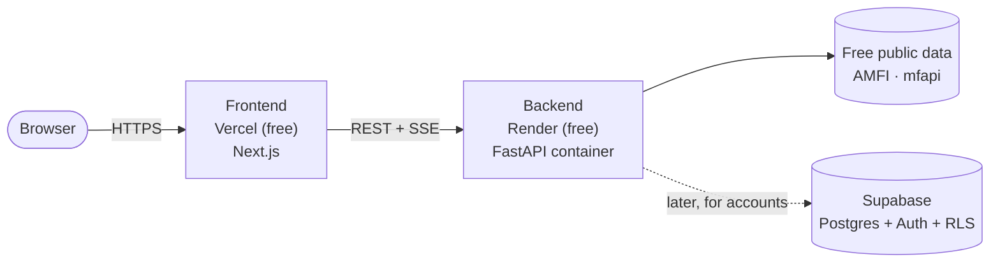

# Truthfolio — Deployment

How Truthfolio is deployed, and why. It targets **free hosting** suitable for a personal /
educational project, and goes live **keyless-first** — the deterministic core (search,
reviews, recommendations, charts, CAS import) runs with **no API keys at zero cost**, and the
AI features hide themselves until keys are added (via `GET /api/capabilities`).

## Topology

- **Frontend → Vercel (Hobby, free).** Built for Next.js: zero-config, global CDN, HTTPS.
- **Backend → Render (free Web Service).** A long-running Docker container.
- **Future accounts → Supabase (free).** Postgres + Auth + per-user row-level isolation.

### Why these, and not serverless / AWS
- **Not serverless** (Vercel Functions / Lambda) for the backend: the app **streams** results
  (SSE), **warms the ~14k-scheme AMFI master into memory** on startup, and keeps **in-process
  caches and rate counters**. Those need a persistent process — a container host fits; cold,
  stateless function invocations don't.
- **Not AWS** for now: powerful but not free beyond a 12-month window, easy to run up surprise
  bills, and heavy ops for a solo project. Revisit (Lightsail ~$5/mo, or ECS) only if real
  traffic or always-on performance demands it.

## Prerequisites
- The repo on GitHub (done: `github.com/chamanthmvs/Truthfolio`).
- Free accounts: **Render** and **Vercel** (GitHub login works for both).
- Nothing else — keyless-first means no API keys at launch.

## Deploy — step by step

> Order matters because the two services need each other's URLs. Deploy the backend first,
> then the frontend, then point CORS back at the frontend.

### 1. Backend on Render
1. Render dashboard → **New → Blueprint** → select this repo. It reads [`render.yaml`](../render.yaml)
   and provisions `truthfolio-backend` (Docker, free, region Singapore, health check `/api/health`).
   *(Manual alternative: New → Web Service → Runtime "Docker", Root Directory `backend`.)*
2. Deploy. First build installs numpy/pandas/etc., so it takes a few minutes.
3. Note the URL, e.g. `https://truthfolio-backend.onrender.com`.
4. Sanity check: open `https://<backend>/api/health` → `{"status":"ok"}`.

### 2. Frontend on Vercel
1. Vercel → **Add New → Project** → import this repo.
2. **Root Directory: `frontend`** (Vercel auto-detects Next.js; leave build/output defaults).
3. Add an environment variable:
   - `NEXT_PUBLIC_API_BASE = https://<backend>.onrender.com/api`  *(note the `/api` suffix)*
4. Deploy. Note the URL, e.g. `https://truthfolio.vercel.app`.

### 3. Wire CORS (back on Render)
1. Render → the service → **Environment** → add:
   - `HPR_CORS_ORIGINS = https://truthfolio.vercel.app`  *(comma-separate multiples; add a
     custom domain here too if you add one)*
2. Save → it redeploys. The app is now live end to end.

## Environment variables (production)

| Where | Variable | Value | Notes |
| ----- | -------- | ----- | ----- |
| Render | `HPR_CORS_ORIGINS` | your Vercel URL(s) | comma-separated; required for the browser to call the API |
| Render | `PORT` | *(auto)* | Render injects it; the Dockerfile honors it |
| Vercel | `NEXT_PUBLIC_API_BASE` | `https://<backend>/api` | where the frontend sends requests |
| Render | `LLM_PROVIDER` / `LLM_MODEL` / `ANTHROPIC_API_KEY` or `GROQ_API_KEY` | *(unset at launch)* | only when enabling AI — see below |
| Render | `HPR_TAVILY_API_KEY` | *(unset at launch)* | only when enabling web research |

## The cold-start caveat (free tier)
Render's free Web Service **sleeps after ~15 min idle**; the next request wakes it (~30–60s),
and because the free filesystem is ephemeral, the AMFI master + NAV caches rebuild on wake, so
the first call after a nap is slow. Fine for a demo. To remove it later: Render paid instance,
Fly.io, or a ~$5 Lightsail box — no code changes needed.

## Enabling the AI features later (deliberately)
Keyless, the app is free and safe. To turn on narrative / chat / insights / research / market
pulse in production:
1. Set the LLM keys (`LLM_PROVIDER`, `LLM_MODEL`, one of `ANTHROPIC_API_KEY` / `GROQ_API_KEY`)
   and optionally `HPR_TAVILY_API_KEY` on Render.
2. **First add per-user rate limiting.** The current caps (`HPR_SEARCH_DAILY_CAP`,
   `HPR_PORTFOLIO_CHAT_DAILY_CAP`) are **per-process and global**, not per-user — a public
   deploy with keys could let anyone drain your quota. A shared, per-IP/user limit (e.g. via
   the accounts/DB work below) must land before exposing keyed AI publicly.

## Future: accounts & saved portfolios (documented choice)
When we add login so portfolios persist across devices, the stack is **Supabase**
(Postgres + Auth + Row-Level Security) — one managed, free service that handles authentication
*and* the database *and* per-user data isolation (each row stamped with the owner; RLS ensures
a user can only read their own). Data policy, non-negotiable:
- Store only the **parsed holdings** (fund code, units, avg NAV, a label) — the minimum to
  rebuild a portfolio.
- **Never store the raw CAS or its password** (keep the in-memory-only promise).
- Rely on the managed DB's encryption at rest + RLS; never log holdings.

A lighter interim option (no accounts, no server-side storage) is **browser localStorage** —
persist holdings in the user's own browser so they don't re-upload on the same device.

## Costs
₹0 on the free tiers (Vercel Hobby + Render free + Supabase free). The only spend is optional:
LLM/Tavily usage if you enable AI, or a small monthly fee if you later move the backend to an
always-on instance.

## Local development
See the [README](../README.md): `./dev.sh` runs backend (:8077) and frontend (:3000). Tests:
`cd backend && .venv/bin/python -m pytest -q`.
