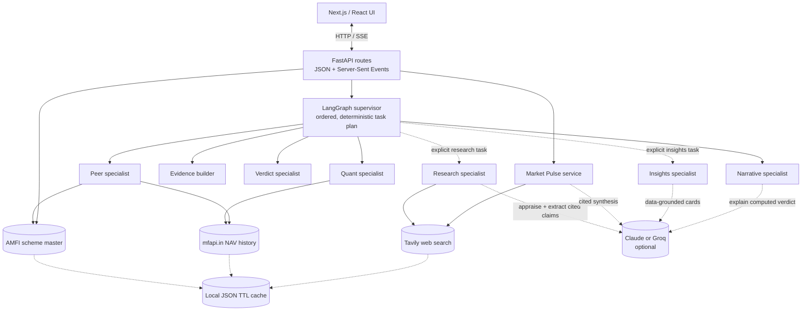
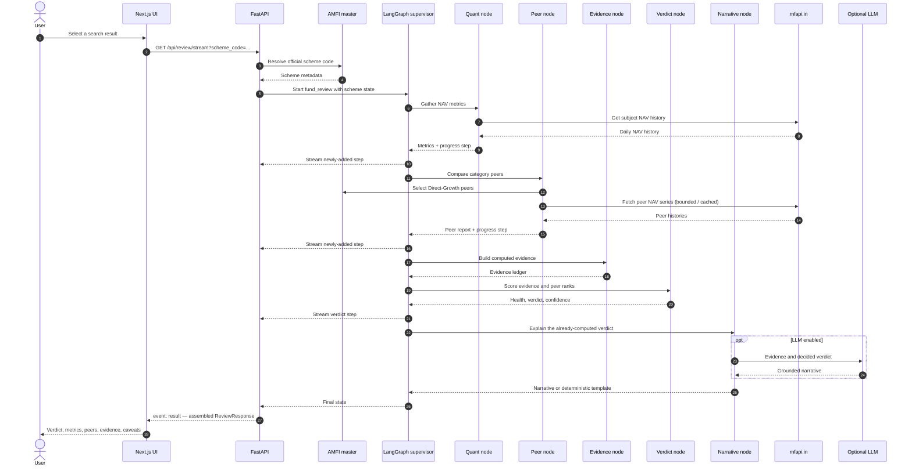
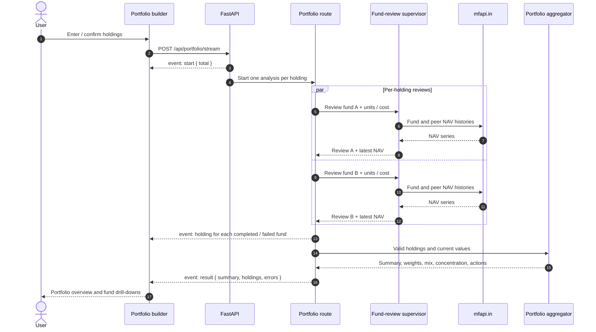
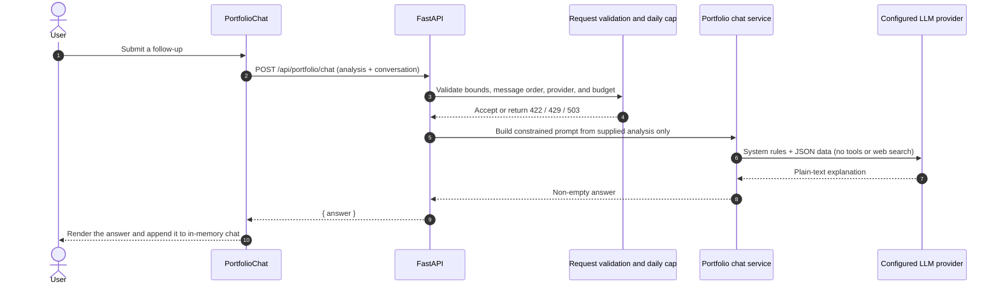

# Truthfolio — product and engineering guide

> A practical, code-aligned guide to what Truthfolio does, how a request travels through the
> system, how each number is produced, and where to make changes. This document describes the
> implementation in this repository rather than an aspirational architecture.

**Audience:** contributors, reviewers, and anyone who wants to understand how the application
works before changing it.

**Product in one sentence:** Truthfolio reviews Indian mutual funds and portfolios using
public NAV data, transparent calculations, peer comparisons, and plain-language explanations.

---

## Contents

1. [Start here](#1-start-here)
2. [Principles and product boundaries](#2-principles-and-product-boundaries)
3. [Repository map](#3-repository-map)
4. [System architecture](#4-system-architecture)
5. [Run the project](#5-run-the-project)
6. [Configuration and optional services](#6-configuration-and-optional-services)
7. [Fund review, step by step](#7-fund-review-step-by-step)
8. [Portfolio review, step by step](#8-portfolio-review-step-by-step)
9. [CAS import and privacy](#9-cas-import-and-privacy)
10. [Research, insights, and Market Pulse](#10-research-insights-and-market-pulse)
11. [Data sources and caching](#11-data-sources-and-caching)
12. [Analysis and scoring](#12-analysis-and-scoring)
13. [API reference](#13-api-reference)
14. [Frontend architecture and interaction model](#14-frontend-architecture-and-interaction-model)
15. [Validation and tests](#15-validation-and-tests)
16. [Operational characteristics and limitations](#16-operational-characteristics-and-limitations)
17. [How to extend Truthfolio](#17-how-to-extend-truthfolio)
18. [Deployment](#18-deployment)
19. [Current product scope](#19-current-product-scope)
20. [Plain-English glossary](#20-plain-english-glossary)

---

## 1. Start here

Truthfolio answers two related questions:

- **Fund:** “How does this fund look when its returns, risk, consistency, and peers are
  considered together?”
- **Portfolio:** “What do my holdings add up to, how are they distributed, and which parts
  deserve another look?”

The result is an educational assessment, not a promise or a personal investment instruction.
The core experience works without paid APIs or model credentials. It searches the official
AMFI scheme universe, obtains NAV history from mfapi.in, computes metrics, compares a sample of
same-category schemes, and applies a deterministic scoring rule. Optional language-model and
web-search features add explanation or cited context; they are separate from the core
calculation.

### Important vocabulary

| Term | What it means in this project |
| --- | --- |
| Scheme | A real AMFI-registered mutual-fund option identified by its scheme code. |
| NAV | Net asset value: the published per-unit value of a scheme. |
| Review | A fund's computed metrics, peer ranks, evidence, score, verdict, narrative, and caveats. |
| Holding | A user's position in a scheme, represented by units and average purchase NAV. |
| Specialist | A focused LangGraph node, such as the quant, peer, verdict, or narrative step. |
| Evidence item | A statement used to explain a review, with direction, weight, confidence, and source. |
| SSE | Server-Sent Events: a stream of named events sent from the API to the browser. |

---

## 2. Principles and product boundaries

The implementation is organized around three product principles:

1. **Say what the evidence supports.** The Continue / Stop / Shift result comes from
   `backend/app/agent/verdict.py`, not from an LLM.
2. **Make claims inspectable.** Computed evidence points to the metric or peer comparison that
   produced it. Optional web claims pass through appraisal and carry citations.
3. **Explain without assuming expertise.** Each metric can include a short plain-language
   explanation, a fuller meaning, why it matters, and how to read it.

### What the LLM can and cannot do

- It **can** write the narrative around a result whose verdict has already been computed.
- It **can** turn existing fund or portfolio data into optional insight cards or answer
  bounded, on-demand questions about the analyzed portfolio.
- It **can** extract cited claims from appraised web-search results for the explicit research
  experience.
- It **does not** calculate NAV returns, set the deterministic fund verdict, or supply missing
  quantitative values.
- Market Pulse is different from the deterministic review: its short synthesis depends on
  current web results and is unavailable when its required services are not configured.

### What the product does not claim

Truthfolio is educational analysis, not personalised financial advice. Portfolio returns are
total returns from an average cost basis, not annualised returns: purchase dates are not
collected. Portfolio concentration is measured by fund and category weights; there is no
stock-level holdings-overlap analysis. The current scoring model does not incorporate every
qualitative fund attribute, such as manager changes or mandate drift.

---

## 3. Repository map

```text
.
├── backend/
│   ├── app/
│   │   ├── api/routes.py            HTTP routes, JSON responses, and SSE streams
│   │   ├── agent/                   LangGraph supervisor and task specialists
│   │   ├── analysis/                Pure metrics, peer ranks, portfolio math, explainers
│   │   ├── data/                    AMFI, mfapi, cache, CAS parser, Tavily client
│   │   ├── models/schemas.py        Pydantic request/response models
│   │   ├── config.py                Environment-backed settings
│   │   └── main.py                  FastAPI application and startup lifecycle
│   ├── tests/                       Quant, CAS-import, and citation tests
│   └── pyproject.toml               Python dependencies and pytest/Ruff config
├── frontend/
│   ├── src/app/                     Next.js App Router page, layout, and global styles
│   ├── src/components/              Search, reviews, portfolio, research, and chart UI
│   ├── src/lib/                     API streaming, shared types, and formatters
│   └── package.json                 Next.js, React, TypeScript, Tailwind, Framer Motion
├── docs/
│   ├── index.html                   Static GitHub Pages product landing page
│   └── TECHNICAL.md                 This guide
├── dev.sh                           Starts the local API and web app together
└── README.md                        Project overview and quick start
```

### Backend modules by responsibility

| Area | Main files | Responsibility |
| --- | --- | --- |
| HTTP/API | `backend/app/api/routes.py`, `backend/app/models/schemas.py` | Input validation, endpoint behavior, and response shapes. |
| Orchestration | `backend/app/agent/supervisor.py`, `graph.py`, `nodes.py`, `state.py` | Task plans, specialist routing, state, and execution steps. |
| Scoring | `backend/app/agent/verdict.py` | Evidence generation and deterministic fund score/verdict. |
| Quant | `backend/app/analysis/metrics.py`, `peers.py` | NAV-derived metrics and peer percentile ranks. |
| Portfolio | `backend/app/agent/portfolio.py`, `backend/app/analysis/portfolio.py` | Per-holding review, personal values, and portfolio aggregation. |
| Sources | `backend/app/data/amfi.py`, `navapi.py`, `websearch.py`, `cache.py` | External data access, normalization, caching, and search budget. |
| Optional synthesis | `backend/app/agent/research.py`, `appraisal.py`, `citations.py`, `insights.py`, `market.py`, `portfolio_chat.py`, `llm.py`, `llm_provider.py` | Research, source scoring, citations, insight cards, portfolio Q&A, Market Pulse, and model access. |
| CAS | `backend/app/data/cas_import.py` | Parse a statement and match active holdings to AMFI schemes. |
| Shared review output | `backend/app/analysis/review_view.py` | Canonical response assembler shared by single reviews and portfolio holdings. |

### Frontend modules by responsibility

| Area | Main files | Responsibility |
| --- | --- | --- |
| App shell and flows | `frontend/src/app/page.tsx` | Three tabs and the fund / portfolio phase flows. |
| Search | `frontend/src/components/SearchBar.tsx` | Debounced scheme typeahead and keyboard selection. |
| Fund review | `FundReview.tsx`, `VerdictCard.tsx`, `MetricCard.tsx`, `PeerBars.tsx`, `RollingReturns.tsx`, `EvidenceLedger.tsx` | Explain and inspect a complete review. |
| Portfolio | `PortfolioBuilder.tsx`, `PortfolioOverview.tsx`, `PortfolioChat.tsx`, `HoldingsTable.tsx` | Import or enter holdings, inspect aggregate results, ask bounded follow-ups, drill into a fund. |
| Optional features | `ResearchPanel.tsx`, `InsightsPanel.tsx`, `MarketPulseView.tsx`, `Citations.tsx` | On-demand content and source links. |
| Transport and models | `frontend/src/lib/api.ts`, `types.ts`, `format.ts` | Fetch/SSE transport, shared data contracts, display formatting. |
| Visual system | `frontend/src/app/globals.css`, `BackgroundMotif.tsx`, Tailwind config | Design tokens, backgrounds, typography, and reusable visual utilities. |

---

## 4. System architecture

### 4.1 The whole system



**Reading the diagram:** the browser calls one API. Fund-review work is run through the
supervisor's ordered plan. Market Pulse is a separate market-scoped service. External NAV
history is cached; search/LLM work happens only on the relevant optional path.

### 4.2 The supervisor and its plans

`backend/app/agent/supervisor.py` owns a `StateGraph`. The supervisor reads a task name, loads
that task's ordered specialist list, dispatches its first step, and receives control again
after the specialist returns. Routing depends on the remaining plan, not on an LLM decision.

| Task | Ordered plan | Typical caller |
| --- | --- | --- |
| `fund_review` | `gather_quant` → `gather_peers` → `build_evidence` → `synthesise` → `narrate` | Fund JSON endpoint, fund SSE endpoint, portfolio holding. |
| `fund_review_deep` | Quant → peers → research → evidence → verdict → narrative | Available through `review_fund(deep=True)`; the current UI research panel uses the separate on-demand path. |
| `research_only` | `gather_research` | `GET /api/research`. |
| `fund_insights` | Quant → peers → evidence → verdict → `generate_insights` | `GET /api/insights`. |

Market Pulse does not go through this supervisor: it is not tied to a fund review and is
invoked directly by `GET /api/market-pulse`.

---

## 5. Run the project

### Requirements

- Python 3.11 or newer; the project has been developed with Python 3.13.
- `uv` for the backend environment and dependencies.
- Node.js 18 or newer and npm for the frontend.

### Start both applications

From the repository root:

```bash
./dev.sh
```

The script starts FastAPI at `http://localhost:8077` and Next.js at
`http://localhost:3000`. The backend API documentation is at `http://localhost:8077/docs`.

### Start them separately

```bash
# Backend
cd backend
uv venv .venv
uv pip install -e ".[dev]"
.venv/bin/uvicorn app.main:app --reload --port 8077
```

```bash
# Frontend
cd frontend
npm install
npm run dev
```

### Run checks

```bash
cd backend && .venv/bin/python -m pytest -q
cd frontend && npx tsc --noEmit
```

---

## 6. Configuration and optional services

Backend settings are defined in `backend/app/config.py`. `HPR_` is the default settings
prefix; provider keys and LLM provider/model also accept their conventional unprefixed names.
The backend reads a local `backend/.env` when present. The frontend API URL is
`NEXT_PUBLIC_API_BASE`.

| Setting | Default | Purpose |
| --- | --- | --- |
| `NEXT_PUBLIC_API_BASE` | `http://localhost:8077/api` | Frontend API base URL. |
| `HPR_CORS_ORIGINS` | localhost:3000 origins | Allowed browser origins. |
| `HPR_AMFI_NAV_URL` | AMFI `NAVAll.txt` portal URL | Scheme master source. |
| `HPR_MFAPI_BASE` | `https://api.mfapi.in/mf` | NAV history source. |
| `HPR_HTTP_TIMEOUT_SECONDS` | `20` | Upstream HTTP timeout. |
| `HPR_CACHE_DIR` | `backend/.cache` | Local JSON cache directory. |
| `HPR_AMFI_MASTER_TTL_HOURS` | `24` | AMFI master cache lifetime. |
| `HPR_NAV_TTL_HOURS` | `12` | NAV history cache lifetime. |
| `HPR_RISK_FREE_RATE` | `0.065` | Annual risk-free rate used for Sharpe/Sortino. |
| `LLM_PROVIDER` / `HPR_LLM_PROVIDER` | `anthropic` | `anthropic` or `groq`. |
| `LLM_MODEL` / `HPR_LLM_MODEL` | `claude-opus-4-8` | Model name passed to the provider. |
| `ANTHROPIC_API_KEY` or `GROQ_API_KEY` | unset | Enables the selected LLM provider. |
| `HPR_TAVILY_API_KEY` | unset | Enables web search. |
| `HPR_SEARCH_DEPTH` | `basic` | Tavily depth / cost setting. |
| `HPR_SEARCH_MAX_RESULTS` | `4` | Search results requested per query. |
| `HPR_SEARCH_TTL_HOURS` | `72` | Search-result cache lifetime. |
| `HPR_SEARCH_DAILY_CAP` | `60` | Per-process daily cap on Tavily calls. |
| `HPR_PORTFOLIO_CHAT_DAILY_CAP` | `100` | Per-process daily cap on portfolio chat LLM requests. |
| `HPR_CAS_WARN_DAYS` | `30` | Age beyond which an imported statement warns. |
| `HPR_CAS_REJECT_DAYS` | `90` | Age beyond which an imported statement is rejected. |
| `HPR_CAS_MAX_BYTES` | `15,000,000` | Maximum uploaded statement size. |

The standard fund review, search, and portfolio analysis do not require an LLM or Tavily key.
Research and Market Pulse require both a configured LLM and Tavily. Narrative and insight
features can use a deterministic fallback when no LLM is configured.

---

## 7. Fund review, step by step

### 7.1 Search is the input gate

The browser calls `GET /api/search?q=...`. The API obtains the AMFI master and returns
`SchemeHit` records. The search indexes the fund base name and AMC, uses RapidFuzz to tolerate
reordered words, filters weak matches with a distinctive-token gate, and collapses plan /
option variants to one representative scheme. It prefers Direct-Growth when available.

The selected scheme's AMFI code is the identifier sent to the review endpoint. The backend
resolves it back through the master; arbitrary user-entered scheme names are not accepted as
review inputs.

### 7.2 Standard review sequence



### 7.3 What the user sees

The streaming endpoint sends progress events as the agent state gains steps. The final
`ReviewResponse` is assembled by `analysis/review_view.py`. The UI shows:

1. **Verdict and health:** category, data date, verdict, confidence, and score gauge.
2. **Personal position (portfolio drill-down only):** units, average buy NAV, current value,
   total gain/loss, and total return.
3. **Narrative:** LLM-written when enabled, otherwise a deterministic template.
4. **Insights:** optional, explicitly requested, cached insight cards.
5. **Metrics:** computed values with concise explanations and expandable detail.
6. **Peers and rolling returns:** relative rank and a distribution of historical holding
   period outcomes.
7. **Evidence ledger:** claims, direction, weight, source reliability, and appraisal reasons.
8. **Deep research:** optional, explicitly requested web research and cited sources.
9. **Caveats:** what the review does not establish and the educational-use notice.

`FundReview` is shared by standalone reviews and a holding drill-down. `assemble_review` is
what keeps the response shape consistent.

### 7.4 Standard review versus web research

The normal review does not call Tavily. Clicking **Run deep research** calls
`GET /api/research?scheme_code=...`, which executes `research_only`; those researched claims
are shown in the research panel and do not retroactively change the already-rendered standard
verdict. `fund_review_deep` is also available as an orchestration plan, but is not the normal
browser review flow.

---

## 8. Portfolio review, step by step

### 8.1 Portfolio input

The builder accepts up to 40 holdings. Each holding needs:

```json
{
  "scheme_code": "122639",
  "units": 500,
  "avg_nav": 55
}
```

Users can create these entries by searching AMFI schemes or import a CAS and review the
prefilled entries before analysis.

### 8.2 Analysis and streaming



The API also exposes synchronous `POST /api/portfolio`. The browser currently uses the
streaming endpoint. Per-fund analyses run concurrently; NAV upstream calls are independently
bounded by a semaphore and cached.

### 8.3 Portfolio calculations

For a holding with `units`, average buy NAV `avg_nav`, and latest NAV:

```text
invested      = units × avg_nav
current_value = units × latest_nav
gain          = current_value − invested
return_pct    = gain ÷ invested
```

These values are absolute, total-to-date returns, **not annualised**. They do not model
purchase dates or cash flows.

Portfolio aggregation derives:

- each fund's weight from its current value;
- category weights and a category-mix visualization;
- the largest holding and largest category shares;
- a Herfindahl-Hirschman Index (HHI), calculated as the sum of squared holding weights;
- a value-weighted fund health score, reduced by a concentration penalty;
- best and worst personal performers; and
- action-item observations for holdings with Stop / Shift verdicts.

The result contains only successfully analysed holdings and an `errors` count for omitted
ones. If none can be analysed, the route returns HTTP 422.

### 8.4 Optional portfolio Q&A

After analysis, the portfolio page offers an optional chat panel. It does not re-run fund
analysis or replace the overview, insights, evidence, or drill-down. A user can ask up to five
questions in the current browser view. The frontend sends the current computed summary,
bounded per-holding evidence and metrics, and the successful conversation turns to
`POST /api/portfolio/chat`. The question and context are not added to a saved portfolio or
persisted by this feature.



The service is deliberately evidence-bound: it must not invent benchmark or underlying-stock
overlap data, fill gaps with external research, or direct a user to buy, sell, or switch a
specific fund. A question about moving out of a fund should be answered by explaining the
available verdict and evidence, acknowledging missing goals and circumstances, and directing
the user to a SEBI-registered investment adviser for personalised decisions. Chat is disabled
with HTTP 503 when the configured LLM provider has no key. Known provider API failures and
empty model responses map to HTTP 502; unexpected errors are left to FastAPI's standard
server-error handling.

Requests are constrained to 40 holdings, 50 KB of serialized analysis/context, at most nine
alternating conversation messages (five user questions), 600 characters per user question,
2,000 characters per assistant answer, and 400 output tokens. The default daily cap is 100
calls per application process; failed model requests consume a slot. This is an in-memory
operational cost guard, not a user-level quota:
it resets daily and is independent per worker/instance. Deployments needing a durable or
cross-instance quota must use a shared rate-limit store. The user is told that question
submissions send their current portfolio analysis and chat to the configured AI provider;
the provider's retention and processing terms apply. Before sending, the frontend converts
fractional returns, weights, and metric percentages to percentage points and sends monetary
amounts as INR, so the model receives explicit, human-readable units.

---

## 9. CAS import and privacy

### Import flow

```mermaid
sequenceDiagram
    actor User
    participant UI as Portfolio builder
    participant API as FastAPI
    participant Parser as casparser
    participant AMFI as AMFI master

    User->>UI: Select CAS PDF; enter password if needed
    UI->>API: multipart POST /api/portfolio/import
    API->>API: Read upload and enforce byte-size limit
    API->>Parser: Parse PDF bytes in memory
    alt Password required or invalid file
        Parser-->>API: Parse status
        API-->>UI: password_required or error + clear message
    else CAS parsed
        Parser-->>API: Statement period, folios, schemes
        API->>API: Reject stale statement beyond configured age
        loop Active schemes only
            API->>AMFI: Resolve AMFI code, then ISIN fallback
            AMFI-->>API: Matched scheme or no match
        end
        API-->>UI: Matched holdings, unmatched names, date and freshness status
        UI->>UI: Prefill builder; user reviews and edits before analysis
    end
```

### Privacy properties in the implementation

- The upload is parsed in the API request; CAS parsing does not intentionally write the
  statement to disk or send it to the LLM or web search.
- Only matched scheme data and the holdings needed by the builder are returned. PAN, folio,
  investor name, and email are not part of the returned holding shape.
- The frontend clears its password state after the import attempt.
- The frontend rejects files over the configured 15 MB default before upload. The API reads at
  most `cas_max_bytes + 1` bytes and returns HTTP 413 if the limit is exceeded, rather than
  loading an arbitrarily large file into application memory.
- Active holdings require closing units greater than zero. Matching uses AMFI code, then ISIN.
- Statements older than `cas_reject_days` are rejected; statements older than
  `cas_warn_days` produce a warning.
- A connection-level failure is shown as an API/network reachability problem; HTTP errors retain
  the server-provided detail where available, so users can distinguish service failures from
  unreadable PDFs or incorrect passwords.

As with any in-memory processing, this is not a claim of secure memory erasure: the route
releases references after processing, but Python/runtime memory reclamation is not a
cryptographic wipe guarantee.

---

## 10. Research, insights, and Market Pulse

### 10.1 On-demand fund research

`GET /api/research?scheme_code=...` validates the scheme, checks that both the LLM and Tavily
are configured, then runs the research specialist. The specialist:

1. runs a small number of fact/news searches through Tavily;
2. deduplicates citations and appraises source reliability;
3. ignores sources below the configured trust floor for claim extraction;
4. asks the configured LLM to extract concise claims tied to numbered sources; and
5. returns claims, footnotes, and current daily-search-budget information.

Research is a separate panel and explicit user action. Search results are cached, and actual
network calls count against an app-wide-in-process daily cap. A cache hit does not spend a
new search call.

### 10.2 Insights

- `GET /api/insights?scheme_code=...` runs a deterministic fund review without the narrative
  step, then produces 4–6 structured cards. Results are cached for 12 hours by fund code.
- `POST /api/insights/portfolio` accepts a computed summary plus a brief holding list and
  returns portfolio-level cards. The cache key is a hash of the submitted summary and
  holdings; entries are cached for 12 hours.
- If an LLM is not configured, the feature uses deterministic fallback cards. A transient
  model error also falls back for that request.

### 10.3 Market Pulse

`GET /api/market-pulse?focus=...` bypasses the fund supervisor. It performs two general
Indian-market news searches and optionally a third focused search, filters sources through the
same appraisal gate, and asks the LLM to return structured mood, triggers, highlights,
watch-outs, and attributed outlook. It is cached for six hours when a pulse is produced.

Projections are represented as the named source's view, not Truthfolio's prediction. Without
both services or without usable reliable sources, the API returns an explicit unavailable
state rather than fabricating a pulse.

### 10.4 Portfolio Q&A

`POST /api/portfolio/chat` accepts a validated portfolio summary, per-holding evidence, and a
bounded alternating conversation. It sends only those supplied values to the configured
provider, with no tools, web search, or transcript cache. Its limits, advice boundary,
disclosure, and in-process daily cost cap are described in [Portfolio review, step by
step](#84-optional-portfolio-qa). If no model key is configured, it returns HTTP 503; provider
API failures and empty responses return HTTP 502, while unexpected errors use the standard
HTTP 500 path.

### 10.5 Source appraisal and citations

`agent/appraisal.py` scores web sources from transparent criteria such as domain authority,
recency, and corroboration. The result includes reliability reasons for display. Computed
evidence is treated as primary evidence with reliability 1.0.

`agent/citations.py` deduplicates sources by URL and assigns first-use numbers. The frontend's
`CitedText`, `Markdown`, and `SourcesList` components render inline markers and source links.

---

## 11. Data sources and caching

### AMFI scheme master

`backend/app/data/amfi.py` downloads the official AMFI `NAVAll.txt` portal feed. It parses
semicolon-separated records and delimiter-less scheme/AMC headers; supports the current
8-column form and older 6-column data; derives a distilled category; and indexes schemes by
AMFI code and ISIN. The master is cached for 24 hours by default and warmed during FastAPI
startup. If startup warming fails, the lifespan handler allows the app to continue and a
later request can retry.

### NAV history

`backend/app/data/navapi.py` reads a scheme's historical NAV series from
`https://api.mfapi.in/mf/{scheme_code}`. It normalizes dates and values into ascending
`NavPoint` records, drops invalid/non-positive values, caches raw data for 12 hours, and
limits simultaneous upstream fetches with a module-level semaphore of 16. Upstream
exceptions are retried up to three times with exponential backoff.

### Web search

`backend/app/data/websearch.py` calls Tavily's REST endpoint directly. It caches by query
parameters for the configured TTL, limits real outbound searches per process/day, and returns
no results when the key is absent or the budget is exhausted. Network and response parsing
errors return an empty result list.

### Local cache

`backend/app/data/cache.py` implements a small JSON file cache with per-entry timestamps and
TTL. It is a local cache, not a distributed cache or durable application database. Cache
storage is best effort.

---

## 12. Analysis and scoring

### 12.1 Metrics

`backend/app/analysis/metrics.py` is the pure-analysis center. It builds a date-indexed series,
removes duplicate dates, sorts chronologically, then computes:

| Metric | Interpretation | Implementation convention |
| --- | --- | --- |
| 1-year return | Recent trailing annualized return | CAGR over one year when available. |
| 3-year return | Medium-term annualized return | CAGR over three years when available. |
| 5-year return | Longer-term annualized return | CAGR over five years when available. |
| Since-inception CAGR | Annualized growth over available history | From first to last NAV and elapsed calendar years. |
| Volatility | Size of NAV-return movement | Sample standard deviation (`ddof=1`) of daily returns × √252. |
| Sharpe ratio | Excess return relative to total volatility | Annualized arithmetic mean less configured risk-free rate, divided by annualized volatility. |
| Sortino ratio | Excess return relative to downside variation | Annualized arithmetic mean less risk-free rate, divided by annualized standard deviation of negative daily returns. |
| Maximum drawdown | Largest peak-to-trough decline | Minimum of NAV / running NAV peak − 1; a negative value. |
| Rolling 3y/5y returns | Range of historical holding-period CAGRs | Monthly-stepped start points; min, median, max, observation count, and share of negative windows. |

When there is not enough history for a metric or rolling window, its value may be null or the
window may be omitted.

### 12.2 Peer set and ranks

`backend/app/analysis/peers.py` selects other schemes in the same distilled AMFI category,
excluding the subject and keeping Direct-Growth plans. It sorts by AMC/name, takes at most two
schemes per AMC, and caps the selected sample at 18. Peer NAV and metric work runs
concurrently. A peer that fails to load is dropped.

For each ranked metric, the percentile is the share of the pool (successful peers plus the
subject) that the subject is at least as good as. “Good” is direction-aware: higher returns
and ratios rank higher; lower volatility ranks higher; a less-negative drawdown ranks higher.
The implementation reports a percentile only when there is at least one usable peer value.

### 12.3 Health score

`backend/app/agent/verdict.py` calculates each present component and renormalizes by the sum
of the weights that were available:

| Component | Weight | Sub-score |
| --- | ---: | --- |
| Peer standing | 0.30 | Mean percentile of 3-year return, 5-year return, and Sharpe × 100; missing ranks are excluded. |
| Risk-adjusted | 0.26 | Mean of available Sharpe and Sortino ÷ 1.5 × 100. |
| Long-term return | 0.22 | 5-year CAGR, or fallback 3-year CAGR, ÷ 0.20 × 100. |
| Consistency | 0.14 | (1 − negative rolling-window share × 4) × 100; uses 5-year rolling data if available, otherwise the first available window. |
| Drawdown | 0.08 | (1 − (absolute drawdown − 0.20) ÷ 0.40) × 100. |

Each component is clamped to 0–100. Missing components are omitted and the remaining
weights are renormalized. A score of zero is used only if there are no scoreable components.

### 12.4 Fund verdict

The rule order matters:

1. If health is at least 62 and the peer-standing percentile is at least 0.45 (or unavailable),
   verdict = **Continue**.
2. Otherwise, if health is below 42, verdict = **Stop**.
3. Otherwise, if peer-standing percentile is available and below 0.45, verdict = **Shift**.
4. Otherwise, verdict = **Continue** for health at least 55, else **Shift**.

Confidence is clamped to 0.25–0.95 and is calculated from available component weight
(completeness) and agreement between component scores. It is a model confidence indicator,
not a statistical guarantee.

### 12.5 Portfolio score and verdict

The portfolio aggregator computes a value-weighted average of successful fund health scores,
then subtracts a concentration penalty. The penalty is bounded at 12 and reflects fund count,
HHI, and top-category share. The verdict is:

- health at least 65 **and** penalty no more than 5 → **Healthy**;
- otherwise health at least 50 → **Minor tweaks**;
- otherwise → **Needs rebalancing**.

These thresholds describe the current implementation; they are heuristics, not regulated
classifications.

---

## 13. API reference

The API prefix is `/api`. FastAPI's generated docs are available at `/docs` and `/redoc`.

| Method | Route | Input | Output / behavior |
| --- | --- | --- | --- |
| `GET` | `/health` | none | Liveness response. |
| `GET` | `/search` | `q` (min 2 chars), optional `limit` (1–30) | AMFI-backed scheme results. |
| `POST` | `/review` | JSON `ReviewRequest` | Synchronous `ReviewResponse`. |
| `GET` | `/review/stream` | `scheme_code` query | SSE `step` events followed by `result`, or `error`. |
| `POST` | `/portfolio` | `PortfolioRequest` (1–40 holdings) | Synchronous summary, valid holdings, and omitted count. |
| `POST` | `/portfolio/stream` | `PortfolioRequest` | SSE `start`, `holding` events, then `result`; an `error` if every holding fails. |
| `POST` | `/portfolio/import` | multipart `file`, optional `password` | CAS status, matched holdings, freshness, unmatched names. |
| `GET` | `/research` | `scheme_code` query | On-demand cited fund research and search budget. |
| `GET` | `/insights` | `scheme_code` query | Fund insight cards and whether an LLM was used. |
| `POST` | `/insights/portfolio` | JSON summary and brief holdings | Portfolio insight cards. |
| `POST` | `/portfolio/chat` | Computed summary, bounded holdings, up to five user questions | Evidence-bound answer; 503 without an LLM, 429 at the process daily cap. |
| `GET` | `/market-pulse` | optional `focus` query | Optional cited Market Pulse and budget. |

### Request model notes

- `ReviewRequest`: required `scheme_code`; optional non-negative `units` and `invested_amount`.
- `PortfolioRequest`: 1–40 holdings; each requires an official scheme code, `units > 0`, and
  `avg_nav > 0`.
- `PortfolioChatRequest`: 1–40 analyzed holdings; up to nine alternating user/assistant
  messages ending with a user question; 600 characters per user message, 2,000 per assistant
  message, and a 50 KB serialized request limit. The interface exposes five questions per analysis.
- Search returns `query` plus scheme rows with `code`, `name`, `amc`, `category`, and
  `scheme_type`.

### Review response shape

The shared review response includes:

```text
scheme_code, scheme_name, category, as_of,
verdict, health_score, confidence, headline, narrative, caveats,
metrics[], rolling[], peers, evidence[], footnotes[], steps[],
llm_used, research_used
```

`metrics[]` entries combine the computed key/label/value/unit/direction with optional
explanation text and interpretation. `evidence[]` entries have claims, category, direction,
weight, confidence, and source references. Portfolio holdings embed this same review shape,
plus personal position values and a portfolio weight.

### SSE event envelopes

Events are text frames with an `event:` name and JSON `data:` payload.

```text
GET /review/stream
event: step
data: {"message":"Computed metrics ..."}

event: result
data: {"scheme_code":"...","verdict":"...", "...":"..."}
```

```text
POST /portfolio/stream
event: start
data: {"total":3}

event: holding
data: {"done":1,"total":3,"scheme_name":"...","verdict":"Continue"}

event: result
data: {"summary":{...},"holdings":[...],"errors":0}
```

An unsuccessful holding is still reported as a `holding` event with `failed: true`. If every
holding fails, the stream emits an `error` and does not emit `result`.

---

## 14. Frontend architecture and interaction model

### App shell

`frontend/src/app/page.tsx` is the client-rendered application entry. It owns the active tab
and composes three feature areas:

- **Review a fund** — typeahead selection → stream → reusable `FundReview`.
- **My portfolio** — builder/import → stream → overview, insights, optional five-question
  analysis chat, holdings, and reusable fund drill-down.
- **Market Pulse** — explicit fetch → cited market snapshot or an explicit unavailable state.

Each fund/portfolio flow uses a local phase (`idle`, `running`, `done`, `error`) and an
`AbortController` for a newly selected fund or a reset. The tab panels stay mounted and
inactive panels are hidden, so switching tabs preserves draft holdings, completed results,
and optional-panel state.

### Transport

`frontend/src/lib/api.ts` owns JSON fetches and manual SSE decoding. Fund streams handle
`step`, `result`, and `error`; portfolio streams handle `start`, `holding`, `result`, and
`error`. Portfolio chat uses a typed JSON request/response and never persists its local
conversation. The UI uses progress events rather than waiting behind a generic spinner.

### Review components

The review is composed from focused components. Metric explanations lead with plain-language
copy; additional detail is expandable. Evidence rows expand to reveal source type, URL,
reliability, and reasons. Citations link to a numbered source list.

### Visual system

`frontend/src/app/globals.css` defines color and shadow custom properties; Tailwind classes
consume them. The visual direction is a warm editorial-light interface with evergreen brand
color. `BackgroundMotif` draws a low-contrast NAV-inspired rising line and soft texture.
Framer Motion provides entrance, tab, gauge, and chart transitions.

### Accessibility and interaction expectations

When changing a UI surface, preserve:

- keyboard-accessible search and controls;
- visible loading, empty, unavailable, and error states;
- responsive layouts, including narrow screens;
- `prefers-reduced-motion` support for decorative animation;
- readable contrast and non-color-only explanations of verdicts; and
- visible source/caveat context wherever a claim may influence a user's interpretation.

---

## 15. Validation and tests

Backend tests currently cover:

- metric contracts against synthetic NAV series (`backend/tests/test_metrics.py`);
- CAS parsing, matching, and freshness behavior (`test_cas_import.py`); and
- citation registry behavior (`test_citations.py`).

Run all backend tests:

```bash
cd backend
.venv/bin/python -m pytest -q
```

The frontend uses strict TypeScript. Run its type check with:

```bash
cd frontend
npx tsc --noEmit
```

There is no frontend component-test suite configured at present. Use the existing project
checks and manually verify critical UI states when a change affects interaction behavior.

---

## 16. Operational characteristics and limitations

### Performance

- The AMFI master is cached and warmed at API startup.
- NAV series are cached for 12 hours by default.
- A semaphore limits concurrent mfapi fetches to 16; portfolio work fans out per holding.
- First-time analysis can be slower because the subject and its peers may need cold NAV fetches.
- The portfolio SSE stream reports holdings as individual reviews finish.
- Insight, search, and market results use local cache lifetimes described above.

### Current reliability and scaling boundaries

- The JSON cache is local to a backend instance; it is not shared across replicas.
- Tavily's daily counter is in process memory and resets when the backend process restarts. It
  is not a cross-instance billing quota.
- The backend has no user accounts, persistent portfolio storage, or authentication layer.
- External data availability and freshness depend on AMFI and mfapi.in.
- A portfolio review omits individual holdings that fail to analyse and reports the count.
- The peer sample is capped at 18 and is a sample, not a full census of every eligible scheme.

### Errors and fallbacks

- Invalid scheme codes resolve to HTTP 404 for JSON routes; Pydantic validation failures are
  HTTP 422.
- Missing optional-service keys produce explicit disabled/unavailable responses.
- The deterministic narrative remains available when no LLM is configured or a narrative
  generation fails.
- Research/market search failures can yield no reliable claims; an empty result is not a
  positive finding.

---

## 17. How to extend Truthfolio

### Add a metric

1. Implement its calculation in `analysis/metrics.py`.
2. Add it to `compute_metrics`.
3. Add an explainer and interpretation bands in `analysis/explainers.py`.
4. Decide whether it should affect peer ranks in `analysis/peers.py`.
5. If it belongs in the verdict, add a weighted component in `agent/verdict.py`.
6. Add synthetic-input tests and update this guide's metric/scoring tables.

### Add a specialist task

1. Implement a typed state transformation in `agent/nodes.py` or a focused specialist module.
2. Register it in `supervisor._SPECIALISTS`.
3. Add an ordered task plan in `supervisor.PLANS`.
4. Add an entry point in `agent/graph.py` only if another module needs a stable helper.
5. Wire the API and frontend only when there is a user-facing route.
6. Document whether it is deterministic, uses optional services, is on demand, and is cached.

### Add an endpoint

Add request/response models in `models/schemas.py` where practical; implement the route in
`api/routes.py`; keep errors explicit; define the payload and fallback behavior; then update
the API table and tests.

### Change the interface

First identify whether the surface is shared (such as `FundReview`) or flow-specific.
Preserve the same response model and visible educational caveats. Keep data transport in
`lib/api.ts`, shared types in `lib/types.ts`, and shared visual tokens in `globals.css`.

---

## 18. Deployment

GitHub Pages serves only the static landing page in `docs/index.html`; it cannot run the
FastAPI service or the Next.js application.

For a live application:

- **Frontend:** deploy the Next.js app to a Next.js-compatible host and configure
  `NEXT_PUBLIC_API_BASE` to the deployed backend's `/api` URL.
- **Backend:** deploy FastAPI with `uvicorn app.main:app`; configure `HPR_CORS_ORIGINS` to
  allow the frontend origin.
- **Optional services:** set the selected LLM provider key and Tavily key only if the optional
  narrative/research/insights/market capabilities should be enabled.
- **Cache:** a persistent disk preserves the local JSON cache across restarts on a single
  instance. A multi-instance deployment would need a shared cache and shared search-budget
  mechanism for consistent behavior.

Never commit `.env` files or API credentials.

---

## 19. Current product scope

### Implemented

- AMFI-validated mutual-fund search.
- Deterministic fund review with NAV metrics, peer ranks, health score, verdict, evidence, and
  plain-language explainers.
- Fund and portfolio SSE progress.
- Portfolio analysis from user-entered holdings.
- Bounded, on-demand portfolio Q&A grounded in the analysis currently shown.
- CAMS/KFintech CAS import, active-holding matching, and freshness handling.
- On-demand fund research with source appraisal and citations.
- On-demand fund/portfolio insight cards.
- On-demand cited Market Pulse.
- Optional Anthropic/Groq provider switching.

### Not implemented yet

- Saved portfolios, accounts, authentication, or cross-device persistence.
- Direct stock-holdings overlap between funds.
- Benchmark-index comparison.
- Broader asset classes beyond the current mutual-fund analysis universe.
- Production-grade shared cache / distributed web-search budget / observability.
- Fund-focused market context embedded in the standard review.

This is a scope list, not a delivery schedule.

---

## 20. Plain-English glossary

| Term | Plain-English explanation |
| --- | --- |
| **AMFI** | The Association of Mutual Funds in India; its scheme master provides official scheme identifiers and names. |
| **CAGR** | Compound annual growth rate: the smoothed yearly growth rate that connects a start value to an end value. |
| **Confidence** | Truthfolio's indicator of data completeness and agreement between scoring components; not a promise of correctness. |
| **Drawdown** | How far the NAV fell from an earlier peak before or during recovery. |
| **Evidence ledger** | The inspectable list of claims used to explain a fund result, with source details. |
| **HHI** | A concentration measure: add each holding's weight squared. A larger result means more value sits in fewer holdings. |
| **ISIN** | An international identifier for a security or scheme option; used as a fallback when matching CAS holdings. |
| **NAV** | Net asset value: the published value per unit of a fund. |
| **Percentile** | The share of the comparison group a result is at least as good as, accounting for whether high or low values are better. |
| **Risk-free rate** | A reference return used in Sharpe and Sortino calculations to represent a low-risk alternative. |
| **Rolling return** | The return for many overlapping historical holding periods, rather than only one chosen start/end date. |
| **Sharpe ratio** | A rough comparison of excess return with overall return variation. Higher is generally better in this scoring model. |
| **Sortino ratio** | Like Sharpe, but uses downside variation rather than all variation. |
| **Volatility** | How widely daily returns moved around their average; it describes movement, not whether the movement was up or down. |

---

**Disclaimer:** Truthfolio provides educational analysis, not personalised investment advice.
Past NAV performance does not guarantee future results. A score or verdict should not be the
sole basis for an investment decision.
