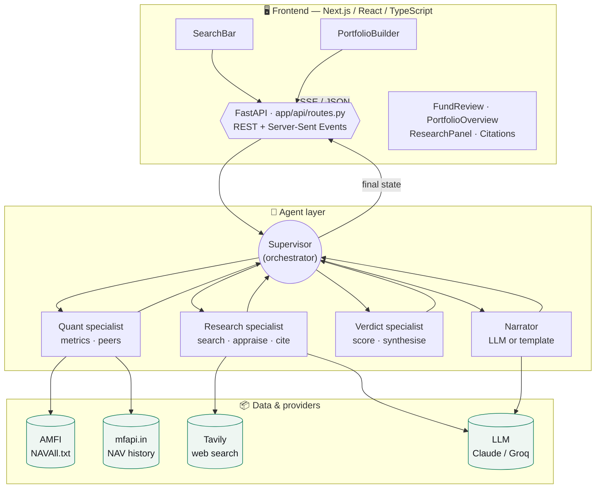
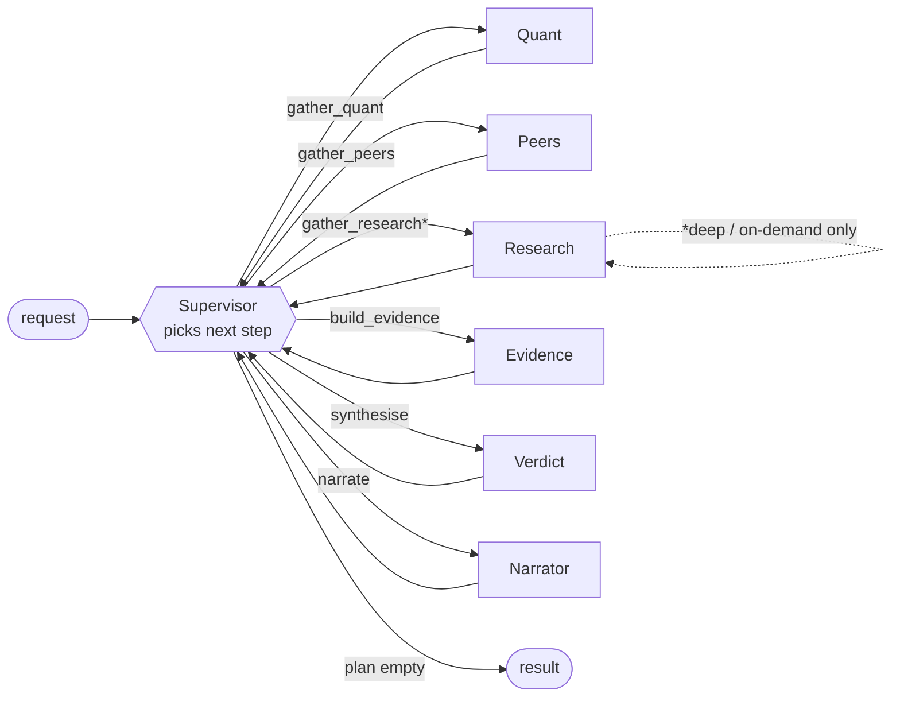
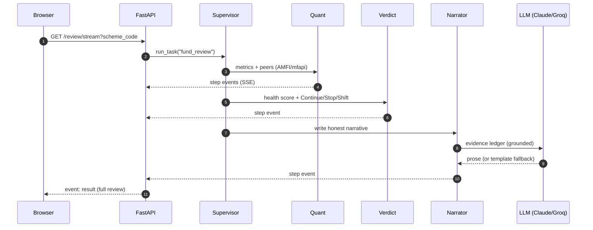
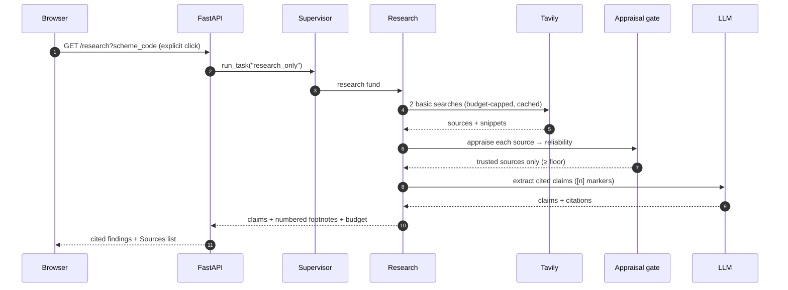
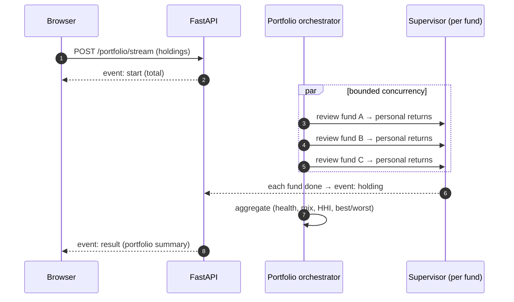

# Truthfolio — Technical Documentation

> Complete engineering reference for contributors and curious developers. For the plain-English
> overview, see the [README](../README.md) or the [landing page](https://chamanthmvs.github.io/Truthfolio/).

Truthfolio is an **evidence-backed, honest reviewer for Indian mutual funds**. Give it a fund
(or a whole portfolio) and it returns a clear verdict — **Continue / Stop / Shift** per fund,
**Healthy / Minor tweaks / Needs rebalancing** for a portfolio — where every verdict is
computed from real NAV data, ranked against peers, and explained in plain language.

This document explains exactly how it works, end to end, so any engineer can read it, run it,
reason about it, and extend it.

---

## Table of contents

1. [Design principles (the USP)](#1-design-principles-the-usp)
2. [Tech stack](#2-tech-stack)
3. [Quick start](#3-quick-start)
4. [Configuration](#4-configuration)
5. [System architecture](#5-system-architecture)
6. [Request lifecycle](#6-request-lifecycle)
7. [Repository layout](#7-repository-layout)
8. [Data layer](#8-data-layer)
9. [Analysis layer](#9-analysis-layer)
10. [Agent layer (LangGraph)](#10-agent-layer-langgraph)
11. [Scoring methodology (exact math)](#11-scoring-methodology-exact-math)
12. [Portfolio methodology](#12-portfolio-methodology)
13. [API reference](#13-api-reference)
14. [Frontend architecture](#14-frontend-architecture)
15. [Testing](#15-testing)
16. [Performance, caching & concurrency](#16-performance-caching--concurrency)
17. [Extending the system](#17-extending-the-system)
18. [Deployment notes](#18-deployment-notes)
19. [Roadmap](#19-roadmap)
20. [Honesty & compliance](#20-honesty--compliance)
21. [Glossary (plain-English metric definitions)](#21-glossary)

---

## 1. Design principles (the USP)

Every feature must serve all three principles, or it does not ship:

1. **Full honesty** — no flattery, no hedging, no sales tone. A fund that made money can still
   be a bad choice; the app says so.
2. **Evidence-based** — every claim traces to a computed, source-scored fact. Nothing is
   asserted without its receipt. The LLM may *explain* numbers but never *invents* them.
3. **Child-level plain explanation** — a person with zero finance background understands what
   each number means and what to do about it. Jargon is always explained in the same breath.

These are not marketing lines; they are architectural constraints. The verdict is produced by
a **deterministic, auditable scoring engine** (not an LLM), computed numbers are the only
inputs to a verdict, and every metric ships with a plain-language explainer.

---

## 2. Tech stack

| Layer    | Technology                                                             |
| -------- | ---------------------------------------------------------------------- |
| Backend  | Python 3.11+ (developed on 3.13), FastAPI, Uvicorn                      |
| Workflow | LangGraph (state-graph orchestration)                                  |
| Quant    | NumPy, Pandas                                                          |
| Search   | RapidFuzz (fuzzy typeahead over the AMFI scheme master)                |
| LLM      | Claude via `langchain-anthropic` — **optional**, reasoning layer only  |
| Frontend | Next.js 15 (App Router), React 19, TypeScript, Tailwind CSS 3, Framer Motion |
| Tooling  | `uv` (Python env/deps), `npm` (Node)                                   |
| Data     | AMFI `NAVAll.txt`, `mfapi.in` — free, public, no key                   |

**Key architectural decision:** the entire deterministic core (search → metrics → peers →
scoring → verdict) runs with **zero credentials** on free public data. The LLM is an optional
enhancement that only writes human-readable narrative; disabling it degrades gracefully to a
transparent deterministic summary.

---

## 3. Quick start

### Prerequisites
- Python **3.11+** and [`uv`](https://docs.astral.sh/uv/)
- Node **18+** and npm

### One command (both servers)
```bash
./dev.sh
```
Starts the API on **:8077** and the web app on **:3000**. Open http://localhost:3000.

### Manual
```bash
# Backend  →  http://localhost:8077   (interactive API docs at /docs)
cd backend
uv venv .venv
uv pip install -e ".[dev]"
.venv/bin/uvicorn app.main:app --reload --port 8077

# Frontend →  http://localhost:3000
cd frontend
npm install
npm run dev
```

### Verify
```bash
cd backend && .venv/bin/python -m pytest -q     # quant contract tests
cd frontend && npx tsc --noEmit                 # type safety
```

---

## 4. Configuration

Settings live in `backend/app/config.py` (env-overridable, `backend/.env`). App-specific
settings use the `HPR_` prefix; standard provider keys are read from their conventional names.

| Variable            | Default            | Purpose                                                        |
| ------------------- | ------------------ | -------------------------------------------------------------- |
| `LLM_PROVIDER`      | `anthropic`        | Reasoning backend: `anthropic` (Claude) or `groq`.             |
| `LLM_MODEL`         | `claude-opus-4-8`  | Model id for the active provider.                              |
| `ANTHROPIC_API_KEY` | *(unset)*          | Claude key. Enables LLM narrative + research when provider=anthropic. |
| `GROQ_API_KEY`      | *(unset)*          | Groq key, used when provider=groq.                             |
| `HPR_TAVILY_API_KEY`| *(unset)*          | Tavily web-search key. Needed (with an LLM key) for research.  |
| `HPR_SEARCH_DEPTH`  | `basic`            | `basic` (1 credit) or `advanced` (2) — cost control.           |
| `HPR_SEARCH_DAILY_CAP` | `60`            | Hard app-wide ceiling on Tavily calls/day.                     |
| `HPR_RISK_FREE_RATE`| `0.065`            | Annualised risk-free rate for Sharpe/Sortino (≈ India G-Sec).  |

Without an LLM key the app uses transparent deterministic text; without Tavily (or the LLM)
web research cleanly no-ops. Frontend: `NEXT_PUBLIC_API_BASE` (default
`http://localhost:8077/api`) points the web app at the backend.

---

## 5. System architecture

The system has three tiers: a **Next.js frontend**, a **FastAPI** edge, and a
**supervisor-orchestrated agent layer** that coordinates focused specialists over free
public data (and, on demand, the web). The LLM is used *only inside* the specialists that
need it; orchestration and scoring are deterministic.



**Reading it (plain version):** the page talks to one API. The API hands the request to a
*supervisor* that calls the right specialists in turn — one crunches the numbers, one (only
when asked) researches the web, one scores the verdict, one writes it up — then streams the
result back so you watch it happen.

---

## 6. Request lifecycle

### The supervisor's plan (how work is routed)

The supervisor owns an ordered **plan** per task and dispatches one specialist at a time; each
returns to the supervisor until the plan is empty. Adding a feature = adding a plan, not
rewiring.


`fund_review` plan = quant → peers → evidence → verdict → narrate (free).
`fund_review_deep` inserts **research** before evidence. `research_only` runs just research.

### Sequence — standard fund review (`GET /api/review/stream`, free)



### Sequence — on-demand deep research (`GET /api/research`, spends credits)



### Sequence — portfolio analysis (`POST /api/portfolio/stream`)



---

## 7. Repository layout

```
backend/
  app/
    config.py              Settings (env-overridable; zero creds for core)
    main.py                FastAPI app, CORS, startup warmup of scheme master
    api/routes.py          All HTTP endpoints (REST + SSE)
    data/
      amfi.py              Scheme master: parse NAVAll.txt, index (code + ISIN), gated search
      navapi.py            NAV history client (+ asyncio.Semaphore)
      websearch.py         Tavily client (cached, daily-capped, no-op without key)
      cas_import.py        CAS parsing → active holdings (in-memory, PII-safe)
      cache.py             TTL file cache (JSON, best-effort)
    analysis/
      metrics.py           Pure quant functions + MetricsReport
      peers.py             Peer set selection + percentile ranking
      portfolio.py         Personal returns + portfolio aggregation (pure)
      explainers.py        Metric meaning catalog (plain + analogy + bands)
      review_view.py       assemble_review(): the shared review dict
    agent/
      supervisor.py        Orchestrator: plans + routes the specialists
      graph.py             Public entry points (review_fund, research_fund, build_graph)
      state.py             AgentState (TypedDict) + EvidenceItem/SourceRef models
      nodes.py             Specialist node functions
      verdict.py           Transparent scoring + verdict synthesis
      research.py          Web-research specialist (search → appraise → cite)
      appraisal.py         Source-reliability gate (web + computed)
      citations.py         Citation registry + inline [n] marker parsing
      insights.py          Insights specialist (fund + portfolio, cached)
      llm.py               LLM narrative (evidence-grounded)
      llm_provider.py      Provider factory (Claude / Groq switch)
      portfolio.py         Portfolio orchestrator (per-fund fan-out)
    models/schemas.py      Pydantic request/response models
  tests/                   test_metrics.py · test_citations.py
frontend/
  src/
    app/layout.tsx, page.tsx, globals.css
    components/            SearchBar, FundReview, VerdictCard, HealthGauge, MetricCard,
                          PeerBars, RollingReturns, EvidenceLedger, ThinkingStream,
                          PortfolioBuilder, PortfolioOverview, HoldingsTable,
                          ResearchPanel, Citations, BackgroundMotif
    lib/                  api.ts, types.ts, format.ts
docs/
  TECHNICAL.md            This document
  index.html              Static GitHub Pages landing site
dev.sh                    One-command local dev
```

---

## 8. Data layer

### 8.1 AMFI scheme master — `data/amfi.py`

**Source:** `https://portal.amfiindia.com/spages/NAVAll.txt`
> ⚠️ Use the `portal.` host. The legacy `www.amfiindia.com` URL issues a 302 redirect, so the
> HTTP client is configured with `follow_redirects=True`.

**Format:** semicolon-delimited, **8 columns**:
```
Scheme Code ; ISIN Growth ; ISIN Reinvest ; Scheme Name ; Plan ; Option ; NAV ; Date
122639;INF879O01027;-;Parag Parikh Flexi Cap Fund;Direct Plan;Growth;90.8844;16-Oct-2026
```
Section banners (scheme type, with parentheses) and AMC names appear as **delimiter-less
header lines** between data rows. The parser tracks the current type/AMC as it scans. It also
tolerates the older 6-column feed (plan/option folded into the name).

**`Scheme` record fields:** `code`, `name` (full), `base_name`, `amc`, `scheme_type`,
`category` (distilled peer-group label, e.g. `Flexi Cap Fund`), `plan`, `option`, ISINs, plus
`is_direct` / `is_growth` convenience properties.

**Indexing & search:** ~14,000 schemes are parsed once, cached 24h, and indexed in memory. The
search corpus is `"<base_name> | <amc>"` lowercased. `RapidFuzz` `token_set_ratio` handles
out-of-order queries ("flexi parag" → "Parag Parikh Flexi Cap"). Results collapse the four
plan/option variants of each fund into one row, **preferring the Direct-Growth plan** (what a
cost-conscious long-term investor should compare).

> **Why this matters:** this layer is the guarantee behind *"no random funds."* The UI can only
> ever select a real AMFI scheme code, so every downstream metric has clean, valid input.

### 8.2 NAV history — `data/navapi.py`

**Source:** `https://api.mfapi.in/mf/<scheme_code>` → full daily NAV history + metadata.

Parsed into an ascending `NavSeries` of `(date, nav)` points; invalid/zero NAVs dropped;
cached 12h. A module-level `asyncio.Semaphore(16)` bounds concurrent upstream fetches so
portfolio fan-out (many funds × their peers) doesn't storm the source. Retries use
`tenacity` (3 attempts, exponential backoff).

### 8.3 Cache — `data/cache.py`

A tiny, dependency-free JSON file cache keyed by name with a per-entry timestamp and TTL.
Best-effort: a cache failure never fails the request.

---

## 9. Analysis layer

### 9.1 Metrics — `analysis/metrics.py`

Pure, unit-testable functions over the NAV series. **Every number a verdict depends on is
computed here.** Output is a `MetricsReport` with these metrics (and 3y/5y rolling-return
distributions):

| Key                   | Label                        | Unit  | Good |
| --------------------- | ---------------------------- | ----- | ---- |
| `ret_1y`              | 1-Year Return                | %     | higher |
| `ret_3y`              | 3-Year Return (annualised)   | %     | higher |
| `ret_5y`              | 5-Year Return (annualised)   | %     | higher |
| `ret_since_inception` | Since-Inception CAGR         | %     | higher |
| `volatility`          | Volatility (annualised)      | %     | lower |
| `sharpe`              | Sharpe Ratio                 | ratio | higher |
| `sortino`             | Sortino Ratio                | ratio | higher |
| `max_drawdown`        | Maximum Drawdown             | %     | higher (less negative) |

Formulas are in [§11](#11-scoring-methodology-exact-math).

### 9.2 Peer analysis — `analysis/peers.py`

A fund is meaningless in isolation — 12% is great in a down year and poor in a bull run. So we
rank it **relative** to its peers:
- **Peer set:** same distilled category, **Direct-Growth plans only** (like-for-like on cost),
  spread across AMCs (≤2 per house), capped at 18 for a stable percentile.
- Each peer's metrics computed concurrently; peers that fail to load drop out.
- **Percentile** per ranked metric = the fraction of the (peers + self) pool the fund is at
  least as good as, direction-aware (lower volatility / shallower drawdown rank *better*).

### 9.3 Explainers — `analysis/explainers.py` (the USP in code)

Every metric has an `Explainer` with: a **`plain`** line (child-level, with an everyday
analogy — always shown first in the UI), `meaning`, `why_it_matters`, `how_to_read`, and
**interpretation bands** that turn a raw value into a plain label + tone (e.g. *"Bumpy"*,
*"Not worth the bumps"*, *"Brutal fall"*). Bands are heuristics for *reading* a number, not
buy/sell signals — the verdict is made by the scoring engine weighing everything.

### 9.4 Shared assembler — `analysis/review_view.py`

`assemble_review()` builds the canonical fund-review dict (metrics merged with their
explainers, plus peers, evidence, verdict, narrative). Used by both the single-fund endpoint
and each portfolio holding, so a holding's embedded review is byte-for-byte identical to a
standalone one — the frontend reuses one component for both.

---

## 10. Agent layer (LangGraph)

### 10.1 State & evidence model — `agent/state.py`

`AgentState` is a `TypedDict` carrying inputs (scheme, units, invested), gathered artifacts
(`metrics`, `peers`, `evidence`), outputs (`health_score`, `verdict`, `confidence`,
`headline`, `narrative`, `caveats`), and a `steps` trail for streaming.

The **evidence ledger** is the spine of the honesty guarantee. Each `EvidenceItem` has a
`claim`, `category`, `direction` (positive/negative/neutral), `weight`, `confidence`, and a
list of `SourceRef`. A `SourceRef` carries `kind`, `title`, `url`, a **`reliability` score
(0–1)**, and `reliability_reasons`. Computed evidence is primary (reliability 1.0).

### 10.2 Supervisor / orchestrator — `agent/supervisor.py`, `agent/graph.py`

The agent layer uses the **supervisor pattern** (see the diagrams in §6). A central
supervisor node owns an ordered **plan** for the requested task and routes to one specialist
at a time; each specialist returns to the supervisor until the plan is empty. Routing is
deterministic (plan-driven), so orchestration costs no tokens and is fully reproducible.

Plans (`supervisor.PLANS`):
- `fund_review` → quant → peers → evidence → verdict → narrate (free, no web)
- `fund_review_deep` → inserts **research** before evidence
- `research_only` → research specialist alone (the on-demand, credit-spending path)
- `fund_insights` → quant → peers → evidence → verdict → **generate_insights** (no narrate)

`graph.py` exposes the stable entry points the API uses: `review_fund(...)`,
`research_fund(...)`, and `build_graph` (the compiled supervisor, used by SSE streaming). New
specialists (insights, market-pulse) slot in by adding a node + a plan — no rewiring.

### 10.3 Specialists — `agent/nodes.py`

Each plan step is a node reusing the existing logic: `gather_quant`, `gather_peers`,
`gather_research`, `build_evidence`, `synthesise`, `narrate`. Deterministic specialists need
no credentials; `gather_research` and `narrate` use the LLM (with graceful fallback).

### 10.4 Research specialist — `agent/research.py` + `data/websearch.py`

Runs only in `fund_review_deep` / `research_only`. Two credit-conservative Tavily searches
(facts + recent news) → every source through the appraisal gate → the LLM extracts concise,
**cited** claims (inline `[n]` markers). Cost controls: on-demand only, `basic` depth, 72h
cache, and an app-wide daily call cap. See §16.

### 10.5 Source-appraisal gate — `agent/appraisal.py`

Every externally-sourced claim passes this gate before it earns weight. Computed evidence
bypasses it (primary, 1.0). Web sources earn a 0–1 reliability from transparent, recorded
criteria: **authoritative domain** (tiered — SEBI/AMFI/RBI highest, then research houses and
fund-data platforms, then press), **recency**, and **corroboration** by independent sources.
Claims below the trust floor (0.45) are logged but given zero weight.

### 10.6 Citation service — `agent/citations.py`

A `CitationRegistry` numbers each unique source (deduped by URL, first-use order) and emits
the footnote list the UI renders. Agents write inline `[n]` markers; the frontend turns them
into links to the numbered **Sources** section, each with domain, date, reliability and link.

### 10.7 LLM layer — `agent/llm.py`, `agent/llm_provider.py`

`llm_provider.get_chat_model()` is the single place that knows the backend (Claude via
Anthropic, or an open model via Groq) — the whole project switches with one `LLM_PROVIDER`
env var. `llm.py` writes the narrative given **only** the computed evidence + the
already-decided verdict; the system prompt forbids inventing numbers or overriding the
verdict and mandates child-level clarity. It explains the arithmetic; it never changes it.

### 10.8 Insights specialist — `agent/insights.py`

The "so what?" layer: synthesises the gathered evidence into 4–6 **structured insight cards**
(title, plain detail, category, tone) — big picture, genuine strengths, the biggest honest
watch-out, and what to monitor. Grounded strictly in the provided data; the LLM interprets,
never invents. Works for a single fund (`fund_insights` plan) and for a whole portfolio
(`generate_portfolio_insights` over the summary). **On-demand** (a button, not automatic) and
**cached 12h per subject**, so it never silently spends tokens and is instant on repeat views.
Degrades to deterministic insights from the evidence ledger without an LLM key.

---

## 11. Scoring methodology (exact math)

All computation uses daily simple returns `rₜ = NAVₜ / NAVₜ₋₁ − 1`, annualised by the
market-standard 252 trading days.

**Metrics**
- **CAGR:** `(NAV_end / NAV_start)^(1/years) − 1`.
- **Trailing N-year (N ≥ 1):** CAGR using the NAV on/just-before `end − N years`. (< 1y:
  absolute return.)
- **Annualised volatility:** `stdev(r, ddof=1) × √252`.
- **Sharpe:** `(mean(r)×252 − r_f) / (stdev(r)×√252)`.
- **Sortino:** `(mean(r)×252 − r_f) / (stdev(r<0)×√252)` (downside deviation).
- **Max drawdown:** `min( NAVₜ / cummax(NAV)ₜ − 1 )` — a negative number.
- **Rolling N-year:** monthly-stepped windows; for each, CAGR over N years; report
  `min / median / max / % negative`. (Shows the *distribution* of outcomes an investor could
  actually have experienced — far more honest than one endpoint.)

**Peer percentile** (per metric): `|{x ∈ peers∪{self} : self is ≥ as good as x}| / |peers∪{self}|`,
direction-aware.

**Health score (0–100)** — a weighted average of component sub-scores over the components
present (weights renormalised if any are missing):

| Component          | Weight | Sub-score (clamped 0–100)                               |
| ------------------ | ------ | ------------------------------------------------------- |
| Peer standing      | 0.30   | mean percentile of `ret_3y`, `ret_5y`, `sharpe` × 100   |
| Risk-adjusted      | 0.26   | mean(Sharpe, Sortino) / 1.5 × 100                       |
| Long-term return   | 0.22   | (5y or 3y CAGR) / 0.20 × 100                            |
| Consistency        | 0.14   | (1 − %negative_windows × 4) × 100                       |
| Drawdown           | 0.08   | (1 − (|maxDD| − 0.20) / 0.40) × 100                     |

**Verdict mapping**
- `health ≥ 62` **and** peer percentile ≥ 0.45 (or unknown) → **Continue**
- `health < 42` → **Stop**
- else if peer percentile < 0.45 → **Shift**
- else → **Continue** if `health ≥ 55` else **Shift**

**Confidence** = `clamp(0.5 × completeness + 0.5 × agreement, 0.25, 0.95)`, where completeness
is the fraction of component weight present and agreement is how strongly the present
components point the same way.

> Why rule-based at the core? **Auditability.** A user (or a regulator, or you) can trace
> exactly why a fund scored what it did. No black box decides the verdict.

---

## 12. Portfolio methodology

`analysis/portfolio.py` (pure math) + `agent/portfolio.py` (orchestration).

**Input per holding:** `units` + `avg_nav` (average buy NAV).

**Personal numbers:**
```
invested      = units × avg_nav
current_value = units × latest_nav
gain          = current_value − invested
return_pct    = gain / invested        # absolute, total-so-far — NOT annualised
```
> Return is **not** annualised because purchase dates aren't collected — stated plainly as a
> caveat so no one misreads it.

**Aggregation:**
- Weights by current value; **category mix** (value share per category).
- **HHI (Herfindahl concentration index):** `Σ wᵢ²` — ranges from `1/n` (evenly spread) to `1`
  (all in one). Plus top-holding and top-category shares.
- **Portfolio health** = value-weighted average of per-fund health − a transparent
  **concentration penalty** (0–12 pts based on fund count, HHI, and top-category share).
- **Verdict:** `health ≥ 65` and penalty ≤ 5 → **Healthy**; `health ≥ 50` → **Minor tweaks**;
  else → **Needs rebalancing**.
- **Best/worst** by personal return; **action items** surface Shift/Stop funds with their
  weight ("reconsider X — it's 16% of your money").

**Overlap** is **category-level** today (concentration by fund category). True stock-level
overlap (shared underlying holdings) is a later version.

---

## 13. API reference

Base path `/api`. Interactive docs at `/docs` (Swagger) and `/redoc`.

| Method | Path                    | Purpose                                            |
| ------ | ----------------------- | -------------------------------------------------- |
| GET    | `/health`               | Liveness.                                          |
| GET    | `/search?q=&limit=`     | Validated typeahead over the AMFI master.          |
| POST   | `/review`               | Single-fund review (synchronous).                  |
| GET    | `/review/stream`        | Single-fund review as SSE (`step`* → `result`).    |
| POST   | `/portfolio`            | Whole-portfolio analysis (synchronous).            |
| POST   | `/portfolio/stream`     | Portfolio as SSE (`start` → `holding`* → `result`).|
| POST   | `/portfolio/import`     | Parse an uploaded CAMS/KFintech CAS → matched active holdings (multipart: file + optional password). |
| GET    | `/research?scheme_code=`| On-demand web research for one fund (spends credits; cited claims + footnotes + budget). |
| GET    | `/insights?scheme_code=`| Structured insight cards for one fund (LLM, cached; deterministic fallback). |
| POST   | `/insights/portfolio`   | Portfolio-level insight cards from a computed summary + brief holdings. |

### `GET /search`
```jsonc
// GET /api/search?q=parag%20parikh&limit=5
{
  "query": "parag parikh",
  "results": [
    { "code": "122639",
      "name": "Parag Parikh Flexi Cap Fund - Direct Plan - Growth",
      "amc": "PPFAS Mutual Fund",
      "category": "Flexi Cap Fund",
      "scheme_type": "Open Ended Schemes(Equity Scheme - Flexi Cap Fund)" }
  ]
}
```

### `POST /review`
```jsonc
// body: { "scheme_code": "122639" }
{
  "scheme_code": "122639",
  "scheme_name": "Parag Parikh Flexi Cap Fund - Direct Plan - Growth",
  "category": "Flexi Cap Fund",
  "as_of": "2026-10-16",
  "verdict": "Continue",
  "health_score": 69.1,
  "confidence": 0.9,
  "headline": "Keep holding ... — it stands up to scrutiny.",
  "narrative": "…",
  "metrics": [
    { "key": "sharpe", "label": "Sharpe Ratio", "value": 0.93, "unit": "ratio",
      "good_direction": "higher",
      "plain": "Was the bumpy ride worth it? …",
      "meaning": "…", "why_it_matters": "…", "how_to_read": "…",
      "interpretation": { "label": "Okay", "tone": "neutral" } }
  ],
  "rolling": [ { "window_years": 5, "observations": 102, "min_cagr": 0.054,
                 "median_cagr": 0.191, "max_cagr": 0.316, "pct_negative": 0.0 } ],
  "peers": { "category": "Flexi Cap Fund", "peers_analysed": 18,
             "ranks": [ { "key": "sharpe", "value": 0.93, "peer_median": 0.57,
                          "percentile": 0.947, "peers_counted": 18 } ] },
  "evidence": [
    { "claim": "Ranks in the 64th percentile of its peers …",
      "category": "peer", "direction": "positive", "weight": 0.30, "confidence": 0.9,
      "sources": [ { "kind": "computed", "title": "Peer percentile …",
                     "reliability": 1.0, "reliability_reasons": ["Primary: computed …"] } ] }
  ],
  "caveats": [ "This is educational analysis, not personalised investment advice.", "…" ],
  "steps": [ "Computed 8 metrics …", "Compared against 18 peers …", "…" ],
  "llm_used": false
}
```

### SSE formats
```
# GET /review/stream
event: step
data: {"message": "Computed 8 metrics from 3294 NAV points (13.4y history)."}
...
event: result
data: { <ReviewResponse> }

# POST /portfolio/stream
event: start
data: {"total": 3}
event: holding
data: {"done": 1, "total": 3, "scheme_name": "...", "verdict": "Continue"}
...
event: result
data: {"summary": { <PortfolioSummary> }, "holdings": [ {review, personal, weight} ], "errors": 0}
```

### `POST /portfolio`
```jsonc
// body: { "holdings": [ {"scheme_code":"122639","units":500,"avg_nav":55}, ... ] }
{
  "summary": {
    "total_invested": 53500, "total_current": 133163, "total_gain": 79663,
    "overall_return_pct": 1.489, "health_score": 62.8, "verdict": "Minor tweaks",
    "confidence": 0.8,
    "category_mix": [ {"category":"Mid Cap Fund","value":66500,"pct":0.50}, ... ],
    "hhi": 0.39, "top_holding_pct": 0.50, "top_category": "Mid Cap Fund",
    "top_category_pct": 0.50, "diversification": "Somewhat concentrated — …",
    "best_performer": {...}, "worst_performer": {...},
    "action_items": [ "Think about shifting … (16% of your money) …" ],
    "headline": "A solid portfolio, up 148.9% overall, with a few things worth tidying.",
    "caveats": [ "…" ]
  },
  "holdings": [ { "review": { <ReviewResponse> },
                  "personal": { "units":500,"avg_nav":55,"current_nav":...,
                                "invested":27500,"current_value":...,"gain":...,"return_pct":... },
                  "weight": 0.34 } ],
  "errors": 0
}
```

---

## 14. Frontend architecture

- **App shell** (`app/page.tsx`): two tabs ("Review a fund", "My portfolio"), each a
  self-contained flow with a small phase machine (`idle → running → done/error`).
- **Streaming** (`lib/api.ts`): SSE frames are parsed manually so the UI shows reasoning being
  *earned* (live step list), not a dead spinner.
- **One review component** (`FundReview`) is reused by the single-fund tab and the portfolio
  drill-down (with an added personal-position strip).
- **Explainer/USP system**: every `MetricCard` leads with an always-visible, analogy-driven
  `plain` line; the deeper "what it means / why it matters / how to read it" is one tap away.
- **Design system** (`globals.css`): dark glassmorphism, CSS custom-property tokens,
  theme-aware tones (positive/neutral/caution/negative), animated health gauge (SVG arc),
  percentile markers, rolling-return range bars, category-mix stacked bar. Fully responsive.

Key components: `SearchBar`, `VerdictCard` + `HealthGauge`, `MetricCard`, `PeerBars`,
`RollingReturns`, `EvidenceLedger`, `ThinkingStream`, `PortfolioBuilder`, `PortfolioOverview`,
`HoldingsTable`.

---

## 15. Testing

`backend/tests/test_metrics.py` locks the **contract of the quant layer** with synthetic NAV
series: steady-growth returns are positive with ~no drawdown; a constructed 50% crash is
captured as a ~−50% max drawdown; volatility is non-negative and sane; the report
round-trips to a dict. If these drift, a verdict could too — so they are the first line of
trust. Run: `.venv/bin/python -m pytest -q`.

Frontend correctness is guarded by `tsc --noEmit` (strict TypeScript).

---

## 16. Performance, caching & concurrency

- **Scheme master** is fetched once, parsed, indexed in memory, cached 24h, and warmed on
  startup (`main.py` lifespan) so the first search is instant.
- **NAV history** is cached 12h per fund. Portfolio analysis reuses these caches across funds
  and their overlapping peers.
- A global **`asyncio.Semaphore(16)`** bounds concurrent upstream NAV fetches; portfolio
  holdings are analysed with `asyncio.gather` / `as_completed` (streamed as each finishes).
- First-ever portfolio analysis of many funds is the slow path (cold caches + peer fetches);
  subsequent runs are fast. SSE keeps the UI responsive throughout.

---

## 17. Extending the system

**Add a metric:** implement a pure function in `metrics.py`, append a `Metric` in
`compute_metrics`, add an `Explainer` (with a `plain` analogy) in `explainers.py`, and — if it
should influence the verdict — add a weighted component in `verdict.py`.

**Add a data source:** add a client under `data/` returning a normalised structure; wire it
into the relevant node. Keep it cached and bounded.

**Wire web research:** implement a fan-out node that searches per claim, routes every result
through `appraisal.appraise_web_source(...)`, and appends only above-floor claims to the
evidence ledger between `gather_peers` and `build_evidence`. The gate and evidence model
already support it.

**Tune the scoring:** the weights and thresholds in `verdict.py` are centralised and
documented — change them in one place; the tests and transparency hold.

---

## 18. Deployment notes

GitHub Pages hosts only the **static landing page** (`docs/index.html`) — it cannot run the
Python backend. To run the real app on the internet:
- **Frontend:** Vercel (set `NEXT_PUBLIC_API_BASE` to the deployed API URL).
- **Backend:** Render / Railway / Fly (run `uvicorn app.main:app`; a persistent disk or a
  swap to Redis improves the cache). Set `HPR_CORS_ORIGINS` to the frontend origin, and
  `HPR_ANTHROPIC_API_KEY` if the narrative is desired.

---

## 19. Roadmap

### ✅ V1 — Single-fund review
Validated search, deterministic metrics (returns, rolling returns, volatility, Sharpe,
Sortino, drawdown), peer-percentile ranking, transparent health score + Continue/Stop/Shift
verdict, evidence ledger with source scoring, child-level explainers, streaming UI.

### ✅ V2 — Whole-portfolio review
Holdings by units + avg buy NAV, per-fund personal returns, portfolio health + verdict,
category mix, category-level concentration (HHI), best/worst performers, "what to reconsider",
two-tab UI with per-holding drill-down, per-fund streaming.

### ✅ V3 (part 1) — Web research + multi-agent + multi-provider LLM
On-demand web-research specialist (manager, cost, mandate, size, regulatory) through the
source-appraisal gate with inline citations; supervisor/orchestrator architecture; LLM layer
switchable between Claude (Anthropic) and Groq; strict Tavily credit controls.

### ✅ V3 (part 2) — Insights
On-demand, cached **insight cards** for a fund and for a whole portfolio: a grounded "so what?"
synthesis (big picture, strengths, biggest watch-out, what to monitor) as an insights
specialist under the supervisor.

### ✅ V3 (part 3) — CAS statement import
Upload a CAMS/KFintech CAS (password optional) → `casparser` → **active holdings only**,
mapped to our universe by **AMFI code then ISIN**, avg NAV from cost÷units; freshness
**warn >30d / reject >90d**; clear statuses for needs-password / wrong-password / not-a-CAS.
Strict privacy: parsed **in memory only**, never stored or logged, password discarded after
use, nothing sent to the LLM/web; only matched holdings returned (no PAN/folio). Holdings
pre-fill the builder for the user to review before analysis.

### Next
- **Market Pulse tab** — overall Indian market + fund-relevant sentiment, triggers, cited
  projections (attributed, never presented as Truthfolio's own forecast).
- True stock-level overlap; benchmark-index comparison; broader asset coverage; saved
  portfolios; statement import.

---

## 20. Honesty & compliance

Truthfolio is **analytical, educational output — not personalised investment advice** (not
SEBI RIA advice). Verdicts are based on past NAV data; past performance does not guarantee
future results. Factors not yet incorporated (manager change, mandate drift, expense ratio)
are flagged so a user never acts on a partial picture. Being transparent about limits makes
the product *more* trustworthy — which is the entire point.

---

## 21. Glossary

| Term | Plain-English meaning |
| ---- | --------------------- |
| **NAV** | The per-unit price of a mutual fund, published daily. |
| **CAGR** | The average yearly growth rate that compounds to the total gain — like a car's average speed over a trip. |
| **Rolling returns** | Returns measured over every possible holding window (e.g. all 3-year stretches), not one lucky start-to-end number. |
| **Volatility** | How bumpy the ride is — how much the value swings around its average. |
| **Sharpe ratio** | Reward earned per unit of total bumpiness — "was the bumpy ride worth it?" |
| **Sortino ratio** | Like Sharpe, but only counts the *downward* (painful) swings. |
| **Maximum drawdown** | The worst peak-to-trough fall — the scariest moment you'd have lived through. |
| **Percentile (vs peers)** | How the fund ranks against similar funds; 90th percentile = better than 90% of them. |
| **HHI** | A concentration score for a portfolio; higher means more of your money rides on fewer bets. |
| **Health score** | Truthfolio's 0–100 composite of the above, weighted transparently. |
```
